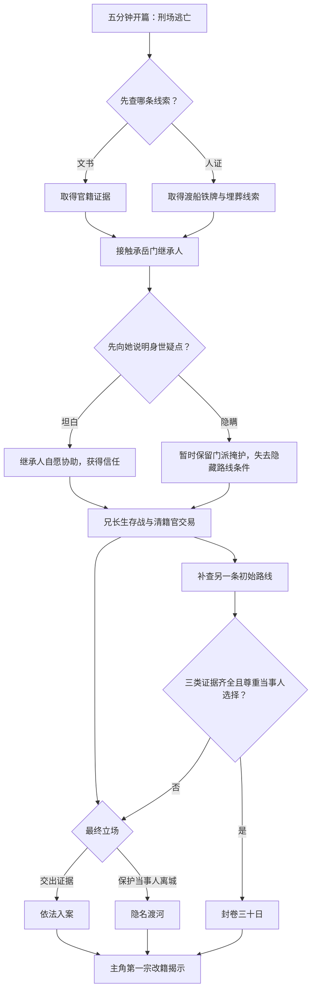

# 武侠 RPG 垂直切片世界与剧情 v0.1

> Day 2 输出件
>
> 状态：Day 2 v0.2 已完成；世界、剧情与第一调查链可供原型使用
>
> 项目代号：`Project Wuming`（无名）
>
> 最后更新：2026-09-10

本文件记录 60～90 分钟垂直切片的世界、势力、人物、剧情节拍、第一调查链和解决路线。v0.2 已根据共同确认的方向完成，可以直接供玩法原型使用；后续讨论用于细化对白、关卡和数值，不再阻塞 Day 3。

---

## 一、故乡县城

### 1.1 基础定位（已确认）

故乡是一座位于河渡与山口交界处的北方交通县城，设计阶段暂用名：

> 栖河县

它不是繁华大城或纯军事堡垒，而是一座“小而重要”的交通节点：

- 河运连接沧浪帮、商旅、走私、运粮和百姓撤离。
- 山道连接承岳门、雁回门旧址和义兵藏身处。
- 驿路使北廷官员、商旅和军队必须经过。
- 县衙保存县城及周边村镇十六年的户籍与亡籍。
- 控制县城便能控制渡口、粮道和山口，因此后期值得争夺和守卫。
- 同一座县城会从前期的受控状态，逐渐变化为后期战乱和终局守城状态，以复用地图并展示玩家选择的长期后果。

### 1.2 二十年历史（已确认）

| 时间 | 事件 | 留下的矛盾 |
|---|---|---|
| 二十年前 | 北廷占领栖河县；基层官吏和百姓仍以本地人为主 | 为北廷做事是否等于背叛故乡 |
| 十六年前 | 主角生父联合雁回门及部分百姓起事，试图夺取渡口；起事失败 | 雁回门被登记为全门覆灭，养父参与善后并将主角写成死人 |
| 八年前 | 疫病与洪灾造成大量真实死亡和户籍混乱 | 养父借机救人，黑市开始利用死者身份，回春谷医案与官籍不符 |
| 近几年 | 商路恢复，承岳门接管地方武林，沧浪帮控制码头 | 县衙、门派与商帮维持表面稳定，旧日幸存者隐姓埋名 |
| 游戏开始 | 北廷为征兵征粮发动战时清籍 | 一名八年前已经死亡的女子重新出现，县令提前处死养父并争夺《勘亡录》 |

### 1.3 政治与终局位置（已确认）

- 开篇栖河县受北廷治理。
- 地方义兵反抗北廷，但不完全受遥远南朝指挥。
- 中后期栖河县因义兵和地方势力行动而易手，随后遭北廷大军反攻。
- 终局仍发生在栖河县；玩家守护的是故乡百姓、同伴和关系网络，而不是无条件效忠任一政权。

---

## 二、当前危机

### 2.1 女囚主动揭案（已确认）

女囚不是在随机清查中偶然暴露，而是主动选择在战时清籍前击鼓鸣冤：

1. 北廷已经下令战时清籍，上级清籍官将在三日后抵达栖河县。
2. 女囚认为这是恢复原名的唯一机会，带着死亡凭证和养父当年留下的证物回城。
3. 她在县衙公开宣称“亡籍上的人就是我，我还活着”。
4. 她原以为县令不敢在上级官员抵达前灭口，县令却立即拘押她和经手户籍的养父。
5. 案件原应交给上级清籍官审理，县令暗中把行刑提前到清晨，准备让两名关键证人永远闭嘴。
6. 女囚发现行刑提前后，才联络老妇、割松绳索，准备在刑场脱身。

这次行动确实间接导致养父被捕，却不是女囚有意害人。她主动争取命运，也因错误估计县令的狠辣而承担责任。

主角与女囚的开篇矛盾确定为：

> 主角认为她为了一个名字害死了父亲；她则认为养父为了救命，夺走了她选择自己人生的权利。

两人分别想保住和推翻养父给予的身份，构成第一组镜像关系。

### 2.2 女囚为何必须恢复本名（已确认）

女囚的个人经历和行动动机已经确认：

- 八年前她十四岁，是栖河县一名摆渡人的女儿。
- 父亲因帮助义兵和伤员渡河被北廷判作叛逆，她作为同案家属也将被捕。
- 养父利用疫病期间的一具无名女尸，把她登记为病亡，再暗中将她送上沧浪帮的货船。
- 她的父亲最终被处死，遗体埋在河滩的无名罪坟中。
- 为维持假死记录，她不能认领父亲、祭拜祖坟或与旧日亲友相认；此后八年一直依靠沧浪帮在水路生活，没有稳定合法身份。
- 她一直相信养父答应将来帮她恢复身份，养父却因担心牵出同一批亡籍中的其他改籍者而不断拖延。

她恢复本名有两个不可替代的目的：以女儿身份认领和安葬父亲，以及结束依赖他人庇护、随时可能被出卖的无籍生活。

她与主角的父女镜像通过一句话表达：

> “你至少能在人前喊他一声爹。我爹在乱坟里躺了八年，我却连给他立碑都不能。”

### 2.3 外界触发与雁回门推动（已确认）

北廷为扩建栖河县军粮码头，决定征用河滩旧刑场和无名罪坟。三日后开始迁坟，无人认领的遗骨将被集中处理。女囚若错过期限，将永远无法确认父亲遗骨。

雁回门激进派得到消息后，将这次危机变成迫使旧案重开的机会：

1. 通过守墓老妇和沧浪帮向女囚传递父亲遗骨所在地、迁坟告示副本以及上级清籍官的准确行程。
2. 提供写好的鸣冤状、公开告发方案和“必要时会救人”的承诺。
3. 真正目的则是借公开出现的“活死人”迫使官府翻查十六年前的亡籍，证明雁回门没有全灭，并夺取《勘亡录》。
4. 他们隐瞒养父必然成为首要嫌疑人、县令可能提前灭口，以及必要时愿意牺牲养父甚至女囚的事实。

女囚先秘密请求养父协助正名，遭到拒绝。养父认为恢复一人会让更多家庭失去父亲；女囚则不接受养父继续替她决定人生，最终选择接受雁回门方案并公开击鼓鸣冤。

迁坟、清籍官行程和身份风险都是真实的。雁回门欺骗她的是风险程度、保护能力和真实目的，因此女囚仍然拥有行动选择，也必须为自己相信他们承担责任。

开篇协助逃亡的老妇是曾经协助县衙验尸、如今看守罪坟的守墓人，也是雁回门安排的接应者。割松绳索与后巷路线并非巧合。雁回门准备救走女囚并夺取记录，却没有把营救养父列入计划。

完整触发链：

```text
北廷扩建军粮码头并限期清理罪坟
→ 雁回门向女囚提供真实消息与虚假保障
→ 女囚请求养父正名，遭到拒绝
→ 女囚公开击鼓鸣冤
→ 县令拘押女囚和养父
→ 县令赶在清籍官抵达前提前行刑
→ 雁回门按计划救走女囚、寻找《勘亡录》，放弃养父
```

最终 Boss 可以与雁回门激进派存在旧交、资助或情报往来，但不直接策划此次事件，避免所有阴谋都由同一个幕后人物控制。

### 2.4 县令掩盖的旧账（已确认）

县令不是单纯贪官。他曾借改籍保护部分百姓，也从同一套制度中获利，如今已经无法区分自己是在保护县城还是保护自己。

十六年前义兵失败时，他还是县丞。北廷要求按照户籍追查义兵家属，他为尽快结束清剿，默许养父将部分失踪者和无辜家属登记为死亡：一些人因此逃过追捕，一些田产则被县衙和承岳门接收，他本人也曾收受钱财。主角的改籍正发生在这个制度缺口中。

八年前疫病期间，他已经掌握县中实权。为了快速处理大量户籍，他让养父持有一批预先盖印的空白死亡文书，用来隐藏青壮、降低北廷征兵人数，也用来掩盖赈灾粮和军粮缺口，并方便地方豪强接收无人继承的田产。养父利用同一批文书救下了女囚等人。

《勘亡录》一旦与官府底册交叉验证，将证明县令长期存在以下行为：

- 隐匿人口，逃避北廷征兵。
- 默许义兵家属逃亡。
- 侵吞或挪用赈灾物资。
- 借假死记录重新分配田产。
- 使用无籍人口维持码头和地方产业。

女囚公开出现后，上级清籍官只要审问养父，就可能发现空白盖印文书的来源。县令因此利用战时紧急条款，把案件改定为“义兵奸细冒用死者身份，勾结户房小吏潜入县城”，再以防止义兵劫狱为由提前行刑。

县令不准备杀光所有“死人”。他的计划是让养父承担全部罪名，找到并拆散《勘亡录》，清除知道核心旧账的人，再给仍有利用价值的无籍者安排新身份，让码头、田产和征粮继续运转。

他构成最终 Boss 的小型镜像：县令愿意牺牲养父和少数“死人”保住县城与官位；最终 Boss 愿意牺牲三十七名“死人”换取战争胜利。

县令为自己辩护：

> “这账若真清，死的便不只是你爹。北廷会重新点兵、追户、抄产，到时候半座县城都得替你们的清白偿命。”

这句话并非全是谎言。彻底公开旧账确实会引来重新征兵和清算，但县令也确实在用百姓作为杀人与自保的理由。

### 2.5 上级清籍官的立场（已确认）

上级清籍官是“最可信的敌人，也是最危险的盟友”。他反对县令毁证灭口，会调查养父被提前处死，却坚决反对任何人私自决定他人的身份。

他的核心信念是：

> “没有户籍，弱者才最先失去名字。”

他认为私人改籍即使始于救人，也会让富户逃避征兵、穷人身份被夺、冒名者继承他人财产、罪犯逃脱追究，并将兵役和赋税转嫁给其他家庭。这些后果必须在后续案件中真实发生，不能只作为他的辩词。

他向主角提出交易：交出《勘亡录》和证人，协助查明县令伪造口供、提前行刑；作为交换，撤销主角的冒名逃犯罪名，正式审理其身份，并为养父洗去谋逆罪名。代价是其他改籍者会被继续追查，面临拘押、财产冻结、继承重审或重新征发。

他与县令的差异是：县令为地方稳定和个人利益操纵规则、选择牺牲者；清籍官保存证据并遵守程序，却可能为了统一法度摧毁具体家庭。

清籍官同时具有升迁野心。他早已怀疑栖河县县令，希望借这桩大案扳倒对方、证明自己的判断。他不会伪造证据，但可能主动扩大案件范围以取得更大功绩。

为避开县令预先清理现场，他让公开仪仗保持原定行程，自己则与少量亲随提前一夜抵达城外。县令以为仍有一夜可以灭口，玩家也因此能在最终裁定前直接与清籍官交涉。

玩家可以与他完全合作、公开对抗，或以完整证据说服他暂缓公断。三种关系分别对应更多真相但更多暴露、更多保护但继续逃亡，以及条件更高的隐藏路线。

### 2.6 持续对手：养父亲生长子（已确认）

游戏加入一名与主角共同成长、反复交锋的长期镜像对手。他是养父的亲生长子，比主角年长约八岁，也是主角从小认识并一直称作兄长的人，不作为后期突然出现的秘密儿子。

十六年前养父将襁褓中的主角带回家时，兄长已经能够记事。他知道主角来自清剿现场，但不知道生父和改籍的完整经过。养父要求他保守秘密；兄长虽然长期心怀不平，却始终没有出卖主角。

八年前北廷征兵时，十六岁的兄长请求父亲也将自己写成死人。养父认为再制造一宗假死可能暴露整个网络，也坚持不能利用职权偏袒亲生儿子，因此拒绝。兄长被迫从军，在战场上活下来，后来依靠军功加入武巡院，获得稳定身份和地位。

兄长眼中的不公是：父亲可以冒死保护一个抱回来的孩子，却不肯为亲生儿子改一笔；主角得到了父亲的陪伴、身份和秘密，自己只得到征兵、战场与父亲留下的罪名。

他随上级清籍官回到栖河县时，养父已经被提前处死。他当前的目标包括：

1. 查明是谁下令提前行刑。
2. 洗去养父的谋逆罪名，但承认养父确实伪造户籍。
3. 取得《勘亡录》，阻止主角继续父亲的做法。
4. 将主角带回接受正式身份审理，而不是私下杀死或放走。

兄长直接承担武巡院代表，不再增加一名功能重复的追缉官。他与清籍官合作但不完全听命：清籍官关心法度和大案，兄长更在意父亲与主角。

持续对抗节奏暂定为：垂直切片中以逃脱或坚持回合为目标的首次交锋；前中期多次争夺证人和证据；中后期进行第一次真正公平的决斗；终局根据关系与选择成为守城同伴、法理对手或最终 Boss 的支持者。

角色边界：不把他写成只会嫉妒弟弟的反派，不让他每次出场都强制击败玩家，也不固定安排其死亡。他与主角的核心矛盾是父亲如何分配爱、责任与生存机会。

他的代表性台词：

> “你得了他的姓、他的偏爱、他的秘密。我这个亲儿子，只得替他还债。”

### 2.7 门派继承案中心人物（已确认）

门派继承案的中心人物是一名约二十一岁的女性，也是承岳门首徒、掌门候选人和垂直切片中的临时剑法同伴。

她在官籍中是承岳门一名已故弟子的遗孤，从小由现任掌门抚养，凭武功、处事能力、保护山下村民的经历和年轻弟子的信任取得候选资格，而不是依靠血统获得继承权。

她实际上是雁回门幸存弟子的女儿。十六年前起事失败时她只有五岁，身份被改入承岳门弟子名下。她不知道完整真相，只保留少量无法解释的童年记忆。

各方围绕她的立场：

- 承岳门守成派希望销毁证据，维持门派稳定和她的继承资格，也有人担心秘密将来反噬门派。
- 雁回门激进派希望公开其血缘，把她塑造成复派旗帜，并借她取得承岳门资源。
- 县令希望将她认定为叛党后裔，以包庇罪控制承岳门。
- 上级清籍官会冻结身份与继承资格，等待正式审理。
- 地方义兵希望她掌握承岳门后支持起事。
- 她本人认为养育、授艺、共同生活形成的关系都是真实的，不接受任何人仅凭血缘替她改换阵营。

她与女囚构成第二组身份镜像：女囚必须恢复原名才能认领父亲，她一旦恢复原名却可能失去师父、同门和掌门资格。两人都反对养父替别人决定身份，却得出相反答案，使“公开全部真相”无法同时帮助所有人。

她的核心表达是：

> “生我的人给了我血，养我、教我剑的人给了我这一生。凭什么一张旧纸，就说我不再是承岳门弟子？”

她承担第一名剑法型临时同伴、承岳门基础剑法传授者、门派区域向导和隐藏解法师承证人的功能，也作为第二条关系线的起点。垂直切片只建立信任和价值冲突，不发展恋爱；若玩家未经她同意公开身份，她可能获得雁回门支持，却会失去对主角的信任。

### 2.8 第一条索引：守墓老妇（已确认）

《勘亡录》的第一条索引指向刑场上帮助主角脱身的守墓老妇。她拥有合法身份，不是另一名“活死人”，曾担任县衙仵作助手，参与过十六年前起事失败和八年前疫病期间的尸体处理。刑场老妇与原定的老埋尸人合并为同一角色，不再新增功能重复的证人。

她私下保存一册不属于官府档案的埋尸簿，以及能够与尸体对应的木牌。为了钱、恐惧和同情，她都曾调换过尸牌，因此既是证人也是共犯，不会无条件向任何一方说出全部真相。

养父没有在《勘亡录》中写下她的姓名，只留下类似“河西七步，三牌无骨，守墓人记”的加密索引，需要玩家结合地点、尸牌和证词破解。

她分别掌握三条身份线的一块证据：

- 知道女囚父亲埋葬的位置，并保留可用于辨认遗骨的渡船铁牌。
- 知道与承岳门继承人身份相关的一具尸体存在时间和门派暗记矛盾。
- 知道十六年前一口登记了婴儿姓名的棺木重量异常，实际只有石块和染血襁褓，并见过养父抱着活婴离开。

这些证据只能证明养父调换过尸体与婴儿，不能直接揭示主角生父，适合作为切片末尾“主角是第一宗改籍”的证据。

县令要毁掉埋尸簿并灭口；雁回门要利用证词证明本门没有全灭；承岳门要控制其所知范围；清籍官需要建立死亡文书与真实尸体之间的证据链；兄长想保护她并取得记录；女囚则需要她赶在迁坟前找到父亲。

垂直切片的第一调查目标因此确定为：

> 在三方之前找到守墓老妇，并决定由谁保护她、谁取得埋尸簿。

玩家需要通过找回尸牌、保护其家人、带她查看迁坟现场或承诺证据归属来换取不同程度的证词。如果玩家来迟，她可能被县衙抓走、被雁回门带走、主动烧毁部分记录或只留下无法解释的尸牌；剧情带着代价继续，不直接判定失败。

---

## 三、主角在垂直切片中的成长

### 3.1 成长边界（已确认）

完整故事跨越四到五年；垂直切片只表现最初三日，不让主角在短时间内成为成熟高手。

开篇时主角只拥有熟悉县城、阅读户籍、辨认印章和使用木棍基础防御的能力。刑场逃亡使用两至三回合的微型方格教学：玩家只需移动、利用掩体并抵达出口，不需要击败追兵。逃亡途中，女囚教他用于脱身的步法与短打；根据关系和路线，承岳门继承人再通过一场可跳过的短切磋教他一式基础剑法。

主角把多年整理文书形成的比较、校勘习惯用于观察武学：通过招式版本、师承线索和实际动作之间的矛盾识别身份或发现破绽。这项方法暂称“校勘武学”，具体规则见 [`03_core_gameplay.md`](./03_core_gameplay.md)。

切片后段与兄长的第一次战斗不能以击败对方为目标，而是坚持四至六回合、保护证人或抵达撤退位置。兄长能够轻易击落主角武器，却第一次发现主角已将女囚步法和承岳剑势混合使用。

切片结束时，玩家应明确感受到主角已从“只能被人带着逃跑”成长为“能运用观察、第一套武学和关系保护一个人”，但距离真正江湖高手仍然很远。

完整成长同时包含个人武功、调查判断和关系号召三条曲线；武学以“识招—熟练—化用”三层掌握，不依靠血统觉醒、祖传神功或纯粹重复刷经验。

### 3.2 玩法定位与战斗密度（已确认）

本作的对外识别点是“活着的死人、身份调查和有代价的选择”；小型方格战斗是反复游玩时仍需成立的核心系统；调查负责改变玩家进入对话和战斗时掌握的信息、位置、同伴与目标。调查采用证据关联和人物判断，不制作依赖唯一答案的高难解谜。

垂直切片不再增加强制战斗，固定为“一场微型逃生教学＋三场完整战斗”：

1. 刑场后巷：两至三回合，学习移动、行动、掩体和撤离目标。
2. 承岳门外院：第一场完整战斗，学习距离、援护和内力消耗。
3. 驿路关卡：兄长生存战，目标是坚持、护人或撤离，不以击败高手为目标。
4. 旧义庄：根据路线变为守证、拖延或掩护撤离的小型 Boss 战。

承岳门继承人的两至三分钟切磋是可选教学，复用同一角色、场景和招式，不计入强制战斗数量；跳过的玩家通过简短对话获得基础剑法，但不会得到额外熟练度和关系反馈。

普通首次游玩的时间占比目标为：对话与选择约 35%～40%，探索与调查约 25%～30%，战斗约 25%～30%，成长与界面约 5%～10%。三场完整战斗和微型教学合计约 18～24 分钟，避免剧情长期打断玩法，也避免用重复战斗填充时长。

调查结果必须直接改变已有战斗，而不只是增加背景文字：

- 提前辨认县衙的押解阵形，可在首场完整战斗前看到敌方攻击距离和第一回合意图。
- 查到兄长的旧伤后，玩家可在生存战中利用破绽降低难度，也可拒绝利用，以较难的战斗换取兄长的尊重。
- 找到旧义庄暗道，会把终战的初始位置或胜利目标由正面守证改为护送撤离。
- 提前向继承人坦白身世疑点，决定她是否自愿参战、提供场外援护或拒绝被玩家继续利用。

---

## 四、养父旧罪与真相层级

### 4.1 养父最严重的过错（已确认）

十六年前义兵起事失败后，北廷军无法分辨普通百姓、义兵家属与真正参与者，要求县衙交出一份完整可信的关系名单，否则便逐坊搜捕所有无法自证身份的人。

当时担任户房书吏的养父认为，提供准确名单可以缩小清剿范围、避免整片街坊被牵连。他使用户籍、婚姻、田产、粮食领取、渡口和路引记录，整理出义兵成员、亲属与藏身处的关系图。

关系图确实阻止了无差别搜城，也让北廷精准找到数处藏身地，其中包括主角生父家人的藏身处。第一批拘捕扩大到家属后，养父已经知道北廷“只追究参与者”的承诺失效，却仍选择完成名单，因为他判断此时拒绝会导致军队恢复逐户搜查、造成更多死亡。

他的核心过错不是整理文书本身，而是替整座县城计算并决定谁可以被牺牲。

清剿结束时，养父在被查抄的藏身地发现仍然活着的婴儿主角。他意识到自己的关系图导致北廷找到这里，若按程序登记，主角也会作为叛党遗孤被处置，于是第一次篡改亡籍，把主角登记为死亡并抱回家抚养。

最初救下主角包含赎罪心理，十六年的共同生活则已经形成真实父爱。养父后来持续帮助“死人”，既是在保护具体的人，也是在用余生修补自己亲手制造的死亡名单。

### 4.2 真相揭示顺序（已确认）

1. 垂直切片结尾：守墓老妇证明养父抱走过一个活婴。
2. 完整版前期：幸存者指责养父当年替北廷指认义兵家属。
3. 中期：主角发现关系图确实出自养父之手。
4. 后期：原始文书证明养父知道清剿已经扩大，仍然选择完成名单。
5. 终局前：主角得知养父的名单可能减少了总死亡人数，却永远无法证明当年不存在其他办法。

玩家不能得到“养父完全无罪”或“养父一直是坏人”的简单答案。养父在未寄出的信中留下：

> “我那夜没有救你。我只是从我亲手写下的死人里，抱走了一个。”

---

## 五、切片人物与势力范围

详细表见 [`02_characters_factions.md`](./02_characters_factions.md)。

六名切片主要互动 NPC 已冻结为女囚、兄长、承岳门继承人、县令、上级清籍官和守墓老妇。养父作为序章限定核心角色单独计算；其他差役、弟子、码头工和雁回门接应者使用功能型次要角色规格。

这六人只属于序章和第一章前半段的垂直切片，不等于完整版全部阵容。完整版维持 8～10 名贯穿主线人物、5～6 名可战斗同伴和 4 名可发展深层感情的女性角色上限。《勘亡录》中的多数人物是案件当事人，不会全部入队或获得长线关系。

---

## 六、三日结构与主角为何留下

### 6.1 主角不能一走了之的理由

主角并非被空气墙困在栖河县。他可以在雁回门或沧浪帮帮助下逃离，但开篇后的五项现实压力使“立刻离开”等于主动放弃最重要的一切：

1. 县衙将主角列为劫囚和伪造户籍同犯，封锁驿路与渡口；其现有路引已经失效，公开离城会被捕。
2. 养父被定为义兵奸细。若原始证据在三日内被毁，主角以后几乎无法推翻这项罪名。
3. 三日后罪坟被清理，女囚父亲的遗骨和十六年前的埋葬证据将永久消失。
4. 守墓老妇与承岳门继承人已经被多方盯上，主角离开会让县衙或雁回门单独控制证人与解释权。
5. 《勘亡录》第一条索引、主角身份线索和唯一可能提供合法保护的清籍官都将在栖河县交汇。

玩家追查的直接目标不是拯救天下，而是保住养父的真相、确认自己的身份，并决定是否帮助眼前两名身份诉求相反的人。

### 6.2 时间推进规则

- 三日是叙事阶段而非实时倒计时，不让玩家因阅读对话或探索角落受到惩罚。
- 只有完成标记清楚的关键行动才推进时段；普通交谈、检查物件和失败重试不消耗时间。
- 第一天处理刑场逃亡和第一条索引，第二天争夺证人与证据，第三天处理迁坟与清籍官公开接管。
- 每个关键时段开始时，用告示、巡逻变化、迁坟进度和 NPC 转移表现世界行动，不只弹出“时间过去”的文字。
- 错过某项证据会关闭或改变解法，不直接结束游戏；主要路线始终保留一条可继续的处理方式。

### 6.3 三日事件表

| 时段 | 县衙 | 清籍使团与兄长 | 门派场 | 玩家主目标 |
|---|---|---|---|---|
| 第一天黎明 | 提前行刑、封锁街巷 | 仍在公开行程之外 | 雁回门启动刑场接应 | 与女囚逃脱并理解危机 |
| 第一天下午 | 查抄养父住所、核查码头 | 兄长先行赶往栖河县 | 承岳门控制继承人，雁回门寻找索引 | 从文书或人证路线破解首条索引 |
| 第一天夜间 | 派便衣接管罪坟 | 兄长发现父亲已死，开始独立追查 | 两派争夺继承人和守墓老妇 | 接触继承人并取得师承矛盾 |
| 第二天白日 | 抓捕守墓老妇、清理旧档 | 兄长追上主角 | 承岳门试图带回继承人，雁回门准备公开其身世 | 找到埋尸簿并决定是否向继承人坦白 |
| 第二天傍晚 | 封锁驿路并追索证人 | 兄长拦截主角，要求交出证人与证物 | 承岳门与雁回门观察主角的保护对象 | 经历兄长生存战，决定是否利用已知旧伤 |
| 第二天夜间 | 准备焚毁无法带走的证据 | 清籍官提前秘密抵达城外并提出交易 | 雁回门准备抢人，承岳门寻求程序保护 | 面对清籍官交易，选择主要立场并补齐可选证据 |
| 第三天黎明 | 启动迁坟，派灭口队进入旧义庄 | 清籍官人少，尚不能公开接管县衙 | 两派在罪坟会合 | 保护证人、遗骨和证据，完成路线高潮 |
| 第三天正午 | 面临上级正式接管 | 清籍使团仪仗抵达，开始封存 | 门派必须接受暂时结果或转入地下 | 决定证人与证据归属，发现主角是第一宗改籍 |

---

## 七、60～90 分钟剧情节拍

目标时长为普通首次游玩约 75～85 分钟；熟悉流程并跳过可选调查约 60 分钟，完整探索不超过 90 分钟。

| 分钟 | 时段与场景 | 剧情和玩家行动 | 验证的系统 | 必须获得的结果 |
|---:|---|---|---|---|
| 0～5 | 第一天黎明：街巷、刑场、后巷 | 奔赴刑场，养父公开否认主角；女囚与守墓老妇启动逃亡，养父被处死；玩家以两至三回合抵达出口，无需击败追兵 | 移动、行动、掩体、撤离目标的微型方格教学 | 五分钟内理解“活着的死人”，完成第一次主动脱身，标题出现 |
| 5～12 | 废弃祠堂 | 女囚展示死亡凭证与首条索引；主角得知三日迁坟和自身通缉，二人因养父之死发生第一次冲突 | 对话选择、任务目标、关系反馈 | 玩家主动决定留下查明真相 |
| 12～22 | 第一天下午：父亲住所或码头 | 二选一先调查“文书路线”或“人证路线”；前者取得空白印文痕迹，后者取得渡船铁牌和守墓老妇去向 | 小区域探索、调查点、非线性线索 | 两条路线都指向河西罪坟；另一条保留为可选补查 |
| 22～32 | 山道口与承岳门外院 | 与继承人相遇；县衙便衣或雁回接应者试图抢夺线索，发生第一场完整小型方格战斗；战后可进行两至三分钟短切磋 | 距离、内力、援护、关系条件；复用场景的可选教学 | 继承人临时同行并传授一式基础剑法；切磋者额外获得熟练度和关系反馈 |
| 32～43 | 第一天夜间：河西罪坟 | 破解“七步、三牌、无骨”索引，发现守墓老妇已转移；取得一块矛盾尸牌和埋尸簿藏处 | 环境调查、证据关联、轻度谜题 | 建立死亡文书与真实埋葬不符的事实 |
| 43～52 | 第二天白日：旧义庄外围 | 找到守墓老妇留下的线索；玩家决定是否先把身世疑点告诉继承人，并处理女囚与她的正面争执 | 信任／认同、信息交付选择 | 取得师承证据；决定继承人是否自愿继续同行 |
| 52～61 | 第二天傍晚：驿路关卡 | 兄长拦截主角，揭示自己随清籍使团回来；进行坚持四至六回合、保护证人或撤离的生存战；已调查其旧伤的玩家决定是否利用 | 特殊胜负条件、初次混合武学、情报与关系的取舍 | 玩家不能击败兄长，但能靠新招式完成目标；战法影响兄长的尊重 |
| 61～69 | 第二天夜间：城外驿亭 | 提前秘密抵达的清籍官制止追击或接管谈判，提出交出证据换取合法审理的条件；兄弟第一次谈及父亲 | 阵营选择预告、证据界面、关系反馈 | 玩家明确法理路线与隐名路线的代价 |
| 69～76 | 祠堂与已调查区域 | 选择立刻前往旧义庄，或补查另一条初始路线以争取隐藏解法与暗道入口；完成女囚／继承人关系短场景 | 可选目标、地图复用、准备配置 | 普通路线拥有至少一类关键证据；隐藏路线可集齐三类并改变终战部署 |
| 76～84 | 第三天黎明：旧义庄与罪坟 | 县衙灭口队、雁回门和承岳门人员会合；根据调查与立场发生守证、拖延或护送撤离战 | 小型 Boss、同伴差异、初始位置和环境目标变化 | 救下或失去部分证据，进入最终裁定 |
| 84～88 | 第三天正午：罪坟出口 | 选择依法扣押、隐名脱身或暂缓公断；清籍使团正式接管县城 | 对话裁定、状态结算 | 证人、遗骨、继承人与证据各有明确去向 |
| 88～90 | 片尾钩子 | 守墓老妇指出十六年前的婴儿棺是空棺；兄长承认见过养父抱主角回家 | 悬念和完整版导向 | 主角确认自己是《勘亡录》第一宗改籍，但生父身份仍未知 |

### 7.1 场景数量控制

切片只制作并复用以下核心区域：

1. 刑场与相连市场街巷。
2. 废弃祠堂安全屋。
3. 养父住所及附近户房外院。
4. 码头与河岸货栈。
5. 承岳门外院及山道口。
6. 河西罪坟与旧义庄，作为调查区和最终据点共用。

不制作完整县衙、完整承岳山门、雁回门总部或南朝区域。需要发生在这些地方的信息通过门外场景、文书和人物行动表现。

---

## 八、证据与关键选择

### 8.1 三类关键证据

| 证据 | 主要来源 | 能证明什么 | 单独不能证明什么 |
|---|---|---|---|
| 官籍证据 | 养父住所的空白印文、县衙底册抄件 | 死亡文书由县衙预先盖印，养父不是唯一责任人 | 具体哪一名死者仍然活着 |
| 埋葬证据 | 守墓老妇、私人埋尸簿、尸牌和渡船铁牌 | 文书姓名与实际尸体不一致，女囚父亲和婴儿空棺有实物链 | 活人现在使用的身份是否合法 |
| 师承证据 | 继承人的结饰、承岳门谱和招式差异 | 继承人与雁回门存在真实联系，师承不能只由官籍决定 | 她是否愿意恢复血缘身份或复兴雁回门 |

证据界面只显示“已知事实、来源、可用于质证的人物或说法”，不要求玩家拼接复杂推理句。隐藏路线由证据和关系状态自动解锁，避免像素级找物或必须猜中作者答案。

### 8.2 轻调查的操作规则（已确认）

调查不是把场景中的发光物全部点击一遍，而是围绕一个明确问题反复执行：

```text
发现矛盾
→ 选择追查方向
→ 取得证物、文书、证言或武学观察
→ 向人物质证，或比较两项记录
→ 形成“已知事实”
→ 决定向谁公开、交给谁或如何用于战斗
```

玩家使用四种基础调查行为：

- **查：** 在场景中取得线索。每个小场景只设置两至四个有意义的调查点；关键线索直接进入视野或随主目标获得，不做像素级寻物。
- **问：** 向人物询问明确话题。可疑说法作为“证言”记入《命卷》，而不是只存在于对话历史中。
- **证：** 在人物说法出现矛盾时出示证物、文书、另一段证言或已知事实。界面只列出两至四项相关记录，不让玩家在整个背包中盲试。
- **校：** 比较两项具有共同标签的记录，形成一个新的已知事实。每宗小案件只要求一至两次二项校勘，不制作大型自由连线推理板。

武学观察是第五种特殊证据来源。主角可在切磋或战斗中记录招式的起手、步法、旧伤和师承特征，再用门谱、人物证言或另一套招式校勘。由此得到的“武证”既能质问人物，也能显示敌人意图、揭示攻击范围或提供破绽选项。

同一证据不绑定唯一正确人物。它可以产生三类不同价值：交给官员形成法理作用，交给当事人形成关系作用，保留或校勘形成战术作用。玩家的主要判断是证据如何使用，而不是猜作者指定的唯一物品。

出示无关证据时，角色会简短说明其为何不能证明当前说法，不扣除时间也不造成永久失败；只有反复威胁、公开指控或交出原件等标记清楚的重大行为才改变信任和世界状态。漏掉可选证据会失去更好的战法或结局条件，但主要路线始终可以继续。

垂直切片每宗调查严格限制为一个中心问题、四至六项可收集证据、至多两段关键证言、两至三名可质证人物、一至两个证据关联、一项行动或武学验证，以及一个证据归属选择。

### 8.3 第一调查链：守墓老妇与无骨尸牌

中心问题为：

> 在县衙与雁回门之前找到守墓老妇，并确认她为何带走埋尸簿。

第一调查链使用以下记录。编号是开发 ID，不在成品界面显示：

| ID | 记录 | 类型与来源 | 玩家获得的信息 | 可产生的作用 |
|---|---|---|---|---|
| `EV_INDEX_01` | 《勘亡录》首条索引 | 文书；女囚在祠堂交出 | “河西、七步、三牌、无骨” | 必得入口；与养父的书吏批注规则校勘，可解出罪坟位置 |
| `EV_BLANK_DEATH_01` | 预盖空白亡籍 | 文书；养父住所 | 死亡文书在填写姓名前已经盖有县印，边角保留养父使用的“方位—列数—牌数—尸况”简记规则 | 形成官籍证据；解读首条索引；首战前辨认县衙便衣编组 |
| `EV_FERRY_TOKEN_01` | 新近使用的渡船铁牌 | 物证；码头路线 | 铁牌有当日渡口验痕和老妇修补留下的铜钉 | 可质证船夫；证明老妇近期前往河西 |
| `CL_BOATMAN_01` | “老妇三个月没有渡河” | 证言；码头船夫 | 船夫试图撇清自己与老妇的关系 | 用渡船铁牌质证后，他承认把老妇送到河西罪坟附近 |
| `EV_GRAVE_TAG_03` | 第七列三号尸牌 | 物证；河西罪坟 | 正面登记一名病亡女子，背面却有处置无名男尸的旧刻痕 | 与埋尸簿残页校勘，证明一个编号对应了不同尸体与姓名 |
| `EV_BURIAL_PAGE_01` | 私人埋尸簿残页 | 文书；三号空坟暗格 | “第七列三号，无骨；真簿移旧义庄” | 指向老妇藏身处；与尸牌形成“亡籍无尸”事实 |
| `EV_SWALLOW_STEP_01` | 燕尾回步 | 武证；首场完整战斗 | 抢证者和继承人在受压时使用了同源转身步 | 可向继承人追问雁回门关系；战斗中显示该步法的撤退落点 |

两条初始路线都能继续主线，但提供不同优势：

- **先查养父住所：** 用空白亡籍解读索引，直接定位第七列，并在首场战斗前看见县衙便衣的攻击距离与第一回合意图。
- **先查码头：** 用铁牌质证船夫，得知老妇的渡河时间与路线，在进入罪坟时获得更近的入口和一段关于她动机的证言。

到达罪坟后，`第七列三号尸牌＋埋尸簿残页`形成已知事实：

> 县衙曾在没有对应尸体的情况下登记死亡，守墓老妇带走真簿是为了阻止迁坟把错账变成无法复核的事实。

玩家随后可以让同一事实产生不同后果：

- 先告诉女囚：她确认老妇不是在买卖父亲遗骨，提升信任，并愿意在旧义庄先保护人而非先抢簿。
- 先告诉继承人：她认出尸牌刻法和燕尾回步同属雁回旧制；若主角不隐瞒其身世疑点，她自愿继续同行。
- 先交给清籍官：证据获得官封和法律效力，却让老妇的位置更早进入使团视野，限制隐名撤离路线。
- 暂不公开并保留原件：终战可从暗道护送证人与原件离开，但养父的罪名暂时缺少官方翻案依据。

没有完成全部可选质证时，老妇仍会通过残页或女囚的记忆被找到；差异体现在谁先到达、她是否信任主角、证据能否成为官封原件，以及终战采用守证还是撤离目标，不以“调查失败”结束流程。

### 8.4 至少三个有后果的选择

1. **先查文书还是先找人证：** 改变第一类可用证据、首次遭遇者和后续战斗准备；另一条可以在最后行动前补查。
2. **是否先向继承人公开她的身世疑点：** 坦白会获得信任但可能失去门派掩护；隐瞒可暂时利用其身份，却会阻断她参与隐藏裁定。
3. **是否接受清籍官的证人保护：** 接受会获得法律掩护并限制自由；拒绝则保有行动权，但兄长继续追捕。
4. **最终把人和证据交给谁：** 决定路线结局、关系变化以及完整版第一章的起始状态。

任何单次普通对话选项都不应导致角色突然死亡或永久锁线。重要后果必须经过提示、重复确认或由此前多次行为累计形成。

### 8.5 切片状态流



### 8.6 “重勘”与后悔选择（已确认）

第一次游玩时，重大选择前自动存档并用非剧透方式提示可能受影响的人物、势力或证据，但不允许立即无成本撤销，以保留选择重量。

垂直切片通关后解锁一次“从旧义庄最终裁定前重勘”，让玩家尝试其他路线。系统只恢复该节点保存的完整故事状态，并把后续行动记录为一条新路线；旧路线的结局和人物记录保留在《命卷》中，但两条路线的任务、关系、证据和物品状态不能混合。

完整版可在完成章节后扩展为章节级重勘。六个月版本不制作战斗逐行动撤回，也不允许携带后期等级、装备和同伴跳回早期章节；战败默认从该场战斗开始处重试。

---

## 九、三种解决路线

三条路线复用旧义庄、罪坟和同一组敌人，通过盟友、目标、战斗条件、证据归属与尾声变化产生差异，不制作三套独立关卡。

高潮场景同一时间只让一支敌对战斗队伍进入战斗地图；其他势力通过场边角色、对话、抢夺目标或战后裁定表现，避免出现五方同时混战和额外 AI 成本。

### 9.1 主要路线 A：依法入案

**进入条件：** 接受清籍官交易，并保留至少一项可建立证据链的原件。

**高潮：** 主角与兄长保护守墓老妇和证据，抵抗县令派来的灭口队；雁回门试图趁乱抢走埋尸簿。胜利目标是坚持到清籍官正式接管，而非杀光所有人。

**结果：**

- 守墓老妇进入清籍使团保护性拘押，生命安全但失去自由。
- 女囚父亲的遗骨作为案件证物被封存，她暂时不能正式安葬父亲。
- 承岳门继承人的资格被冻结，她不会被直接交给县令。
- 养父的“义兵奸细”罪名被暂停采用，但伪造户籍事实仍会审理。
- 主角得到临时证人路引，不再被普通差役追捕，却必须继续协助清籍官。
- 女囚信任下降，兄长关系改善，清籍官掌握最多证据。

### 9.2 主要路线 B：隐名渡河

**进入条件：** 拒绝交出证人与全部原件，选择优先保证当事人自由。

**高潮：** 主角、女囚与继承人保护守墓老妇取出遗骨，经罪坟暗沟撤往码头；兄长和县衙追兵从不同方向封锁出口。目标是携带有限物件撤离，而不是击败兄长。

战斗中仅主角与一名阶段性同伴受玩家控制；另一名同行者提供场外援护，守墓老妇为护送目标，不扩展我方两人的可控上限。

**结果：**

- 守墓老妇和女囚经沧浪帮水路离城，女囚取回父亲遗骨，但尚不能以本名公开安葬。
- 继承人暂时保留承岳门身份；若玩家曾隐瞒她的身世，她会在出口与主角分开。
- 部分原始文书被县衙焚毁，养父仍被官方认定为奸细和主谋。
- 主角继续作为逃犯，没有合法路引；女囚关系改善，兄长关系恶化。
- 雁回门可能取得一份埋尸簿抄页，为正式版复派冲突埋下风险。

### 9.3 隐藏路线 C：封卷三十日

**进入条件：** 集齐官籍、埋葬和师承三类证据；提前向继承人说明身世疑点；未把守墓老妇交给雁回门，也未销毁关键原件。

**高潮：** 主角先保护证人和三类证据不被县令灭口队焚毁，再当众指出官籍、尸体与师承互相矛盾。清籍官无法在不制造更多错案的情况下立即裁定，兄长也拒绝强行带走当事人。

**结果：**

- 清籍官依法封存相关底册三十日，暂停迁坟和承岳门继承裁定，并正式调查县令。
- 守墓老妇暂由承岳门和清籍使团共同保护，任何一方都不能单独控制她。
- 女囚可以确认并保护父亲遗骨，但正式恢复姓名和安葬仍需后续裁定。
- 继承人保有行动自由和暂时身份，却必须面对两派公开争夺。
- 证据由原件、官封抄件和私人抄页分开保存，避免一次抢夺解决全部案件。
- 主角仍没有合法身份，只获得三十日不被地方差役追捕的临时文书。

隐藏路线不是无代价的完美结局：它仅争取时间，并使所有势力都确认《勘亡录》确实存在。正式版中的追查范围因此更大。

### 9.4 状态结算表

| 状态 | 依法入案 | 隐名渡河 | 封卷三十日 |
|---|---|---|---|
| 守墓老妇 | 清籍使团拘押保护 | 随沧浪帮逃亡 | 双方共同保护 |
| 女囚父亲遗骨 | 作为证物封存 | 私下取回 | 确认位置并暂停迁移 |
| 继承人 | 资格冻结 | 暂保身份，关系决定去留 | 保有自由，裁定暂停 |
| 养父名誉 | 暂停谋逆定性，保留伪造指控 | 仍是官方主谋 | 进入重新调查 |
| 主角身份 | 临时证人路引 | 通缉中的无籍者 | 三十日临时文书 |
| 关键证据 | 主要归清籍官 | 部分随玩家，部分损毁或外流 | 分散保存，任何一方无法垄断 |
| 兄长关系 | 改善 | 恶化 | 出现和解可能 |

---

## 十、切片结束与完整版悬念

无论玩家选择哪条路线，守墓老妇都会以埋尸簿或幸存尸牌证明：十六年前，一口登记了男婴死亡的棺木中没有尸体，只有石块和染血襁褓。

兄长随后承认：

> “那一夜，我看见爹抱着你回来。娘从来没有生过第二个儿子。”

主角由此确认：养父确实是父亲，却不是生父；自己正是《勘亡录》的第一宗改籍。现有证据只能说明他来自十六年前被清剿的藏身处，不能揭示生父姓名、义兵地位或最终 Boss 的关系。

片尾最后一条新目标指向栖河县外仍然活着的第一名清剿幸存者，为完整版提供明确行动方向：

> 找到当年从北门逃出的持旗人，查明养父从哪一户抱走了主角。

完整版悬念同时保留四层：

1. 主角生父是谁，养父为何从众多遗孤中抱走他。
2. 养父当年的关系图究竟害死和救下了哪些人。
3. 《勘亡录》其余身份缺口正在被谁寻找和利用。
4. 承岳门继承、雁回门复派与县令旧案将因本次选择如何发展。

---

## 十一、Day 2 验收

- [x] 已确定栖河县的地理定位、二十年历史、政治归属和当前危机。
- [x] 已明确县衙、清籍使团和地方门派场的目标、资源、限制、冲突及三日行动。
- [x] 已说明主角不能简单远走的现实与情感原因，不依赖不可见空气墙。
- [x] 已定义六名切片主要互动 NPC；每人都有公开目标、秘密、资源、底线和主动行动。
- [x] 已完成目标 60～90 分钟、普通流程约 75～85 分钟的剧情节拍表。
- [x] 已设计“依法入案”“隐名渡河”两条主要路线和“封卷三十日”隐藏路线。
- [x] 玩家至少有调查顺序、是否告知继承人、是否接受保护、证据归属四类有后果选择。
- [x] 三条路线复用主要场景和敌人，同时改变盟友、战斗目标、证据、关系与后续状态。
- [x] 已定义切片结尾“主角是第一宗改籍”的揭示边界和完整版下一目标。
- [x] 当前内容没有要求制作完整县衙、完整门派总部或第四个国家势力；切片仅主角加至多一名同伴受控参战。

Day 2 v0.2 已完成。世界、剧情、人物、第一调查链和三种路线可以直接进入原型；正式姓名与对白润色留给后续人物写作，像素关卡尺寸已由 Day 4 的 [`04_technical_spec.md`](./04_technical_spec.md) 与 [`05_art_bible.md`](./05_art_bible.md) 冻结。
