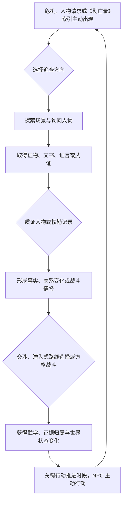
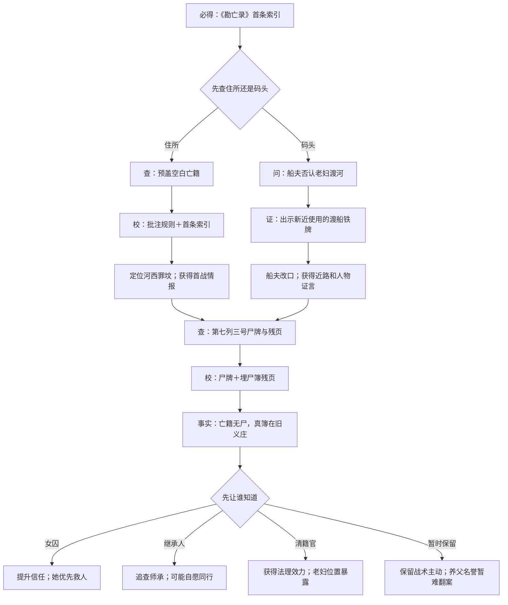

# 武侠 RPG 核心玩法规格 v0.1

> Day 3 输出件
>
> 状态：已完成，可进入第二周原型开发
>
> 项目代号：`Project Wuming`（无名）
>
> 最后更新：2026-09-10

本文件把 [`01_game_vision.md`](./01_game_vision.md) 的设计支柱和 [`02_vertical_slice_story.md`](./02_vertical_slice_story.md) 的剧情节拍转化为可操作、可配置、可验证的游戏规则。本文冻结垂直切片的 v0.1 默认方案；原型测试可以调整数值，但改变玩法支柱、战斗规模或调查复杂度必须重新评估范围。

---

## 一、玩法定位与边界

### 1.1 三种系统的分工

| 系统 | 对玩家提供的主要乐趣 | 在项目中的位置 |
|---|---|---|
| 身份调查与选择 | 发现矛盾、理解人物、决定真相由谁承担 | 对外卖点与叙事核心 |
| 小型方格战斗 | 位置、内力、招式和目标之间的短时策略 | 反复游玩的核心系统 |
| 关系与世界状态 | 让人物记住选择并主动帮助、阻拦或离开 | 把剧情、调查和战斗连接起来 |

调查不等于高难解谜，战斗不等于刷怪，关系不等于送礼加数值。三者必须互相提供新的处理方式：

- 调查可以揭示敌人意图、初始位置、可利用破绽或非歼灭目标。
- 战斗中的招式和行为可以成为师承、旧伤与人物立场的证据。
- 关系可以改变谁愿意作证、同行、传授武学或承担风险。

### 1.2 垂直切片时长预算

普通首次游玩目标为 75～85 分钟，完整探索不超过 90 分钟：

| 内容 | 目标占比 | 目标时长 |
|---|---:|---:|
| 对话与选择 | 35%～40% | 27～32 分钟 |
| 探索与调查 | 25%～30% | 19～24 分钟 |
| 战斗 | 25%～30% | 18～24 分钟 |
| 成长、整备与界面 | 5%～10% | 4～8 分钟 |

战斗固定为一场微型逃生教学和三场完整战斗；另有一场两至三分钟、可以跳过的切磋。任何新增战斗都必须替换现有战斗或证明其验证了不可替代的机制。

### 1.3 单个玩法单元

每个 8～15 分钟的玩法单元至少包含以下三个环节中的两个：

1. 获得一条会改变判断的证据或人物信息。
2. 作出一次会改变关系、时间或战斗准备的选择。
3. 通过战斗、质证或交涉验证之前的判断。

不连续安排超过十分钟的纯对话，也不连续安排两场没有剧情或状态变化的普通战斗。

---

## 二、核心循环

### 2.1 完整循环



这里的“潜入式路线”只表示利用暗道、身份或巡逻空隙避开战斗，不制作视野锥、警戒值和实时潜行 AI。

### 2.2 三层循环

| 层级 | 周期 | 玩家反复做什么 | 结束反馈 |
|---|---|---|---|
| 即时循环 | 10～60 秒 | 移动、观察、询问、出示证据、移动与使用招式 | 新信息、伤害、状态或人物反应 |
| 案件循环 | 8～20 分钟 | 选择线索、建立事实、处理冲突、决定证据用途 | 案件状态、关系、武学或新路线 |
| 章节循环 | 60～120 分钟；切片约 75～85 分钟 | 面对一宗身份矛盾并决定公开、隐藏或暂缓 | 地区和势力变化、结局记录、重勘节点 |

### 2.3 系统间的最小闭环

第二至第四周要优先实现的最小闭环为（第二周先完成探索与交互，第三周完成战斗，第四周串联调查和存档）：

```text
祠堂取得索引
→ 选择调查养父住所或码头
→ 获得一项证据
→ 用证据质证一句证言
→ 两项记录校勘为一个事实
→ 事实改变首战情报或初始位置
→ 完成一场小型战斗
→ 关系与时段变化
→ 存档并正确恢复全部状态
```

该闭环能够在 15～20 分钟内完成，先于正式地图、美术和完整剧情实现。

---

## 三、探索与场景交互

### 3.1 基础移动

- 2D 俯视区域式地图，四方向移动。
- 探索状态不显示战斗格；进入战斗后同一场景叠加逻辑方格。
- 玩家可以行走、冲刺、交互、打开《命卷》和暂停菜单。
- 冲刺不消耗体力，不制作生存或耐力条。
- 2026-09-22 试玩后确认：当前灰盒步速 100、冲刺 180 逻辑像素／秒，冲刺配更快步频和轻量像素尘点。用户再次选择暂不加精力消耗；数值是待新版手感复测的起点，不是永久平衡承诺。
- 不制作跳跃、攀爬、即时格挡和实时攻击。
- 地图出口显示目的地和是否推进时段，避免误触进入不可逆场景。

### 3.2 调查点分级

| 级别 | 用途 | 表现 | 是否可能漏掉 |
|---|---|---|---|
| 关键调查点 | 推进主线所需的索引、人物或证物 | 进入区域后镜头、角色台词或明确轮廓提示 | 否；离场前会提醒 |
| 方案调查点 | 提供战斗情报、关系或隐藏路线条件 | 靠近后出现统一交互符号，可用观察键短暂标出 | 可以，但主线继续 |
| 氛围调查点 | 世界观、人物生活和少量对白 | 无强提示，靠近后才可互动 | 可以，不影响结局条件 |

每个小场景最多设置一个关键调查点、两到三个方案调查点和两个氛围调查点。场景价值来自玩家如何使用信息，而不是调查点数量。

### 3.3 NPC 与区域状态

- 核心 NPC 的位置由“时段＋任务状态＋人物行动”决定，不使用实时分钟日程。
- 地图界面显示玩家已知的最后位置；人物主动转移后显示“可能去向”，不提供全知追踪。
- 每个时段至少有一个可见变化，例如封锁线、迁坟进度、门派弟子或告示内容。
- 普通路人只提供一条当前时段反应，不建立独立日程和关系数值。
- 被巡逻者发现时使用剧情对话、路线封锁或短战斗，不制作独立潜行系统。

---

## 四、轻调查系统：“查—问—证—校”

### 4.1 调查目标

每宗调查先向玩家提出一个可以用一句话表达的问题，例如：

> 守墓老妇在哪里，她为何带走埋尸簿？

玩家不需要找齐全部资料才能继续。最低证据链保证主线推进，可选证据链提供更准确的事实、更好的关系处理或更有利的战斗条件。

### 4.2 四种基础行为

| 行为 | 玩家操作 | 系统产出 | 复杂度限制 |
|---|---|---|---|
| 查 | 调查明确物件或场景状态 | 证物、文书、环境观察 | 每个小场景两至四个有效点 |
| 问 | 从人物话题中取得说法 | 证言、人物立场、新去向 | 每次会面两至四个主要话题 |
| 证 | 对当前说法出示相关记录 | 改口、新证言、信任或敌意变化 | 只显示两至四项相关记录 |
| 校 | 比较两项记录 | 已知事实、疑点或武学判断 | 每宗小案件一至两次二项比较 |

“证”针对人物，“校”针对记录。玩家不填写完整推理句，也不在大型关系图中自由连线。

### 4.3 证据类型和状态

证据记录分为五类：

- **文书：** 户籍、亡籍、门谱、书信、印章和账簿。
- **物证：** 尸牌、铁牌、遗物、武器和遗骨特征。
- **证言：** 人物明确说过、承认或否认的内容。
- **观察：** 场景痕迹、人物行动和时间矛盾。
- **武证：** 战斗中观察到的招式、起手、旧伤和师承特征。

每条记录拥有以下认知状态：

| 状态 | 含义 | 能否用于质证或结局 |
|---|---|---|
| 线索 | 玩家知道它可能相关，但尚未理解 | 可以向相关人物询问，不能单独完成裁定 |
| 疑点 | 它与另一项信息存在矛盾 | 可以质证当前说法或进入校勘 |
| 事实 | 已有两项独立来源互相支持，或由权威当事人确认 | 可以改变任务、战斗和路线条件 |
| 原件已交付 | 事实仍保留，但玩家不再持有原件 | 能否作为法理证据取决于接收者与封存状态 |
| 损毁或失效 | 物件不能继续作为原件使用 | 已知事实不消失，但部分路线关闭 |

《命卷》明确区分“玩家知道的事实”和“玩家手里仍持有的原件”，避免交出证据后角色突然忘记已经发现的真相。

### 4.4 相关性与错误处理

- 一条可疑证言出现时，界面标记“存在可质证之处”，但不指出正确证据。
- 质证列表根据共同标签筛选为两至四项，仍由玩家理解内容。
- 第一次出示无关记录只获得角色解释，不扣时间、不降关系。
- 对同一人物连续两次无关质证后可以主动退出；仍不造成主线失败。
- “公开指控”“交出原件”“威胁证人”是独立的重大选择，必须预览影响类型并二次确认。
- 关键事实缺失时，游戏呈现“证据不足但必须选择”，而不是要求玩家反复试到唯一正确答案。

### 4.5 同一证据的三种价值

同一项证据至少拥有一种、最多拥有三种用途：

1. **法理价值：** 交给清籍官、县衙或具有见证资格的人，形成封存、拘押或公开裁定依据。
2. **关系价值：** 向当事人坦白、证明承诺或让其参与自身命运，改变信任与认同。
3. **战术价值：** 保留原件、识别行动规律或找到暗道，改变战斗预览、部署和目标。

原件不是消耗品，但交给一方后不再同时由玩家持有。抄件可以保留信息，却不总具有同等法理效力。

### 4.6 武学验证

战斗或切磋中满足观察条件后，系统记录武证：

- 第一次看见招式，只记录外观和攻击形状。
- 与门谱、师承证言或另一招校勘后，确认招式名称和来源。
- 确认后的武证可用于质问师承，也可在后续战斗中提前显示该招式的范围或落点。
- 旧伤只有在观察其保护动作、取得医案或听到可信证言后才能成为事实。
- 利用人物旧伤是一次价值选择；发现破绽不等于系统强迫玩家攻击。

### 4.7 第一调查链的系统映射

详细证据内容见 [`02_vertical_slice_story.md`](./02_vertical_slice_story.md#83-第一调查链守墓老妇与无骨尸牌)。玩法流程如下：



### 4.8 调查内容预算

垂直切片总量上限：

| 内容 | 上限 |
|---|---:|
| 调查中心问题 | 3 个 |
| 有效证据与证言记录 | 12～16 条 |
| 必需二项校勘 | 3 次 |
| 可选二项校勘 | 2 次以内 |
| 正式质证场景 | 3～4 场 |
| 武学验证 | 2 次 |
| 因错误质证产生的专用对白 | 每名主要人物最多 2 条通用回应 |

调查内容优先复用已有 NPC、地图和战斗，不为每件证物制作独立大图或动画。

### 4.9 《命卷》调查界面

《命卷》只保留四个一级页面，避免把调查做成复杂数据库：

- **当前案：** 显示中心问题、已知事实、未处理疑点和会推进时段的下一步。
- **证据：** 按文书、物证、证言、观察和武证筛选，显示来源、认知状态与当前持有人。
- **人物：** 显示主角已经知道的身份说法、最近位置、关系阶段和未解决矛盾，不显示隐藏真相。
- **路线：** 第一次通关前只记录重大选择；通关后显示结局记录和可用重勘节点。

选择“证”时直接从当前证言进入相关证据列表；选择“校”时先选一项记录，再只显示存在有效校勘规则的候选记录。界面缩小检索范围，但不替玩家自动选择答案。

---

## 五、对话、选择与关系

### 5.1 对话节点类型

对话系统只需要支持以下节点：

- 普通台词与说话人变化。
- 二到四项玩家选择。
- 条件分支：事实、证据持有、关系、时段、任务和路线。
- 取得或更新证据、任务、关系和世界状态。
- “问”话题列表和“证”质证入口。
- 重大选择的影响类型预览和确认。
- 战斗、地图切换、时段推进和结局调用。

不制作自由输入、实时语言模型对话、复杂表情演出系统和每句配音同步。

### 5.2 关系的两条轴

每名核心人物使用两条隐藏数值和少量显式事件标记：

| 变量 | 范围 | 表示什么 | 典型变化 |
|---|---:|---|---|
| 信任 `trust` | -100～100 | 是否相信主角会守约、保护自己和诚实交付信息 | 坦白、守诺、隐瞒、利用、交出证人 |
| 认同 `alignment` | -100～100 | 是否认同主角处理身份、法度和牺牲的原则 | 依法处置、保护自由、尊重当事人、以大局牺牲少数 |

单次普通回答通常改变 0～5 点，共同经历或重大选择改变 10～25 点。关键剧情不只检查数值，还检查具体事件，例如“是否在公开身世前先告诉本人”。这样无法通过重复选择讨好话术绕过价值冲突。

界面不显示精确数字，只显示“戒备、合作、信赖”等关系阶段，并在重大变化时给出具体反馈，例如：

> 她记住了你先让她知道自己的身世，而不是拿它与门派交易。

### 5.3 关系对玩法的影响

- 决定角色是否自愿同行，而不是只决定伤害加成。
- 决定角色是否提供证言、路线、武学或场外援助。
- 同时参战上限不因关系角色增多而扩大；未参战者转化为准备效果或环境目标。
- 关系下降不会立即永久断线，重要离队必须经过明确冲突和确认。
- 切片不出现告白、排他关系和完整恋爱结局。

### 5.4 选择反馈规则

- 普通选择可以立即反馈语气和小幅关系变化。
- 重大选择先显示“将影响：人物／势力／证据／时段”中的类别，不剧透具体结果。
- 一项重大后果至少通过后续人物行动、地图变化、战斗条件或结局状态之一表现。
- 不使用“好／坏／真结局点数”提示。
- 主要失败采用带着代价继续；只有全队倒下或明确保护目标被摧毁才进入战斗重试。

---

## 六、小型方格回合制战斗

### 6.1 战斗目标

战斗要让玩家在两到四分钟的普通遭遇中至少判断两件事：

1. 站在哪里，是否需要先控制通路或保护目标。
2. 何时消耗内力使用招式，何时用基础行动恢复资源。

关键战斗再加入“是否利用调查所得”和“胜利不等于杀光敌人”。

### 6.2 战场与单位规模

- 原型战场以 10×8 至 12×10 个逻辑格为基准；Day 4 已将逻辑格与地面瓦片统一为 32×32 像素。
- 只允许上下左右移动，不允许斜向移动。
- 硬障碍阻挡移动和直线招式；不制作高度、朝向、背刺和命中率系统。
- 垂直切片由主角加至多一名可控同伴参战；敌方通常二至五人。
- 完整版在验证界面和节奏后，可以扩展为主角加两名同伴，但六个月切片不依赖这一规模。
- 剧情中同时在场但未受玩家控制的同伴，以场外援护、地图目标或战斗前效果表现。

### 6.3 回合结构

战斗以“轮”为单位：

1. 每轮开始时刷新持续状态，并显示玩家当前已知的敌人意图。
2. 所有单位按身法值由高到低各行动一次；同值时沿用上一轮稳定顺序。
3. 单位行动时可以先移动，再使用一个招式、物品、守势或吐纳；使用行动后不能继续移动。
4. 单位可以少移动或不移动，未使用的移动格不累积。
5. 所有存活单位行动完毕后进入下一轮，检查坚持轮数和环境目标。

首个原型不加入插队、延迟行动、反应攻击和复杂行动点。援护与反击作为明确招式效果实现。

### 6.4 基础属性与公式

| 属性 | 作用 |
|---|---|
| 气血 `hp` | 降到 0 时倒地；切片没有随机永久死亡 |
| 内力 `qi` | 使用招式和身法的资源，常规上限为 5 |
| 力道 `power` | 增加外功伤害 |
| 护体 `guard` | 减少受到的伤害 |
| 身法 `agility` | 决定行动顺序；部分角色提高移动格数 |
| 移动 `move` | 本次行动最多移动格数，默认 3 |

原型使用确定性伤害，不加入随机浮动、普通闪避和随机暴击：

```text
基础伤害 = max(1, 招式威力 + 攻方力道 - 守方护体)
最终伤害 = 基础伤害 + 明确显示的状态、距离或目标加成
```

基础攻击消耗 0 内力并恢复 1 内力；“吐纳”放弃攻击、进入守势并恢复 2 内力。强力招式消耗 1～3 内力并可能有一至三轮冷却。

### 6.5 攻击范围与预览

- 招式使用预定义格形：相邻单格、直线两格、十字一格、指定格周围等。
- 障碍可以阻挡标记为“直线”的招式；近身和自我范围不受影响。
- 玩家选择招式时显示可选格、影响格、确定性伤害和将施加的状态。
- 默认只显示敌人的行为类型和本轮可达范围。
- 调查或武学识招成功后，额外显示敌人的具体目标、招式形状或撤退落点。
- 没有情报时仍可通过敌人武器、站位和动画做基本判断，调查不是强制答案。

### 6.6 首批状态效果

首个战斗原型只实现五种通用状态：

| 状态 | 效果 | 默认持续 |
|---|---|---:|
| 守势 | 下一次受到伤害减少 2，触发后移除 | 至下一次被击或下次行动开始 |
| 破势 | 护体降低 2 | 至目标下次行动结束 |
| 牵制 | 下次行动的移动降低 2 | 1 次行动 |
| 流血 | 每次完成行动后失去 1 气血 | 2 次行动 |
| 援护 | 相邻友军第一次受击时，由施术者替其承受伤害并减少 1 | 1 轮 |

所有状态确定生效，不使用百分比概率。推动、交换位置和额外移动属于即时位移效果，不作为持续状态。

### 6.7 胜利与失败目标

战斗系统必须数据化支持：

- 击退指定敌人。
- 抵达撤离格。
- 坚持指定轮数。
- 保护人物、证物或场景目标。
- 护送目标抵达出口。
- 阻止敌人在限定轮数内焚毁或带走证据。

“击败所有敌人”只是其中一种目标。兄长战和终战不以清空敌方为默认解法。

### 6.8 垂直切片战斗表

| 战斗 | 目标时长 | 可控单位 | 敌方 | 教学或验证重点 |
|---|---:|---:|---:|---|
| 刑场后巷微型逃生 | 2～3 分钟 | 主角 1 人 | 2 名追兵与场景阻挡 | 两至三回合内移动、观察行动范围、利用障碍抵达出口；无需攻击 |
| 承岳门外院首战 | 3～4 分钟 | 主角＋女囚 | 3 名抢证者 | 距离、内力、破势和一次场外援剑；调查路线改变情报或部署 |
| 承岳门短切磋 | 2～3 分钟；可跳过 | 主角 1 人 | 继承人 1 人 | 尝试基础剑法、识别燕尾回步；失败不阻断流程 |
| 驿路兄长生存战 | 5～7 分钟 | 主角＋一名关系同伴 | 兄长，必要时加 1 名封路者 | 坚持四至六轮、护人或撤离；决定是否利用旧伤 |
| 旧义庄终战 | 7～10 分钟 | 主角＋一名关系同伴 | 3～4 人和 1 名头目 | 守证、拖延或护送撤离；证据、暗道和关系改变目标与初始位置 |

三场完整战斗与微型教学合计约 18～24 分钟。可选切磋不影响快速通关时长。

### 6.9 战斗失败与恢复

- 全部可控角色倒地、必须保护的目标被摧毁或关键敌人带着证据离场，判定战斗失败。
- 失败界面提供“原配置重试”“返回战前整备”和“查看目标说明”。
- 重试恢复战斗开始时的完整快照，不推进时段，不消耗物品和关系状态。
- 连续失败两次后提示故事辅助选项：敌人气血降低 20%或额外显示敌人意图；不自动启用。
- 普通同伴倒地不触发永久死亡；剧情死亡只能由明确编写的剧情节点决定。
- 可选切磋失败视为教学结果，继承人会点评玩家问题，仍可获得基础剑法；获胜只增加熟练度和关系反馈。

---

## 七、武学、配置与成长

### 7.1 武学分类

| 分类 | 主要作用 | 切片实现 |
|---|---|---|
| 外功 | 主动攻击、控制和援护 | 剑与拳／短打 |
| 内功 | 内力循环、被动规则和少量属性修正 | 1 套通用吐纳法 |
| 身法 | 位移、脱离和改变攻击位置 | 女囚步法与燕尾回步观察版 |

不单独制作暗器、刀、枪、毒、医术和多套内功。敌人的刀招仍使用通用敌方动作数据，不形成玩家可学习的完整刀法系统。

### 7.2 战前配置

主角在战斗外或战前整备界面配置：

- 三个外功槽。
- 一个身法槽。
- 一个内功槽；内功主要提供被动规则。
- 一个通用物品快捷槽。
- 基础攻击、守势和吐纳始终可用，不占外功槽。

切片同伴使用固定但会随关系改变一项招式的配置，避免为每名同伴制作完整装备管理。

### 7.3 “识招—熟练—化用”

| 阶段 | 获得方式 | 玩法效果 |
|---|---|---|
| 识招 | 观察、门谱、调查或第一次被招式命中 | 《命卷》记录攻击形状与特征；对敌时可逐步显示意图，玩家尚不能稳定装备 |
| 熟练 | 师友传授、切磋目标或关键战斗实践 | 可以装备标准版本，显示完整消耗、冷却和组合标签 |
| 化用 | 将两项已熟练武学用于同一关键问题，并经过人物或剧情验证 | 解锁一个固定变体或组合效果，不开放无限自由合成 |

垂直切片只完整实现一次化用：主角把女囚的脱身步法与承岳直势结合成“错简式”，用于兄长战中保护证人或抵达撤离位置。它是成长高潮，也是技术上验证标签组合的最小样本。

### 7.4 成长资源

- 战斗、切磋和武学调查提供“心得”，不直接按击杀数量刷经验。
- 首次完成招式目标获得熟练进度；重复击败同一批敌人不再提供心得。
- 切片不开放随机刷怪和无限练级。
- 主角的属性成长发生在明确节点：完成短切磋、兄长生存战和切片结算。
- 一次成长节点只允许“气血／内力”或“一项招式熟练”中的小幅提升，三日内不形成高手级数值跃迁。
- 武器和衣物只提供一项主要属性与一个标签，不制作随机词条、强化和耐久度。

### 7.5 招式数据字段

每项武学必须可以由数据定义，至少包含：

```text
id
name
category            # 外功／内功／身法
weapon_tag          # 剑／拳／通用
range_pattern
area_pattern
power
qi_cost
cooldown_rounds
effects[]
requirements[]
mastery_stage
narrative_tags[]    # 师承、版本、人物来源
presentation_key    # 共用动画与特效，不直接写资源路径
```

新增普通招式不应修改行动顺序、伤害结算或 UI 代码；只有出现全新效果类型时才扩展系统。

### 7.6 首批玩家武学数据草案

以下数值用于原型，允许在测试后调整：

| ID／工作名 | 分类 | 范围 | 威力 | 内力／冷却 | 效果与用途 |
|---|---|---|---:|---|---|
| `SK_FIST_BASIC` 短拳 | 拳外功 | 相邻 1 格 | 2 | 0／0 | 基础攻击；命中后恢复 1 内力 |
| `SK_STICK_GUARD` 木棍架势 | 通用外功 | 自身 | 0 | 0／0 | 获得守势；仅用于序章表现和教学 |
| `SK_TRIP_WRIST` 绊腕 | 拳外功 | 相邻 1 格 | 1 | 1／1 | 施加破势；女囚传授 |
| `SK_WATER_STEP` 掠水步 | 身法 | 自身后选择 2 格内位置 | 0 | 1／2 | 忽略单位阻挡移动至空格，并获得守势 |
| `SK_YUE_THRUST` 承岳直势 | 剑外功 | 正交直线 1～2 格 | 3 | 1／0 | 若目标在第 2 格，额外造成 1 伤害 |
| `SK_YUE_GUARD` 回山护剑 | 剑外功 | 自身与相邻友军 | 0 | 1／2 | 自身获得守势，相邻友军获得援护 |
| `SK_SWALLOW_RETREAT` 燕尾回步 | 身法／武证 | 相邻 1 格 | 1 | 1／2 | 攻击后向指定空格后撤至多 2 格；最初只供观察 |
| `SK_MISPRINT_FORM` 错简式 | 化用剑招 | 相邻 1 格 | 2 | 2／2 | 施加破势后移动 1 格；若用于援护或撤离目标，返还 1 内力 |
| `IN_BREATH_BASIC` 无名吐纳 | 内功 | 被动 | — | — | 内力上限 5；基础攻击恢复 1，吐纳恢复 2 |

### 7.7 首批敌人数据草案

| ID／敌人 | 气血 | 内力 | 力道／护体／身法／移动 | 行为与招式 | 调查可改变什么 |
|---|---:|---:|---|---|---|
| `EN_YAMEN_BLADE` 县衙刀役 | 8 | 3 | 2／2／2／3 | 接近最近目标、横刀攻击、低血时守势 | 识别便衣编组后显示其第一轮目标 |
| `EN_YAMEN_CATCHER` 县衙捕手 | 7 | 4 | 1／1／3／3 | 优先牵制证据携带者，用锁拿降低移动 | 官籍路线提前显示锁拿范围 |
| `EN_YANHUI_RUNNER` 雁回接应者 | 6 | 4 | 2／1／4／4 | 优先夺取证据，使用燕尾回步后撤，不恋战 | 识招后显示其落点；可由继承人场外封路 |
| `EN_BURNER` 灭口队火手 | 6 | 3 | 1／1／2／3 | 接近书堆或油罐，准备一轮后焚毁目标 | 找到暗道后改变其与证据的初始距离 |
| `EN_BURNER_CAPTAIN` 灭口队头目 | 14 | 5 | 3／3／3／3 | 标记目标、命令火手额外移动、重击破势者 | 掌握押解阵形可取消其第一次命令 |

兄长作为剧情 Boss 单独配置：气血不会在本战降到 1 以下；其胜负由轮数、保护和撤离目标判断。玩家若查明并利用旧伤，可令其一次重招失效；拒绝利用则获得关系事件标记 `BROTHER_SPARED_WEAKNESS`。

---

## 八、时间推进与世界行动

### 8.1 时间不是实时倒计时

三日由八个剧情时段组成：第一天黎明、下午、夜间；第二天白日、傍晚、夜间；第三天黎明、正午。

- 阅读、普通交谈、场景调查、整理《命卷》和失败重试不推进时间。
- 只有标有“完成后进入下一时段”的重大行动推进时间。
- 选择重大行动前显示将被暂时放弃的已知线索，但不揭示后果。
- 主线关键行动永远保留；可选行动可能因人物转移而改变内容，而非简单消失。

### 8.2 垂直切片的调查取舍

| 时段 | 必须完成 | 玩家取舍 |
|---|---|---|
| 第一天下午 | 破解首条索引 | 先查养父住所或先查码头；另一条在后期只能以缩短版本补查 |
| 第一天夜间 | 进入罪坟并形成“亡籍无尸”事实 | 是否继续追查燕尾回步与继承人师承 |
| 第二天白日 | 找到守墓老妇去向 | 先向继承人坦白，还是保留门派掩护 |
| 第二天夜间 | 面对清籍官条件 | 立刻进入终局准备，或补查一条线索以争取暗道、旧伤或第三类证据 |

玩家不能在一次流程中无成本看完所有版本。重勘用于体验另一种选择，不把第一次游玩变成穷举任务清单。

### 8.3 NPC 主动行动

推进时段时，世界系统按优先级处理：

1. 固定公共事件，例如封城、迁坟和清籍使团抵达。
2. 任务相关行动，例如县衙查抄住所、雁回门转移证人。
3. 核心人物根据关系和信息采取的行动。
4. 更新 NPC 位置、可用话题、封锁和地图提示。
5. 自动存档，显示一条可观察到的世界变化。

同一时段的行动顺序必须固定并可测试，不依赖帧率或 NPC 实时移动是否完成。

---

## 九、失败、存档与“重勘”

### 9.1 非战斗失败

- 无关证据质证不造成任务失败。
- 漏查可选证据会改变战斗与路线条件，不会阻断主线。
- 证人先被其他势力找到时，任务转为营救、谈判或追踪，而不是直接显示失败。
- 关系不足时角色可以拒绝同行，但必须提供另一条代价更高的主线方案。
- 不设置因为阅读慢、暂停或探索角落而触发的实时失败。

### 9.2 存档方案

垂直切片提供：

- 5 个手动存档槽。
- 3 个循环自动存档槽，在时段变化和关键任务完成后写入。
- 1 个临时战前快照，战斗结束后可覆盖。
- 每个重大选择前保存一个只读选择锚点，直到本章结束。
- 存档包含版本号、路线 ID、时间、任务、人物、关系、证据、原件归属、武学和玩家配置。

战斗中和不可中断演出中不能手动保存；战斗前后、普通探索和大多数对话结束后可以保存。

### 9.3 重大选择保护

重大选择同时满足以下处理：

1. 进入选择前自动保存锚点。
2. 界面显示可能影响的类别，例如“继承人／门派／师承证据”。
3. 玩家确认后写入不可变的选择事件。
4. 第一次通关前不提供立即撤销按钮，但玩家仍可主动加载普通存档。

系统尊重玩家存档自由，同时不把“读档试完所有台词”设计成获得隐藏路线的必要方式。

### 9.4 切片版“重勘”

- 玩家完成任一切片结局后解锁《命卷》的路线页。
- 六个月版本只提供一个节点：“旧义庄最终裁定前”。
- 选择“从此重勘”时复制该节点完整快照并生成新的路线 ID。
- 旧路线保留结局、重大选择和人物去向记录，但不与新路线共享任务、证据、物品和关系状态。
- 重勘不携带后期等级、装备和同伴回到旧节点。
- 完整版可以在章节完成后增加节点；是否保留战斗成长留待完整游戏阶段评估。
- 六个月版本不制作战斗逐行动撤回，战败从战斗开始处重试。

### 9.5 状态重置原则

所有可回溯状态分为：

| 状态范围 | 示例 | 重勘处理 |
|---|---|---|
| 路线内状态 | 任务、关系、证据原件、NPC 位置、武学与装备 | 恢复锚点快照 |
| 路线记录 | 选择、结局、人物去向 | 旧路线归档，新路线重新记录 |
| 账号级展示 | 已观看结局、设置、辅助功能 | 保留 |
| 开发调试状态 | 跳关、无敌、强制证据 | 不写入正式存档 |

任何任务不得通过散落的匿名布尔值判断跨章节结果。所有重大状态必须拥有稳定 ID、明确所属范围和默认值。

---

## 十、运行时状态与内容数据

### 10.1 游戏状态分区

```text
GameState
├── route_id / save_version
├── time_state
├── world_flags
├── quest_states
├── character_states
│   ├── location
│   ├── trust / alignment
│   └── explicit_events
├── evidence_states
│   ├── knowledge_state
│   ├── holder
│   └── validity
├── martial_states
│   ├── mastery
│   └── loadout
├── inventory
└── player_state
```

战斗开始时从 `GameState` 和战斗定义生成独立 `BattleState`。失败时丢弃 `BattleState`；胜利后只通过结算事件把结果写回 `GameState`，避免半场状态污染存档。

### 10.2 内容定义与运行状态分离

- 武学、敌人、证据、人物、任务、对话和战斗关卡使用稳定字符串 ID。
- 内容文件描述静态定义；存档只保存 ID 和运行状态，不复制整份内容文本。
- 对话条件读取统一状态查询接口，不直接访问场景节点。
- 对话结果生成事件，例如 `GAIN_EVIDENCE`、`SET_FACT`、`CHANGE_RELATION`、`ADVANCE_TIME` 和 `START_BATTLE`。
- 任务条件、结局条件和战斗准备读取同一事实 ID，避免剧情认为已查明而战斗系统不认识。
- 所有随机数都从可保存的种子取得；首个战斗版本尽量使用确定性规则。

### 10.3 调查记录最小字段

```text
EvidenceDefinition
├── id
├── title
├── kind
├── description
├── source_id
├── tags[]
├── related_claim_ids[]
├── presentation_rules[]
├── compare_rules[]
└── legal_weight

EvidenceState
├── knowledge_state
├── holder_id
├── validity
└── discovered_at
```

一条校勘规则只声明“两项输入 ID、条件、输出事实 ID 和反馈文本”。首版不实现任意数量线索的通用逻辑推理引擎。

### 10.4 任务状态

每项任务只使用以下运行状态：

```text
locked      # 条件尚未满足
available   # 已出现，但玩家尚未接受或查看
active      # 当前可以推进
resolved    # 以某种结果结束
changed     # 原目标失效，已转为营救、谈判或追踪等新方案
```

`changed` 不是失败状态。它必须记录转化原因和新的目标 ID，让“带着代价继续”成为可测试的状态迁移，而不是对话中的临时补丁。

### 10.5 重大事件记录

每次重大选择保存：

```text
choice_id
route_id
chapter_id
anchor_id
time_slot
selected_option_id
affected_state_keys[]
```

重勘通过锚点快照恢复状态并开启新路线，不尝试逐条反向执行所有事件；事件记录主要用于路线页、测试和后续后果查询。这比完整事件溯源更适合两人项目。

---

## 十一、原型顺序与验证标准

### 11.1 第二至第四周的原型顺序

1. 探索移动、交互和区域切换。
2. 统一状态容器、稳定 ID 和基础存档。
3. 一条证据、一段证言、一次质证和一次二项校勘。
4. 一场 2 对 3 的战斗，支持移动、内力、三种招式、两种状态和撤离目标。
5. 调查事实改变战斗意图预览或初始位置。
6. 战后关系变化、时段推进和 NPC 转移。
7. 从存档恢复整条最小闭环。

先证明系统互相连接，再扩充武学、证据和剧情文本。

### 11.2 内部可玩验证

| 问题 | 通过标准 |
|---|---|
| 玩家是否理解当前调查问题 | 不看任务全文也能说出要找谁或证明什么 |
| 调查是否只是点完所有物件 | 至少存在一次“向谁质证／如何使用证据”的主动判断 |
| 证据是否影响玩法 | 至少一项事实改变战斗预览、部署、参战关系或目标 |
| 战斗是否只有普通攻击 | 玩家至少一次主动使用破势、位移、援护或内力循环 |
| 战斗信息是否清楚 | 选择招式时能预测范围、伤害、状态和资源变化 |
| 失败是否令人愿意重试 | 战斗重试在十秒内返回战前，且不丢失剧情进度 |
| 关系是否只是一条好感值 | 至少一个结果由明确事件标记和关系阶段共同决定 |
| 时间是否造成无意义焦虑 | 阅读和探索不计时，重大行动会提前说明推进时段 |
| 新内容是否数据驱动 | 新增普通招式、证据或敌人不需要修改无关系统代码 |

### 11.3 Day 3 验收清单

- [x] 已绘制完整核心循环和 15～20 分钟最小闭环。
- [x] 已定义探索、调查、对话、关系、战斗、成长和时间之间的数据与玩法联系。
- [x] 已定义方格、行动顺序、移动、属性、伤害、内力、状态、意图预览和六类胜负目标。
- [x] 已确定剑、拳、身法和通用内功的分类、槽位与“识招—熟练—化用”。
- [x] 已定义非实时的三日八时段，以及哪些行为推进时间。
- [x] 已定义战斗、调查、关系失败如何重试或带着代价继续。
- [x] 已定义手动存档、自动存档、选择锚点和切片单节点重勘。
- [x] 已提供 9 项玩家武学／内功和 5 类敌人的首批数据草案。
- [x] 已定义轻调查的记录状态、质证、二项校勘、错误处理和武学验证。
- [x] 已将守墓老妇第一调查链映射为可以实现的系统流程。
- [x] 已确定运行时状态边界，为存档、分支和后续重勘留下结构。

Day 3 到此完成。Day 4 已在 [`04_technical_spec.md`](./04_technical_spec.md) 和 [`05_art_bible.md`](./05_art_bible.md) 中确定引擎版本、目录与模块接口、画面分辨率、瓦片和角色规格、输入映射、存档文件格式与构建方式，不再重新讨论核心玩法类型。
