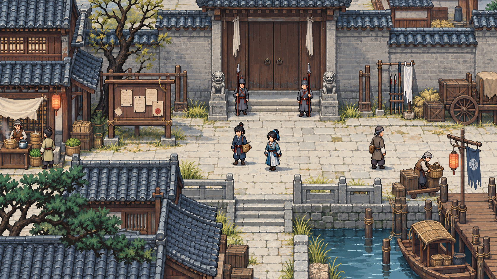

# 武侠 RPG 像素美术规范 v0.1

> Day 4 输出件
>
> 状态：已完成，可供角色测试图与灰盒地图制作
>
> 项目代号：`Project Wuming`（无名）
>
> 最后更新：2026-09-16

本文件规定垂直切片的像素尺寸、色板、角色比例、动画、场景模块、战斗反馈、UI 和资产生产预算。技术窗口与导入规则以 [`04_technical_spec.md`](./04_technical_spec.md) 为准，剧情场景范围以 [`02_vertical_slice_story.md`](./02_vertical_slice_story.md) 为准。

---

## 一、美术目标

### 1.1 风格方向

内部风格名暂定为：

> 北地残卷

画面表现一座被战争、清籍和旧案反复书写的北方县城：低饱和的石、土、旧木和河水构成环境，人物的肤色、布结、官印和灯火提供有限暖色。整体不是阴暗写实或华丽仙侠，而是“寒冷制度中的具体人”。

#### 已认可的日常县城基调（2026-09-16）

用户在看过提亮后的第二版概念图后确认“好，先做成这样吧”。日常城镇因此采用：**青灰屋瓦与旧木作为底色，白日道路更明亮，热食摊、买菜客与搬货人提供烟火气，官告、守卫和少量白幡把紧张感留在环境中。** 刑场、夜间追捕等段落可以压暗，以形成情绪对比；不是把整个江湖长期处理成肃穆的刑场。



本图是 AI 生成的气质／构图参考，不是实机截图、可直接导入的地图或通过像素规格验收的生产素材。图中细节密度、字符、人物尺寸和像素网格不作为精确规范；运行时仍遵守本文件的色板、32×32 瓦片、32×48 角色与可读性要求。第二周先以灰盒表达冷暖、路线和交互层级，不因认可图片而追加正式整套瓦片生产。

原始结果原样复制为内部参考，未重新绘制或裁切，完整来源与审核边界见 [AI 内容登记](./docs/ai_content_register.md)的 `AI-ART-006` 和[素材来源](./docs/asset_sources.md)的 `REF-AI-TOWN-V2`。

### 1.2 五条视觉原则

1. **可读优先：** 角色、障碍、出口、证据和威胁范围在 1×视口下也必须清楚。
2. **人物优先：** 场景细节服务人物和案件，不以大量装饰遮盖交互点。
3. **身份可见：** 官籍、绳结、门派纹样、武器携带方式和招式轮廓形成可以调查的视觉语言。
4. **有限而一致：** 固定色板、像素密度、轮廓和阴影方向，不混用高清插画、低分辨率角色与平滑 3D 光照。
5. **可持续生产：** 同一角色素材用于探索和战斗；同类招式共享动作和特效，不为每个技能逐帧重画。

### 1.3 明确不采用

- HD-2D、3D 场景、景深、体积光和自由旋转镜头。
- 写实人体比例、八方向移动和斜向攻击动画。
- 每个招式一套角色逐帧动画。
- 把中文剧情文字画进图片。
- 依赖大量透明渐变、亚像素线条和非整数缩放的界面。
- 高频闪光、长时间屏幕震动和遮挡方格信息的粒子爆炸。

---

## 二、画布、像素与缩放

### 2.1 基础规格

| 项目 | 规格 |
|---|---|
| 设计视口 | 640×360，16:9 |
| 默认显示 | 1280×720，2×整数缩放 |
| 地面瓦片 | 32×32 |
| 普通角色画布 | 32×48 |
| 普通角色逻辑占地 | 一个 32×32 地面格；碰撞约 20×12 |
| 特殊大型角色 | 最多 48×64，只用于明确的大体型或终局 Boss |
| 战斗逻辑格 | 32×32，与地面瓦片一致 |
| 核心人物头像 | 96×96 |
| 常规特效画布 | 32×32 或 64×64 |

640×360 每屏约显示 20 个横向瓦片和 11.25 个纵向瓦片，足以容纳 Day 3 的 10×8 至 12×10 战场，同时给对话和战斗 UI 留出覆盖空间。

### 2.2 像素纪律

- 所有像素素材在 1×尺寸绘制，预览时使用 2×或 3×最近邻缩放。
- 不在运行时对角色做非整数缩放、任意角度旋转或亚像素移动。
- 一像素轮廓在同一类对象中保持一致，不混入半透明抗锯齿边缘。
- 像素 PNG 关闭过滤、mipmap 与有损压缩。
- 角色落脚点和 Camera2D 最终显示坐标取整数。
- 透明阴影使用固定像素图，不使用会产生模糊边缘的实时软阴影。
- 允许动态字体保持矢量源；它不是像素插画，不强迫中文使用残缺像素字库。

### 2.3 安全区域

- 关键 HUD 距视口边缘至少 12 像素。
- 对话框、命卷和战斗菜单不得依赖黑边区域。
- 交互提示不能贴在角色头顶最上方 4 像素内，避免与门楣和屋檐重叠。
- 重要目标在常规相机视野内至少保留一个完整 32×32 格的边距。

---

## 三、核心色板

### 3.1 24 色环境与界面色

| 色名 | Hex | 主要用途 |
|---|---|---|
| 墨夜 | `#171820` | 最深轮廓、夜色、文字背景 |
| 炭青 | `#242833` | 深衣、屋内暗面 |
| 铁灰 | `#333B46` | 石墙、兵器暗部 |
| 岩灰 | `#4C5660` | 石、金属中间色 |
| 灰雾 | `#747B78` | 远景、失活 UI |
| 冷雾 | `#A9ADA4` | 石面亮部、次要文字 |
| 旧纸 | `#D8D0BE` | 文书、主要浅底 |
| 骨白 | `#F1E6CF` | 高亮文字、证据与遗骨 |
| 焦土 | `#3B2925` | 土地暗部、深木 |
| 旧木 | `#5B3A30` | 梁柱、棕色衣物 |
| 陶土 | `#7D5037` | 地面、屋瓦与皮革 |
| 赭黄 | `#A96A42` | 灯火暗部、枯草 |
| 麦金 | `#D19A5C` | 目标、高光、稻草 |
| 印泥 | `#8B3432` | 县衙、危险暗红 |
| 朱砂 | `#B84A3E` | 威胁、血迹、重点官印 |
| 暖光 | `#D77758` | 灯火、受光皮肤与情绪强调 |
| 深松 | `#203934` | 山林、承岳门暗色 |
| 松青 | `#34594A` | 植被、承岳门主色 |
| 苔绿 | `#5E8065` | 植被亮部、药草 |
| 灰玉 | `#7FA38D` | 清籍使团、可行动格辅助色 |
| 深河 | `#1F394B` | 河水、夜间蓝面 |
| 河青 | `#335F79` | 水面、女囚与雁回线索 |
| 冷天 | `#5F899B` | 天光、移动范围 |
| 淡青 | `#8FB0B4` | 水光、选中与信息提示 |

### 3.2 肤色色阶

| 色名 | Hex | 用途 |
|---|---|---|
| 肤暗 | `#5C342C` | 深肤暗部、面部轮廓 |
| 肤影 | `#8E503E` | 常规阴影 |
| 肤中 | `#BF7857` | 常规肤色 |
| 肤亮 | `#E2AA78` | 鼻梁、额头、手部受光 |

角色可以调整肤色明暗和色相，但必须在这四级明度关系附近，不把所有人物画成同一肤色。

### 3.3 势力识别色

| 势力或功能 | 主色 | 辅色 | 禁止做法 |
|---|---|---|---|
| 县衙 | 印泥、铁灰 | 旧纸 | 所有人通体纯红，失去阶级和职业差异 |
| 清籍使团／武巡院 | 深河、灰玉 | 骨白 | 与县衙共用同一红黑制服 |
| 承岳门 | 深松、松青 | 麦金 | 满身鲜绿或仙侠荧光 |
| 雁回门暗线 | 河青、炭青 | 淡青 | 统一蒙面黑衣，无法辨认普通生活身份 |
| 百姓与沧浪水路 | 旧木、陶土 | 河青 | 只用灰褐造成角色互相粘连 |
| 可交互／当前选择 | 麦金 | 骨白 | 只靠颜色，不加轮廓或图标 |
| 玩家移动范围 | 冷天 | 淡青 | 大面积不透明遮住地面信息 |
| 敌方威胁 | 朱砂 | 印泥 | 与血量、不可通行区使用完全相同图形 |

任何信息颜色都必须同时配合图标、边框、纹理或文字，不能要求色觉差异玩家只凭红绿区分。

### 3.4 时段与光照

- 黎明：深河阴影＋淡青环境光，暖色只出现在灯笼和人物肤色。
- 白日：使用原色板，阴影统一向右下偏移 2～3 像素。
- 黄昏：赭黄薄层＋深松阴影，不整体染成橙色。
- 夜间：墨夜／深河覆盖，门窗和火盆使用麦金／暖光形成局部焦点。
- 不使用实时昼夜渐变；每个剧情时段切换固定 CanvasModulate、天空和灯光状态。
- 同一地图不重画整套夜间瓦片，只为灯窗、水面和剧情损毁制作少量变体。

---

## 四、环境与瓦片

### 4.1 三套模块

六个剧情区域由三套模块组合，不制作六套完全独立素材：

| 模块 | 覆盖区域 | 核心视觉 |
|---|---|---|
| 县城模块 | 刑场、市场街巷、养父住所外院、祠堂 | 灰石、旧木、白幡、官告、狭窄通道 |
| 河岸模块 | 码头、货栈、河西罪坟 | 湿木、芦苇、浅滩、尸牌、低雾 |
| 山门模块 | 承岳门外院、山道、旧义庄 | 山石、深松、旧瓦、塌墙、暗道 |

县城室内、墓地和义庄通过各模块的专用小组件表达，不另建完整大套件。

### 4.2 瓦片构成

每套基础模块目标控制在 80～110 个有效瓦片或组合件：

- 地面与边缘：12～20。
- 墙体、门窗和屋檐：20～28。
- 高低遮挡与转角：12～16。
- 自然物：10～16。
- 功能道具：12～18。
- 氛围装饰：8～12。
- 损毁、时段或剧情变体：8～12。

瓦片数量按“实际能拼出不同场景的组合”计算，不把自动瓦片的每个排列当作独立美术内容夸大数量。

### 4.3 地图图层

```text
Ground        # 地面与水面
GroundDetail  # 裂纹、泥痕、落叶，不碰撞
CollisionLow  # 墙脚、箱子、矮障碍
Actors        # 角色和可移动目标
AboveActors   # 屋檐、树冠、门楣
EvidenceFX    # 调查轮廓、尸牌、脚印等临时提示
WeatherFX     # 雾、雨、尘，仅少量使用
```

- 屋檐和树冠在角色进入遮挡区时切换为 40%～60%透明，不完全消失。
- 碰撞形状单独配置，不根据透明像素自动生成。
- 战斗障碍必须与视觉一致：看起来能挡路的墙不能允许穿过。
- 可破坏物只用于已经写进战斗规则的货架、油罐和证据目标，不把所有箱子做成可破坏。

### 4.4 调查可读性

- 关键调查物拥有独特轮廓或构图位置，不默认常亮描边。
- 按“观察”后，关键点使用麦金实线框，方案点使用淡青虚线框，氛围点不高亮。
- 已调查物显示短暂的灰色勾记，重复检查仍能查看原文。
- 文书、尸牌、绳结和武器刻痕使用统一“近看卡片”，不为每件物证画全屏插画。
- 只有剧情核心证物可以获得 64×64 或 96×96 特写；切片上限 6 张。

---

## 五、角色规格

### 5.1 普通角色画布

- 标准源画布为 32×48，脚底锚点位于 `(16, 44)`。
- 实际身体通常高 36～44 像素，顶部留出帽冠、发髻和动作空间。
- 逻辑占地始终为一个 32×32 地面格；碰撞矩形约 20×12，位于脚边。
- 影子为 16×6 的固定椭圆像素图，单独控制透明度。
- `y_sort` 以脚底而非贴图中心计算。
- 武器可以超出 32 像素宽画布，但不得改变逻辑占地；超出较大时使用独立特效层。

### 5.2 比例与轮廓

- 头部约占身体高度 1/4，保持像素武侠可读性，不采用写实八头身。
- 手和武器允许适当夸张，确保 1×下能辨认剑、刀、木棍和文书。
- 主角轮廓偏窄，保留书吏短衣、文袋和后来增加的剑。
- 女囚使用利于水路行动的短衣、分片下摆和河青色，不用暴露服装表现“江湖女性”。
- 兄长轮廓更宽直，武巡院腰牌与长刀形成稳定水平线。
- 继承人使用承岳门直线衣褶，雁回结饰是小面积但可在特写中辨认的身份矛盾。
- 县令和清籍官必须通过帽形、色块与随从站位区分，不只更换衣服颜色。
- 守墓老妇背负工具和尸牌袋，剪影能与普通老妇区分。

### 5.3 方向与移动

- 只制作上、下、左、右四方向。
- 左右方向可以镜像身体，但文字、徽记、伤疤和单侧武器需要独立修正帧。
- 行走每方向 4 帧，播放速度 8 FPS 左右；冲刺复用行走帧并提高位移速度，不另画跑步。
- 待机复用对应方向行走中的一帧，不额外绘制四帧；普通 NPC 因而为 16 帧行走＋2 帧手势，镜像修正最多增至 20 帧。核心角色可以增加 2 帧低频呼吸，不作为 Must。
- 移动停止时回到对应方向待机帧，不随机改变朝向。

### 5.4 动画预算

| 角色级别 | 必需动画 | 预计帧量 | 制作预算 |
|---|---|---:|---:|
| 普通非战斗 NPC | 四向待机、四向 4 帧行走、1 个双帧说话手势 | 18～20 帧 | 1～2 个工作日 |
| 功能型敌人 | 普通 NPC 基础＋四向 3 帧攻击、四向受击、1 帧倒地 | 35～40 帧 | 2～3 个工作日；同制服可换色复用 |
| 核心可战斗角色 | 行走＋拳／剑动作族、受击、倒地、剧情手势 | 45～60 帧 | 3～5 个工作日 |
| 核心非战斗角色 | 普通 NPC 基础＋2 个剧情手势 | 22～26 帧 | 1.5～2.5 个工作日，不含头像 |

普通 NPC 的 1～2 日验收以 8～12 个有效工时计算：轮廓与配色 2 小时、四向行走 5～7 小时、手势和导入测试 1～3 小时。超出时先删减服装细节，不减少方向或破坏统一锚点。

### 5.5 探索与战斗复用

- 战斗直接使用探索角色的待机、移动、受击和倒地帧。
- 所有剑招共享“直刺、横斩、护剑”三个动作族；所有拳招共享“直击、绊腕、架势”三个动作族。
- 招式差异主要由位移、时序、范围图形、颜色受控的特效和音效表达。
- 身法只增加起步、残影和落地特效，不为每项身法重画整套移动。
- 武器换装只替换明确支持的武器层；切片不制作任意装备改变全身外观。

---

## 六、头像、人物表情与演出

### 6.1 头像规格

- 主角、六名切片主要互动 NPC 与养父制作 96×96 像素半身头像，共 8 张基础头像。
- 功能型次要角色不制作头像，使用姓名条、职业图标和场景精灵。
- 每张基础头像先完成中性表情；愤怒、痛苦、缓和等变体优先只替换眉眼、嘴形和少量阴影。
- 每名核心角色最多 3 个表情变体，养父最多 2 个，切片不做口型同步。
- 头像背景透明，不把固定对话框或名字画进图片。
- 同一角色的头像与场景精灵必须共享发色、服装主色、伤疤和身份物件。

### 6.2 对话演出

- 常规对话以场景角色、头像、姓名和文字完成，不频繁切换全屏立绘。
- 镜头移动控制在一个屏幕内，持续 0.2～0.5 秒；玩家可设置关闭镜头缓动。
- 重大台词使用停顿、环境音、头像变化和有限构图，不依赖昂贵动画。
- 养父处刑不表现写实断肢或大量血浆，以锣声、白幡、人物反应和少量朱砂色完成。
- 回忆优先通过文书、证言和地图变化表现，不制作大量一次性插画。

### 6.3 身份线索一致性

以下细节一旦用于调查，就必须进入角色设定表并在相关帧中保持一致：

- 雁回结饰的结法与佩戴方向。
- 承岳门剑穗和制服边纹。
- 武巡院腰牌、刀鞘与官靴。
- 县衙印记、尸牌编号和文书边框。
- 兄长保护旧伤时使用的身体侧向。
- 燕尾回步起手脚与落地方向。

不能因为左右镜像而把关键伤疤、结饰或武器手切换到另一侧，导致调查信息自相矛盾。

---

## 七、战斗视觉语言

### 7.1 方格与范围

| 信息 | 颜色 | 图形 |
|---|---|---|
| 可移动格 | 冷天／淡青，25%～35%透明 | 中心小点＋细实线边框 |
| 当前路径 | 骨白 | 连续箭头，不只改变地面色相 |
| 可攻击格 | 麦金 | 四角标记 |
| 敌方威胁 | 朱砂，20%～30%透明 | 斜线纹理＋红色外框 |
| 调查已知意图 | 印泥／骨白 | 敌人头顶招式图标＋目标线 |
| 撤离或护送目标 | 灰玉／麦金 | 双层边框＋出口旗标 |
| 不可通行 | 不覆盖 | 由障碍本身和鼠标／手柄反馈表示 |

- 范围覆盖不得隐藏尸牌、油罐、出口和角色脚底。
- 同时显示多名敌人威胁时，重叠格加深边框而不是不断叠加透明度。
- 战斗格只在选择移动、招式或威胁显示时出现，避免探索场景永久棋盘化。
- 玩家、同伴、中立目标和敌人使用不同脚环形状，不只使用不同颜色。

### 7.2 招式动作族

切片只制作以下共享动作族：

1. 拳：直击、绊腕、格挡。
2. 剑：直刺、横斩、护剑。
3. 刀：横刀、重劈；仅敌人使用。
4. 身法：起步残影、短距滑步、落地。
5. 通用：使用物品、受击、倒地、援护。

每种招式通过动作族＋特效键＋音效键组合，不新增专属角色逐帧动画。例如“承岳直势”和以后同类直刺剑招共用直刺动作，只改变剑气长度、颜色、命中停顿和数值。

### 7.3 特效预算

- 常规斩击、刺击、拳击、格挡、破势、位移残影和命中火花各制作一套 4～6 帧特效。
- 常规特效不超过 64×64；终战环境效果可到 96×96，但不得遮住完整战场超过 0.3 秒。
- 特效播放 10～15 FPS，可使用保持帧增强力度，不靠大量中间帧。
- 命中停顿目标 50～80 毫秒；Boss 重招最多 120 毫秒。
- 常规镜头震动幅度不超过 2 个设计像素、持续不超过 150 毫秒；设置中可以关闭。
- 屏幕闪白最多一帧且透明度受限，提供“减少闪烁”选项。
- 流血只用少量朱砂像素和状态图标，不制作持续喷溅。

### 7.4 敌人意图

- 未调查敌人显示“接近／攻击／夺证／焚毁”等类别图标。
- 已获得战术情报时，额外显示具体招式形状、目标线或撤退落点。
- 精英命令使用头顶旗标与地面短线，不用大段文字挡住战场。
- 图标源画布为 16×16，外框为 1 像素；同类图标共享形状词汇。
- 所有状态图标在《命卷》和战斗帮助页中有文字说明。

---

## 八、UI 与字体

### 8.1 字体选择

- 正文和系统 UI 使用 `Noto Sans CJK SC` Regular。
- 标题、人物名和重要按钮使用同家族 Medium 或 Bold，不再引入第二套正文字体。
- Noto CJK 使用 SIL Open Font License 1.1，可以随应用分发；仓库必须同时保存许可证文本和来源记录。[Noto CJK 官方许可证](https://github.com/notofonts/noto-cjk/blob/main/Sans/LICENSE)
- 原型阶段先使用完整简体中文字体；内容稳定后可以评估字体子集，但必须保留所有实际字符、标点、英文和数字。
- 商店 Logo 与章节题字可以以后单独设计，不替代可访问的动态文字。

### 8.2 字号与行距

| 用途 | 标准字号 | 大字模式 | 行高 |
|---|---:|---:|---:|
| 正文对白 | 18 | 21 | 26／30 |
| 按钮与列表 | 16 | 19 | 22／26 |
| 小型提示 | 14 | 17 | 20／24 |
| 标题 | 22～28 | 26～32 | 30～38 |

- 不使用小于 14 的关键文字。
- 大字模式允许列表滚动、对话框增高和分页，不能简单把文字溢出容器。
- 英文按中文布局宽度的 1.5 倍测试；长角色名、按键名和证据名必须自动换行或截短后提供完整悬停说明。

### 8.3 基础界面布局

| 界面 | 640×360 下的基准 |
|---|---|
| 对话框 | `x=12, y=232, w=616, h=116`；头像占 96×96，正文区域保留至少 4 行 |
| 战斗 HUD | 底部或右侧动态面板，常态不超过画面 96 像素高度 |
| 《命卷》 | `x=16, y=16, w=608, h=328`，四个一级页面 |
| 暂停菜单 | 居中最大 400×300，背景加墨夜半透明遮罩 |
| 交互提示 | 角色或物件上方，图标 16×16，文字可关闭 |
| 重大选择确认 | 居中卡片，先显示影响类别，再显示二到四个选项 |

布局数值是设计基线，不要求每个界面写死绝对坐标；Godot Control 使用容器、锚点和最小尺寸实现。

### 8.4 交互与可访问性

- 键鼠和手柄必须拥有清晰焦点框；鼠标悬停不能是唯一状态。
- 主要按钮最小 24×24 设计像素，列表行最小 24 像素高。
- 证据类型同时使用图标、标题和文字，不只靠颜色。
- 关系变化写明人物记住了什么，不显示孤立的“好感＋10”。
- 打字动画可加速或关闭；对话历史可回看。
- 提供标准／大字、减少闪烁、关闭震动、战斗威胁常显和自动推进关闭选项。
- 状态图标选中后显示完整名称、剩余行动数和数值效果。
- 不把关键提示只放在两秒后消失的飘字里。

### 8.5 UI 九切片与图标

- 面板、按钮、标签和焦点框使用九切片，源边框以 4 或 8 像素为单位。
- 图标基准为 16×16；武学和大型证据图标可为 24×24。
- 线宽统一为 1 像素，选中态允许 2 像素外框。
- 图标先在灰阶下通过形状辨认，再应用势力或状态颜色。
- 同一含义只使用一个图标，不为不同页面重复设计近似符号。

---

## 九、文件、命名与导出

### 9.1 源文件与运行时文件

```text
assets/source/
├── characters/
├── portraits/
├── environments/
├── ui/
├── fx/
└── palettes/

assets/runtime/
├── characters/
├── portraits/
├── tilesets/
├── ui/
└── fx/
```

- 源文件可以使用 Aseprite、Krita 或其他支持图层和动画的编辑器；运行时统一导出 PNG。
- 项目不依赖某个商业绘图软件的运行时或专有导出插件。
- 每个源文件保留图层、帧标签、色板和切片信息；导出 PNG 不反向作为主源修改。
- 外部资产、字体、笔刷和生成式工具使用情况进入资产来源登记表。

### 9.2 命名规则

```text
chr_protagonist_walk_down.png
chr_prisoner_sword_attack_left.png
por_gravekeeper_neutral.png
tile_town_wall_gray.png
prop_grave_tag_03.png
fx_sword_thrust_01.png
ui_icon_status_guard.png
```

- 全部使用小写英文、下划线和稳定角色／内容 ID 的可读部分。
- 不使用“最终版”“新新”“改2”作为文件名；版本由 Git 管理。
- 方向统一为 `up/down/left/right`，帧标签统一为 `idle/walk/attack/hit/down`。
- 导出表格的帧排列与导入脚本固定；不得由每名角色自行决定。

### 9.3 导入检查

每项运行时像素资源进入 Godot 后检查：

- 尺寸、帧数和锚点正确。
- Filter、Mipmaps 和有损压缩关闭。
- 透明边缘没有脏色和抗锯齿半像素。
- 1×、2×、3×下轮廓一致。
- 左右镜像没有改变身份线索侧别。
- 场景与战斗中 `y_sort`、碰撞和脚底对齐。
- 文件来源和许可证已登记。

---

## 十、资产范围与制作预算

### 10.1 垂直切片角色资产上限

| 资产 | 数量上限 | 复用策略 |
|---|---:|---|
| 主角完整可战斗精灵 | 1 | 拳、剑和身法动作族复用全部招式 |
| 阶段性同伴完整可战斗精灵 | 2 | 女囚与继承人；每人只做主要武器族 |
| 兄长剧情 Boss 精灵 | 1 | 复用武巡院基础制服和敌方刀动作族 |
| 核心非战斗人物精灵 | 4 | 县令、清籍官、守墓老妇、养父 |
| 普通敌人基础体型 | 4～5 | 县衙刀役／捕手共享制服，灭口队共享基础体型 |
| 功能型路人基础体型 | 4 | 男女各两种，以发型、帽子和配色产生有限变体 |
| 96×96 基础头像 | 8 | 主角、六名主要 NPC、养父 |
| 头像表情变体 | 每人最多 3 | 优先替换局部，不整张重画 |

Day 3 的 5 类敌人不等于 5 套完全独立身体：县衙刀役和捕手共享一套制服基础，灭口队火手和头目共享部分身体，差异由帽形、武器、轮廓附件和配色完成。

### 10.2 环境与 UI 预算

| 资产组 | 数量／范围 | 首版预算 |
|---|---|---:|
| 县城、河岸、山门模块 | 3 套，每套 80～110 个有效组合件 | 每套 4～7 个工作日 |
| 核心证物特写 | 最多 6 张，64×64 或 96×96 | 每张 2～5 小时 |
| 共享战斗特效 | 7 套基础效果 | 每套 2～4 小时 |
| 通用 UI 九切片 | 面板、按钮、标签、焦点、滚动条 | 2～3 个工作日 |
| 16×16 基础图标 | 首批 24 个以内 | 2～3 个工作日 |

Day 5 若需要进一步减量，优先减少头像表情、氛围装饰、证物特写和敌人附件，不改变基础分辨率、四方向移动、关键 UI 可读性或三个环境模块。

### 10.3 单个资产完成标准

普通 NPC 只有同时满足以下条件才算完成：

- 轮廓、配色和身份道具通过 1×审查。
- 四向待机和四向行走齐全。
- 脚底锚点、碰撞与 `y_sort` 已在灰盒地图验证。
- 与背景、玩家和同类 NPC 不粘连。
- 文件名、帧标签、来源登记和运行时 PNG 齐全。

一张漂亮的正面站姿不能代替完整普通 NPC 资产。

### 10.4 AI 与外部素材

- 生成式图像可以用于构图探索、情绪板和不进入游戏的内部参考。
- 任何计划进入成品的生成内容必须登记工具、日期、提示词、输入来源和人工修改范围，并经过平台与版权风险复核。
- 不直接把不同模型生成的高清图缩成像素角色，避免风格、像素密度和身份细节失控。
- 不临摹在售游戏的角色、UI、Logo、独特纹样或具体地图。
- 第三方素材必须保存原始许可证与购买凭证；无法确认商用和再分发权时不得进入仓库。

---

## 十一、视觉验收

### 11.1 测试尺寸

所有核心界面和场景至少检查：

- 640×360 的 1×开发视图。
- 1280×720 的 2×窗口。
- 1920×1080 的 3×全屏。
- 1366×768 的整数缩放与黑边。
- 标准字号和大字模式。
- 键鼠焦点、通用手柄焦点和不使用鼠标的完整流程。

### 11.2 可读性检查

- 将画面转为灰阶时，玩家、敌人、障碍和交互物仍可通过轮廓区分。
- 模拟常见色觉差异后，移动、威胁、目标和不可通行仍有图形区别。
- 战斗特效播放时仍能看见单位脚底、目标格和气血变化。
- 头像表情在 96×96 下可辨认，但不要求细微写实表演。
- 中文正文在 18 像素下无缺字、重叠和断行错误。
- 英文伪长文本没有超出按钮、对话框和证据卡。
- 夜间画面中最暗角色仍与地面保持至少一级明度或轮廓差。

### 11.3 Day 4 美术验收清单

- [x] 角色、32×32 地面格、32×48 角色画布、640×360 视口和 UI 尺寸互相匹配。
- [x] 已锁定四方向 4 帧行走，不制作斜向移动。
- [x] 已定义探索与战斗共用角色素材及拳、剑、刀、身法、通用五类共享动作族。
- [x] 普通非战斗 NPC 的完整素材预算为 8～12 小时，即 1～2 个工作日。
- [x] 已定义 24 色环境／界面色板、4 级肤色与势力识别规则。
- [x] 已定义三个环境模块复用六个剧情区域，不要求重画整套时段地图。
- [x] 已定义方格、威胁、目标、敌人意图和调查点的颜色＋形状语言。
- [x] 已选定可缩放的简体中文字体、字号、大字模式与许可证要求。
- [x] 已定义像素资源命名、导出、导入和来源登记规则。
- [x] 已控制头像、角色、敌人、证物、特效、UI 和图标的数量上限。
- [x] 未来增加区域时只需组合或扩充 32×32 模块，不改变基础分辨率和角色规格。

美术规范已经足够开始制作主角测试素材和三套灰盒占位瓦片。Day 5 只决定哪些资产属于 Must／Should／Could，不再改变底层像素规格。
