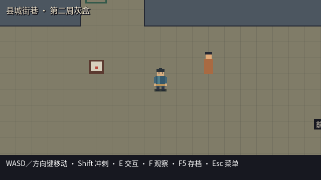
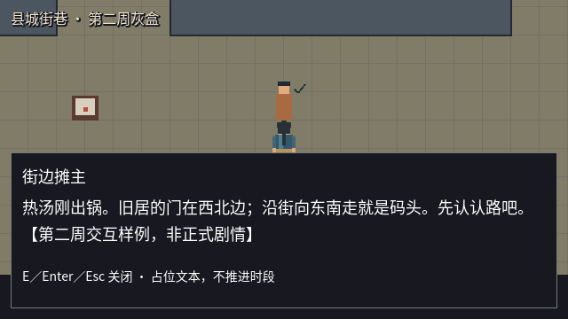
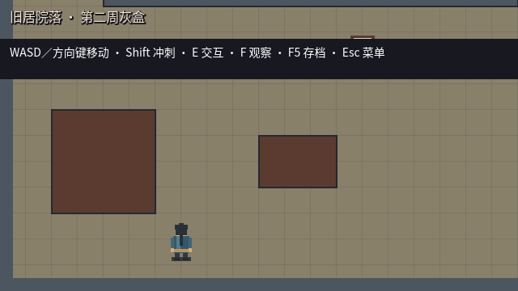

# 第二周评审与交接：灰盒探索

> 更新：2026-09-23。本文第 1～6 节保存反馈前 `0.2.0-week2` 的工程交付与证据；不能作为随后 `0.2.1-week2` 改动的复测结果。
>
> 最新人工反馈：haojie 已填写约 7 分钟 Mac 试玩，认可原版操作基线，提出速度与独立存档槽改进。用户明确将新玩家测试转为 P2 后续追踪，不再阻断本轮修改；暂不加精力消耗。新版改动、测试和人验状态以[反馈处理单](./docs/week2_feedback_followup.md)为准；两周逐项确认见[人工复核清单](./docs/week1_week2_human_review.md)。未填写部分不伪记通过。

## 1. 反馈前实际交付（0.2.0 基线）

- [Day 8～14 每日任务](./武侠RPG_第二周每日任务.md)：七个项目日、40 小时计划容量；每日工作、输出件和验收均已拆分。
- 可玩的县城街巷／祠堂入口、旧居院落、河岸码头三个灰盒区域。祠堂仅有外部入口占位，不新增第四张地图或正式剧情。
- 四向行走／冲刺、真实脚底碰撞、面向、暂停／失焦恢复；镜头随玩家并受区域边界约束。
- 两名 NPC、两份文书与四个双向出口。统一目标选择、E 阅读／切换、F 观察、已检查标记、清晰目的地。
- 稳定区域和出生点 ID；切换锁定与淡入淡出；错误资源／落点保留原场景；探索不推进剧情时段。
- 状态归入 GameSession，文案和布局走 ContentDB。F5 保存、读档、重启恢复和新路线重置均已接通。
- 保留键盘与手柄共用的 InputMap；实体手柄仍未验收。已认可的明亮县城概念图仅是内部参考，运行时仍是程序绘制灰盒。

没有提前实现战斗、名册推理、完整任务／关系系统或量产美术；这些继续按第三、四周及后续内容阶段推进。

## 2. 实现与证据对应

| 任务 | 主要实现／测试 | 当前结论 |
|---|---|---|
| W2-01 移动与碰撞 | `player_controller.gd`、`test_exploration_controller.gd` | 工程检查通过；开发者对速度／手感的接受待试玩 |
| W2-02 镜头与缩放 | `exploration_camera.gd`、控制器测试、`capture_week2.gd` | 边界与整数坐标检查通过；实际渲染比例通过；长时间主观抖动感留试玩 |
| W2-03 交互与观察 | `exploration_region.gd`、`main.gd`、流程测试 | 距离／朝向／遮挡／唯一目标、阅读锁定与关闭恢复通过；理解度留试玩 |
| W2-04 三块灰盒 | 三个 `.tscn`、`exploration.json`、内容可达性检查 | 三地图／两 NPC／文书／出口存在且连通；新玩家路线发现待验 |
| W2-05 出口与回退 | `main.gd`、ContentDB／GameSession、流程测试 | 双分支各五次事件触发往返、无时间消耗、唯一玩家、错误资源和出生点拒绝通过 |
| W2-06 状态与内容 | ContentDB／GameSession／SaveService、内容和重启测试 | 已检查标记、完整状态保存／载入及另一操作系统进程恢复通过 |
| W2-07 集成与候选 | 检查入口、图形检查、包资源审计、独立审阅 | 工程部分有证据；十分钟真实试玩、新玩家体验尚无记录 |

以上路径分别位于 `game/presentation/exploration/`、`game/presentation/`、`game/core/services/`、`game/content/data/`、`game/persistence/` 和 `game/tests/`。具体检查边界见[独立集成审阅](./docs/week2_independent_audit.md)。审阅者参与过控制器实现，其覆盖范围与独立性已在报告注明。

## 3. 验证记录

环境：macOS／Apple M4，Godot `4.7.2.stable.official.ed1daf0bf`，Compatibility／OpenGL。当前分支 `codex/week2-exploration`，HEAD 基线 `850595ea16a9414074464842253c4dd52cc82bda`，第二周代码为未提交工作区，不能把 HEAD 当作完整候选内容。

检查命令：

```bash
./tools/check_project.sh
python3 tools/run_checked.py week2_visual ./tools/godot.sh --path . --script res://game/tests/capture_week2.gd
./tools/build_windows_debug.sh
./tools/build_windows_release.sh
```

已取得的自动结果（日志在 `builds/qa/`）：

| 检查 | 结果与范围 |
|---|---|
| 状态服务 | 73 项通过 |
| 工程契约 | 61 项通过；包含保留的键盘／手柄动作映射 |
| 旧 UI 回归 | 15 项通过 |
| 探索控制器／镜头 | 78 项通过；真实物理碰撞与 Camera2D，注入输入／焦点 |
| 探索内容／状态 | 367 项通过；实际地图数据、事务校验、可达性和隔离存档；含祠堂入口标签 |
| 探索流程 | 主进程 388 项，独立重启进程 16 项通过 |
| 完整键盘通行 | 196 项通过；107 个路径点、实际移动 3174.4 像素，全程脚本注入 WASD／Shift／E／Esc，不赋值玩家位置／面向或直接调用切图 |
| 主场景冒烟 | 从标题进入小镇、移动、离线平台正常 |
| 图形渲染 | `WEEK2_VISUAL_PASS`，九张截图；不是玩家录像或 Windows 真机证据 |

图形检查实际设置并记录：1280×720 为 2×；1366×768 保持 2×并留边 `(43,24)`；1920×1080 全屏为 3×，恢复窗口后可移动。截图是 640×360 逻辑画面；尺寸和留边另外由实际窗口尺寸／显示变换记录证明，不把逻辑截图称作操作系统窗口截图。

以上有计数的检查合计 **1194 项通过**，另有主场景冒烟及图形渲染检查。流程测试的五次往返会先定位到接近点，然后实际派发按键；它证明交互、切换与状态循环，不单独证明玩家走完整条路线或新人可发现性。新增 `test_exploration_walk.gd` 已纳入统一检查入口：从正常出生点完整步行，依次完成街道交谈／告示、旧居家书、码头交谈并返回，验证四项检查标记、时间不变和单一玩家／区域；它补足程序导航证据，仍不冒充人工试玩。

2026-09-22 的实际渲染截图已原样归档在 `docs/week2_evidence/`（由 `docs/.gdignore` 和导出排除规则隔离，不接入运行时）。主代理目视核对以下三张；它们是程序灰盒，不是生成式概念美术：

| 街巷起点 | 阅读面板 | 院落下边缘 |
|---|---|---|
|  |  |  |

## 4. 反馈前候选包与启动（保留历史，不代表 0.2.1）

Mac 直接双击 [Run.command](./Run.command)，选“进入小镇”；详细按键和反馈表在[人工试玩记录](./docs/week2_playtest.md)。

Windows 构建版本为 `0.2.0-week2`，内容版本 `0.2.0`。输出目录包含 EXE、PCK、说明、许可、`build_info.json` 与 `SHA256SUMS.txt`。构建元数据记录 `dirty: true`、源文件指纹、基线提交和日期；未提交代码没有被错误描述为远端已存在。

最终交付候选均在本机 `builds/windows/` 下，未纳入 Git；旧候选保留，不与本表混用：

| 配置 | 本地目录 | 已执行验证 |
|---|---|---|
| Debug | `0.2.0-week2_850595e_debug_20260922T014302Z` | 构建前完整检查通过；导出／PE x86_64 通过；PCK 48 个资源审计通过；清单 7/7 文件 SHA-256 匹配；Mac Godot 载入导出 PCK、进入小镇并移动通过 |
| Release | `0.2.0-week2_850595e_release_20260922T014356Z` | 同上，使用 Release 导出模板；清单 7/7 文件匹配；Mac Godot 对该 PCK 的启动与移动通过 |

两包 `source_sha256` 均为 `25382749c2c20eb751378ab92c71dfbaf3e46605b12872846e55957e353e63af`。它覆盖 `project.godot`、`export_presets.cfg`、`game/` 与 `assets/runtime/` 的源文件，排除 `.import`／`.translation`／`.uid`；不是整个工作区或工具脚本的哈希。具体导出文件由各包校验清单另行标识。

`SHA256SUMS.txt` 自身 SHA-256：

- Debug：`9fb255a9aad518d89e83d02b25600b5ac6f1bb52f791303b004d53731da6f4c3`。
- Release：`0fb3f87327bdb7b2b7ac7b5eef36a7ab1006920b43febb63720b489ddfee7655`。

校验命令是在各候选目录执行 `shasum -a 256 -c SHA256SUMS.txt`；PCK 启动通过 `tools/run_checked.py` 调用同版本 Mac Godot 的 `--headless --path <候选目录> --main-pack ProjectWuming.pck -- --smoke-test`，记录于 `builds/qa/week2_debug_pack_start.log` 和 `week2_release_pack_start.log`。Mac 引擎运行 Release PCK 仅证明打包内容可加载，不证明 Windows Release 可执行文件、目标显卡或原生发布模板行为已实测。

Windows 真机仍待验；本次没有提交、推送、第二周远端 CI 或 Steam 发布，不使用第一周 CI 的结果代替当前版本。

## 5. 反馈前缺陷与未完成项（当前调整见文首）

已修复并有回归：控制器类型推断错误、测试 GameState 快照类型错误、旧无超时测试残留、边缘读档跳回出生点、底栏遮挡角色、错误切图资源破坏原场景、阅读底板透出地图文字。保存比较使用完整 JSON 语义，兼容合法整数在 JSON 解析后表现为浮点数，不删字段掩盖差异。

当前未发现阻断本周探索目标的 P0／P1。该结论来自现有自动和图形检查，不保证人工试玩不会发现新问题。

- **待验：** 开发者至少十分钟真实键盘试玩，以及未参与地图设计的新玩家独立发现两个出口和一次交互。记录表已准备，尚未收到结果。
- **保留第一周遗留：** Windows 真机、独立备份恢复、卖点理解测试；不改写为本周已完成，也不自动取消。
- **延期而非通过：** 实体手柄体验按已批准输入阶段安排。

人工结果若暴露 P0／P1，先修复并复测对应项目。没有结果前保持“工程完成／人工验收待补”，不宣告整周目标完成。

## 6. 时间与下一周入口

计划仍为 40 小时，不等同于 AI、机器或开发者已经各投入 40 小时。本轮从 `2026-09-16 14:02:41 UTC` 开始，工程交接证据记录于 `2026-09-22 01:44:23 UTC`（北京时间 09:44:23），墙钟跨度为 5 天 11 小时 41 分 42 秒。跨度包含多次等待／中断，不当作持续工作时间。各任务净工时与人的主动投入未单独计量；真实试玩暂无参与者结果，不补填估算值作为实测。工程交付时间不等于整周验收完成时间。

第三周入口：在复用当前角色／区域状态的前提下，建立小型方格战斗、行动顺序、基础攻击／技能／状态和胜负；本周不提前实现。人工验收问题优先于新增战斗功能。
