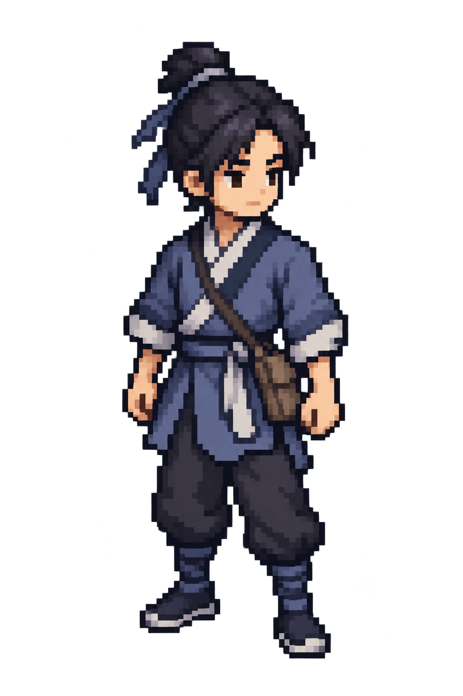

# 主角：重新使用 imagegen 的像素风候选

日期：2026-10-10。状态：内部外观候选；用户反馈长相和少年气质“更接近，进一步推进”，认可方向，不等于正式素材验收。后续见[简化与四向推进记录](./protagonist_imagegen_progress_20261010.md)；没有替换游戏角色或动画。

## 本轮决定与参考

用户认为代码绘制的像素角色仍不符合预期，要求参照《逸剑风云决》，直接让 imagegen 生成像素风人物。本轮停止继续修改代码小人，使用内置 imagegen 从文字生成新候选；没有把旧代码小人或任何第三方图片作为图像输入。

用户提供的[百度图片页面](https://baike.baidu.com/pic/%E9%80%B8%E5%89%91%E9%A3%8E%E4%BA%91%E5%86%B3/62648710/5549301411/32fa828ba61ea8d3fd1f9da52a53274e251f95caf242?fr=lemma&fromModule=lemma_content-image#aid=5549301411&pic=32fa828ba61ea8d3fd1f9da52a53274e251f95caf242)返回 403，未看到其中的指定图片，不能声称已准确匹配。另通过浏览器实际查看了《逸剑风云决》[Steam 官方页面](https://store.steampowered.com/app/1876890/Wandering_Sword/?l=schinese)的[钓鱼实机截图](https://shared.fastly.steamstatic.com/store_item_assets/steam/apps/1876890/ss_6da139b1ffa32da20d30f87dcd142a6c1b6ffe25.1920x1080.jpg?t=1774667199)，只参考紧凑头身、自然站姿和成组明暗的表达方法；没有下载、复制、取色、描摹或输入其游戏素材。角色身份与蓝灰交领、束发、文袋仍来自本项目设定。

前两次内置请求均因连接失败结束，没有产出。用户告知网络已恢复后，重新发起第三次内置请求并成功。没有使用 CLI、外部图片 API 或 API 密钥；具体底层生成模型版本未另核实。

## 原图与归档



- 原始生成位置：`/Users/witcher/.codex/generated_images/01a08145-47dc-7242-a49b-7d4016caecda/exec-3a08978f-1175-4f70-b739-30ee5e7efcd2.png`。
- 仓库原样副本：[protagonist_imagegen_candidate_20261010.png](./protagonist_imagegen_candidate_20261010.png)。两份 SHA-256 相同：`ef75fb5d4e42f7ab9639ee36ec7f25c33fd0862b08a0e35e74968875a053f2c5`。
- 只原样复制，没有程序修图、缩放、扣图、重绘像素或覆盖旧候选。
- 实际文件为 1024×1536 RGBA。读取原图得到 alpha 范围 0～254，完全透明像素 1,116,390，部分透明像素 456,474，alpha=255 像素为 0。虽然请求透明背景，结果仍有柔蓝光晕和非二值透明；不能登记为硬边透明的生产精灵。

## 实际目视评审

主代理与独立 `hero_simple_visual_review` 均实际看过生成原图；以下是 AI 评审判断，不代签用户美术认可。

- 改善：肤色与黑发分离清楚，下颌和头肩衔接自然；袖、手、腿脚不再像僵硬的对称方盒。束发、交领、蓝灰布衣和文袋保留，外边主要为深蓝黑。
- 仍需用户判断：较大的眼白／动漫眼是否合适；头发、布褶、飘带和绑腿细节是否过多。
- 生产边界：目前更像放大的像素人物插画，而非紧凑的地图小人。可用来评主角长相与气质，不能直接当作原生 32×48、统一逻辑网格、可播放的动画图集。若继续修订外观，应使用 imagegen 编辑新版本，不用程序改这张图。

运行时源与图集保持不变；本轮核对 SHA-256：

| 文件 | SHA-256 |
|---|---|
| `assets/source/characters/hero_pixel_source.gd` | `b9a67f25008e390b0fa281fa3566a2e29afb2010a185ac6e0b55001d29136a9b` |
| `assets/runtime/characters/chr_protagonist_atlas.png` | `e13be6ae0ed90c069bcd195d396b3557b13ac8cfbea97fb95c9dd05f632c0358` |
| `assets/runtime/characters/chr_protagonist_atlas.json` | `d600fddcbe1def27e727ef0ebaa41e39535018e0f4ac281a1a73a3dbf55d8146` |

## 成功调用的完整实际提示词

工具：内置 `image_gen.imagegen`；`transparent_background: true`。本次是新图，未传 `referenced_image_paths` 或 `num_last_images_to_include`。前两次失败请求与成功请求使用相同提示词。

```text
Use case: stylized-concept
Asset type: original wuxia RPG protagonist pixel-art appearance candidate, not a production animation atlas.
Primary request: Generate a beautiful, cohesive ORIGINAL young male wuxia hero as an enlarged low-resolution in-game pixel sprite. Reference direction: the compact, expressive map-character pixel language of Wandering Sword / 逸剑风云决, not its painted UI portraits. Do not copy a named character or costume from that game.
Subject: a young novice from a humble clerk's household, lean and youthful but not a baby-faced mascot. Black hair in a modest tied topknot with a simple fringe; warm clear face with small readable dark eyes and a calm, alert expression. Short natural neck, shoulders close to the jawline. Muted indigo / blue-gray short cross-collar cloth tunic, off-white collar and cuffs, simple waist sash, loose dark trousers and cloth boots, one small plain document satchel at his anatomical left hip.
Style/medium: authentic-looking low-resolution pixel SPRITE design, roughly 3 to 3.5 heads tall, clearly visible square pixels and stepped hard edges, coherent coarse pixel scale. Design first for a small on-screen character, not a detailed pixel-painted illustration. Use simple strong shapes and a few well-placed clusters of light and shadow; 2 or 3 discrete tones per main material, no decorative speckling. Clean cool charcoal/navy silhouette edges; NO brown contour around the face or body.
Composition/framing: one character only, full body including topknot and both feet, centered with comfortable transparent margins. Relaxed standing idle pose with a subtle weight shift, arms resting naturally, a gentle front-three-quarter view under a slightly elevated RPG map camera. Recognizable shoulders, waist and soft tunic hem, not a rectangular torso or ruler-straight legs.
Scene/backdrop: genuine transparent background. No environment, floor, ground shadow, checkerboard drawing, color swatches or comparison panels.
Constraints: preserve the humble wuxia youth identity, blue-gray cross-collar clothing, short neck and document satchel. Favor an attractive restrained silhouette over extra detail. Do not add weapons, armor, capes, jewelry, elaborate embroidery or other characters. No text, logos or watermark.
Avoid: smooth anime illustration, high-resolution facial rendering, huge shiny eyes, sunglasses-like eye bars, long thin neck, rigid geometric doll, realistic fabric texture, tiny isolated highlight dots, gradients, anti-aliasing, bloom, glow, blur, soft transparent halos.
Output intent: a visually polished pixel-style candidate for the developer to judge. Do not impose an exact 32x48 output grid or turn it into a technical diagram.
```
