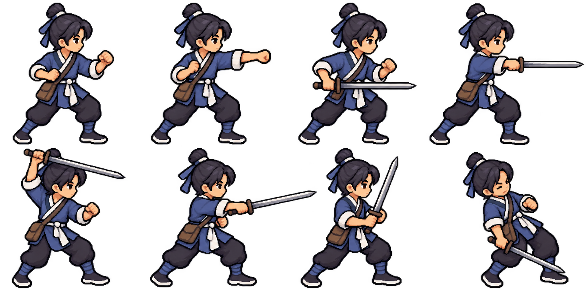
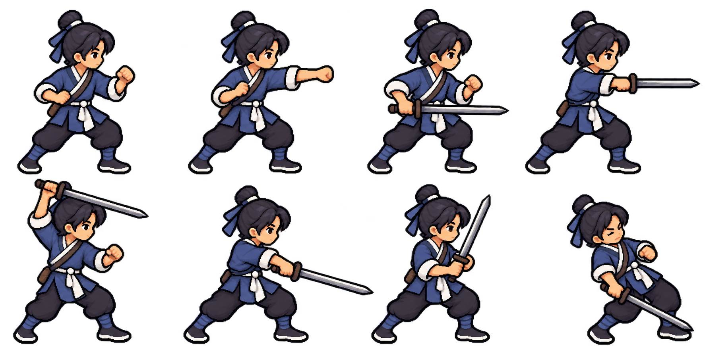

# imagegen 主角朝右基础战斗八姿态候选

2026-10-11。延续用户“继续，不需要调整；完成第五周任务”，保持已认可的主角外观方向，补基础动作候选。这里只完成一次内置生成和原样归档，**不是第五周已完成、不是正式角色接入，也不是八姿态全部通过**。

已完整阅读 imagegen 技能及 prompting／sample-prompts，生成前实际查看两个输入；生成后再次以原始分辨率查看仓库副本。本轮只调用一次内置 `image_gen.imagegen`，`transparent_background: true`。没有CLI、外部API、密钥调用、程序人物图加工或手绘补像素；具体底层模型版本未另核实。

## 原样候选与逐格事实



图片视觉排列为4列2行，各格按从左到右、从上到下编号0～7。它是1774×887大图，不是原生32×48／48×72精灵；严格四列等分边界为x=443.5、887、1330.5，两行等分为y=443.5，并非可直接按统一整数小画布切成生产帧。

| 格 | 请求动作 | 实际目视事实 |
|---|---|---|
| 0 | 短拳蓄力 | 无剑，一只拳在腰／肋旁后收，另一臂前屈守势；不是原静态待机。拳的连续解剖归属仍需和格1一起复核。 |
| 1 | 短拳命中 | 无剑，拳明显向画面右方伸出，和格0有可辨的收／伸变化。离散两姿态不证明连续出拳自然。 |
| 2 | 直刺蓄势 | 素直剑在腰侧后收，刃横向朝右；蓄势和伸出姿态可区分。手臂／持剑侧别不能沿用提示词当作通过证据。 |
| 3 | 直刺刺出 | 手与剑向右水平伸出，直刺动作可读；剑尖抵达全图最右边，没有兑现充足边距，不能安全视为合格单格帧。 |
| 4 | 横斩蓄势 | 持剑手举到头上／身后侧，形成明显高举蓄势；剑身仍从上方向前右伸，不能仅凭这张图证明完整横斩轨迹。 |
| 5 | 横斩落势 | 剑向右前方伸出，但静态造型近似略向上抬的直刺，尚不足可靠区分横斩；剑尖明显越过本格右边界x=887进入第三列，是明确跨格缺陷。 |
| 6 | 护剑 | 剑在胸前上斜／竖起，肘部收拢，防御姿态和直刺可区分；不据此判定实际战斗遮挡或时序。 |
| 7 | 受击 | 上身后仰／后缩，膝部弯曲，眼睛收闭；剑放低，不像向前攻击。与待机／护剑有区别，但仅为单张受击候选。 |

八格均朝画面右方，没有添加文字、编号、棋盘、场景或攻击特效。黑发发髻、少年脸、蓝衣交领、白领袖与文袋等识别点基本保留；这是目视一致性判断，不是非目标像素精确保持或用户审美代签。鞋底大致位于各行下沿，但本轮未做实际世界移动、锚点测量或动画播放，不宣称脚底稳定和完整动作循环通过。

## 生成完成后的侧别纠正

本次实际提示词沿用了此前记录的错误约定：“朝右时解剖左髋在近侧、右手在远侧”。主代理／独立审查的紧急纠正在本次工具结果返回后到达，调用已经结束；本轮没有重启、追加调用或隐藏旧结果。

正确约定以四向参考的正面袋在画面右、背面袋在画面左为权威：两者均为角色解剖左髋。转为面朝画面右时，角色左侧在**远侧**，文袋应主要被身体遮挡，右手在近侧持剑；面朝画面左则左侧近侧、文袋可见。

本张八姿态仍反复显示较完整的前景文袋，没有修正上述侧别。提示词要求的“右手远侧”本身也是错误的，不能把按错误提示生成或图中有剑当作手侧一致通过。本页完整保留实际提示原文，不事后将它改写成正确提示。此项与跨格／剑尖边距问题一起使本张sheet**不能进入正式资源**；后续任何定向修订另行记录。

## 输入、原始路径与哈希

输入顺序及角色均在调用前实际查看：

| 输入 | 角色 | SHA-256 |
|---|---|---|
| [四向v2](./protagonist_imagegen_turnaround_20261010_v2.png) | 主角设计／朝向与服装身份参考，不复制其布局 | `3ada25005b38414efb54531491c092ca26de69e233d8579e48c4b0c9c5c3df7c` |
| [朝右pose0 restored](./protagonist_imagegen_walk_right_pose0_restored_20261010.png) | 已认可朝右身份、比例和像素风渲染参考 | `48da9de48f6d13c1c58209f75dccc70ee462cc9d81f0429148d901b718e81ad9` |

原始生成文件：

`/Users/witcher/.codex/generated_images/01a12b2c-d293-7ff2-bcab-2143a391a4b5/exec-a7e20fc4-5916-4312-839e-c4289ba5e71f.png`

[仓库原样副本](./protagonist_imagegen_combat_right_sheet_20261011.png)：1774×887 RGBA，1,232,929字节，SHA-256：

`26c0cb3bd57cb76beedd0a51559cc9806bbe67ee332d3c94058484dd3dcef616`

原始文件与仓库副本哈希相同，输入哈希亦未变。只进行了文件复制，没有裁切、缩放保存、抠图、阈值透明化、量化色板、重绘或覆盖旧候选。

## 透明度只读统计

本机默认Python没有Pillow，未安装任何包；随后使用桌面提供的捆绑Python／Pillow只读打开并完整加载PNG，读取alpha直方图，无解码错误、无图像写回。

| alpha范围 | alpha=0 | alpha=1～254 | alpha=255 |
|---|---:|---:|---:|
| 0～255 | 981,034 | 590,575 | 1,929 |

alpha>0的全图包围盒为(31,0,1774,875)。包围盒本身不是人物／剑的语义分割，不能用它单独断言头顶被裁切；剑尖抵达最右边的结论来自实际看图。图像大量像素仍为部分透明，没有满足现有二值透明／有限色板生产规则。不能仅凭少量255或透明背景参数宣称透明边缘已通过，也不能单凭alpha=254近乎不透明的像素数量声称角色整体明显透光。

## 完整实际提示词

以下与实际内置调用逐字一致，包括已经发现的错误侧别文字。调用只传上述两个 `referenced_image_paths`，没有 `num_last_images_to_include`。

```text
Use case: identity-preserve
Asset type: transparent pixel-style wuxia RPG basic-combat pose sheet candidate, not a finished animation atlas.
Input images: Image 1 is the same protagonist's four-direction CHARACTER DESIGN reference; use its right-facing figure, face, costume and anatomical satchel side. Image 2 is the approved right-facing CHARACTER IDENTITY / proportions / coarse-pixel-rendering reference. Neither input is a layout to copy. Preserve this same young man; change only his combat pose and the requested plain sword prop, not his appearance.
Primary request: Generate ONE new complete sheet containing EXACTLY eight distinct full-body RIGHT-FACING basic-combat poses arranged in FOUR equal-width columns and TWO equal-height rows. All eight face screen RIGHT. Each pose occupies one equal cell, in the exact order specified below, read left-to-right across the top row, then left-to-right across the bottom row. Do not replace any requested action with a static idle pose.
TOP ROW:
Cell 0: SHORT PUNCH PREPARATION. Unarmed, no sword. Right fist is pulled back close to the waist/ribs with the elbow bent, left arm guarding, knees slightly bent.
Cell 1: SHORT PUNCH CONTACT. Unarmed, no sword. The same right fist has clearly extended forward toward screen right at chest height; shoulder and torso follow a compact punch. This is visibly different from Cell 0, not another fists-at-waist stance.
Cell 2: STRAIGHT THRUST PREPARATION. A plain straight iron jian sword is gripped in the RIGHT HAND, drawn back beside the body at the hip/ribs, elbow bent, blade aligned for a horizontal thrust to the right.
Cell 3: STRAIGHT THRUST CONTACT. The same right hand extends the plain straight sword horizontally toward screen right; the blade and pointed tip form a clear straight thrust, not a raised or vertical guard.
BOTTOM ROW:
Cell 4: HORIZONTAL SLASH PREPARATION. Same right-hand sword, right elbow bent; sword raised and drawn back above/behind the shoulder in a clear wind-up before a slash.
Cell 5: HORIZONTAL SLASH FOLLOW-THROUGH. Same right hand has swung the sword out into the forward-right space, arm extended across the front, torso following the horizontal cut. Show the physical blade clearly; no motion trail or slash effects. This must not duplicate the thrust pose.
Cell 6: SWORD GUARD. Same right hand holds the sword defensively in FRONT of the torso, blade upright or diagonal across the forward chest area, elbow bent; a stable compact defensive stance, not an extended attack.
Cell 7: HIT RECOIL. The torso visibly leans/back-shrinks toward screen left, knees buckle and shoulders recoil from a hit, while still facing right. The right-hand sword is lowered/retracted beside the body and is NOT thrust or slashed forward. This is a visible hurt reaction, not idle or guard.
Character invariants: exactly the same bright youthful face, restrained eyes, black fringe and tied topknot, short neck, head/body ratio, blue-gray cross-collar cloth tunic, off-white collar and cuffs, waist sash, loose dark trousers and cloth boots as the inputs. Do not enlarge the head, change the hairstyle, simplify into a different doll, add armor, emblems, scars or new accessories.
Anatomy / equipment: use only ONE plain straight iron jian with a modest simple crossguard in each sword pose, no ornate or glowing weapon. It is always gripped by the protagonist's anatomical RIGHT HAND, the far-side arm in this right-facing view; do not swap it to the near-left hand. The single plain brown document satchel remains fixed at the anatomical LEFT HIP, the visible NEAR side in a right-facing view as in Image 2; it can be naturally partly occluded by the sleeve or forearm, but do not move it to the opposite hip or mirror the character.
Composition / framing: one wide 2:1 sheet with four columns and two rows of equal square cells. Keep one common character scale and one common shoe-sole ground baseline within each row, approximately 90% of the cell height. Keep the body slightly left of each cell center so forward fists and long sword tips have ample space. Every topknot, hand, boot and complete sword tip must stay INSIDE its own cell with generous empty padding; no sword or body may cross a cell boundary or touch a neighboring pose. No drawn cell borders or guides.
Style / background: match the inputs' grouped coarse stepped pixel-style rendering and costume colors, with a crisp hard silhouette. Genuinely transparent empty background, fully solid character and sword interiors where possible, no diffuse blue or brown halo, no glow, no ground, no shadow, no scenery, no checkerboard drawing.
Avoid: text, labels, numbering, watermark, UI, grid lines, motion trails, particles, blood, magic effects, extra figures, eight copies of one pose, wrong facing, missing/cropped limbs or clipped sword tips.
Output: ONE transparent-background eight-pose sheet only. This is a new pose-study candidate; preserve the approved appearance rather than redesigning the hero.
```

## 交付边界

本轮只新增这张原样候选与此记录，不修改validator、AI登记、旧正式源／PNG／JSON、运行时代码、碰撞、移动数值、战斗规则、候选包或存档。不静态待机冒充动作，不给旧角色套武器。

用户尚未批准32×48／48×72等生产尺寸、有限色板／硬透明或原图显示合同；本页不代替这些选择。侧别、单格留白、横斩辨识、持剑手连续性与实际动画仍待后续处理／复核。没有提交、推送、重新打包、商店发布或代签Windows／实体手柄／第四周体验；不宣称整套第五周完成。

## 2026-10-11：一次定向修订 v2

本批按授权只进行**一次**内置imagegen定向编辑，不继续迭代；本记录累计为首轮生成一次＋本次修订一次。调用前重新实际查看首轮sheet和四向v2，调用后实际查看新生成图与仓库原样副本。旧首轮PNG和原有完整提示词不覆盖。



### 实际修改与仍未通过之处

- 原先各格大面积近景文袋缩为后髋／身体边的小棕色部分，明显减弱了错误近侧大袋；这是可见遮挡改善。单张朝右图不能证明所有动作解剖侧别、跨朝向转换与固定袋形已通过，仍须和正／背／朝左动作共同复核。
- 剑姿态中可见手握柄的近侧连线较清楚，但不是逐关节／逐帧连续性的完整验收；不能单凭提示词写了“RIGHT”判持剑手全部一致。
- 格0～7的动作角色与顺序仍保留：拳收／伸、直刺收／伸、高举蓄斩、斩后末势、胸前守势、后仰受击，不是八张待机。主角脸、发髻、蓝衣白袖和头身识别点基本保持；非目标区域亦有生成重渲染，不声称原像素精确不变。
- 格5的剑身改为向右下的斩后末势，较首轮抬角直刺更能与格3水平直刺区分；这是静态动作辨识改善，不是完整横斩轨迹或连续动画通过。
- **格5剑尖仍越过第二列右边界x=887进入第三列**，单格独立复用仍失败。若只扩大region去包住剑尖，会把相邻格6下方人物／鞋等内容一并带入，不能用这种方式掩盖跨格。
- 格3剑尖虽然不再明显顶住全图最右边，但右侧留白仍很窄。整组人物没有充分兑现约20～25%的统一缩小和充足边距；不将“稍有改善”写成单格留白通过。
- 两行鞋底仍有可见的局部上下差异，本次没有测量共同锚点、在世界中移动或播放完整动作。落地稳定与真实战斗遮挡未验。
- 透明边缘仍有部分透明像素／杂色，不符合现有硬透明生产合同。

结论：v2具有实际局部改进，但**仍不合格为八格可独立复用的正式动作sheet，不接入运行时**。本批止于这一次修订，无论成败均原样归档；不再调用、不程序裁切／改像素、不用旧人物套武器、不借候选进展宣称第五周完成。

### v2输入与原样输出

| 输入顺序／角色 | SHA-256 |
|---|---|
| [首轮八姿态sheet](./protagonist_imagegen_combat_right_sheet_20261011.png)，编辑目标 | `26c0cb3bd57cb76beedd0a51559cc9806bbe67ee332d3c94058484dd3dcef616` |
| [四向v2](./protagonist_imagegen_turnaround_20261010_v2.png)，仅脸／比例／服装风格参考，以正／背两向确认左髋，不照搬错误朝右袋遮挡 | `3ada25005b38414efb54531491c092ca26de69e233d8579e48c4b0c9c5c3df7c` |

本次原始文件：

`/Users/witcher/.codex/generated_images/01a12b2c-d293-7ff2-bcab-2143a391a4b5/exec-e30ebf2f-2d90-4967-bf9b-f7e8d925441d.png`

[仓库原样v2副本](./protagonist_imagegen_combat_right_sheet_20261011_v2.png)：1774×887 RGBA，1,198,923字节，SHA-256：

`e98e0c870eb1c01542121f82fa9fb2527318bf145c3b64efe046bb121ff50175`

原始图和副本摘要相同，两个输入摘要未变。只进行了文件复制，没有任何PNG写回、透明阈值化、抠图、量化、缩小保存或手绘修改。调用为内置 `image_gen.imagegen`，`transparent_background:true`，仅上述两个 `referenced_image_paths`，没有 `num_last_images_to_include`、CLI、外部API或密钥调用。

### v2透明度只读统计

捆绑Pillow只读完整加载PNG并读取alpha，无解码错误，不写回图像：

| alpha范围 | alpha=0 | alpha=1～254 | alpha=255 |
|---|---:|---:|---:|
| 0～255 | 1,008,330 | 563,276 | 1,932 |

alpha>0全图包围盒为(0,9,1773,887)。它包括细小透明杂色，不是语义轮廓；不能把碰到画布边界的包围盒单独解释成某只鞋／剑被裁切，也不据alpha数量推断动态自然度或用户认可。

### v2完整实际提示词

```text
Use case: precise-object-edit
Asset type: corrected transparent pixel-style wuxia RPG eight-combat-pose sheet candidate.
Input images: Image 1 is the EDIT TARGET: the existing 4-column, 2-row right-facing eight-pose sheet. Image 2 is ONLY the approved face, hairstyle, body proportions, costume and coarse-pixel STYLE reference. Do not copy Image 2's pose or layout. Its front and back views identify the single satchel as anatomical LEFT hip; do NOT copy its incorrectly visible pouch in the right-facing profile.
Primary request: Correct ONLY the anatomical satchel/weapon side, cell containment/padding and Cell 5 slash follow-through described below. Preserve the same eight action roles, the same cell order and the same recognizable protagonist. This is a targeted correction, not a new hero or a different sheet design.
Critical anatomy correction for EVERY right-facing pose: The protagonist's anatomical LEFT hip is on the FAR side, away from the viewer, when he faces screen RIGHT. The brown document pouch therefore stays behind the body and must be mostly occluded by the torso/hip. REMOVE the large fully visible NEAR-side brown pouch from all eight poses; do not mirror or move it to the anatomical right hip. Keep the diagonal shoulder strap consistent with a left-hip pouch, but at most a small far-side brown edge may peek from behind the back hip. The anatomical RIGHT arm/hand is the NEAR-side arm in this right-facing view. The plain iron straight sword must be held in that same RIGHT hand for all sword poses, with an anatomically continuous visible near shoulder, elbow, forearm and grip. Do not swap hands between cells.
Keep the exact action order, left to right:
Top row / Cells 0-3: 0 unarmed short-punch preparation, right fist pulled back at waist/ribs and left guard; 1 unarmed short-punch contact, right fist extended toward screen right at chest height; 2 straight-sword thrust preparation, right-hand sword drawn back beside ribs/hip; 3 straight-sword thrust contact, right arm and blade thrust horizontally to screen right.
Bottom row / Cells 4-7: 4 raised/back sword wind-up for a horizontal slash; 5 a clearly DIFFERENT horizontal-slash END pose, not an upward-diagonal straight thrust; 6 compact defensive sword guard in front of the chest; 7 visible hit recoil, torso leaning/back-shrinking to screen left, knees bent and sword lowered/retracted, not attacking.
Cell 5 correction specifically: show the right shoulder/torso rotated through the cut and the right elbow slightly bent in the completed swing; the sword has swept across the forward body and now finishes lower across the right-front space, with the blade angled slightly down after the cut. Do NOT use the same straight reaching arm and raised sword line as the thrust contact in Cell 3. No swing trail or slash effects.
Framing correction: retain FOUR equal virtual columns and TWO equal virtual rows, with no drawn borders. Each of the eight poses must be entirely inside its own cell, including topknot, both hands, both boots and the COMPLETE sword tip. Uniformly scale down the ENTIRE set of figures and weapons by about 20-25% if needed for containment, without changing any head-to-body or limb proportions; do not shorten just the sword or shrink only one pose. Give every cell generous transparent padding, especially on the right of forward blades. Place each body slightly left of its cell center, and retain one shoe-sole ground baseline per row. In particular Cell 3's sword tip must no longer touch the canvas right edge, and Cell 5's sword must not cross into Cell 6.
Invariants: same bright youthful facial identity and restrained eyes, black fringe/topknot and blue tie, short neck and existing head/body scale ratio, blue-gray cross-collar tunic, off-white collar/cuffs, sash, loose dark trousers, cloth boots, grouped stepped coarse pixel rendering and costume colors. Keep Cell 7's hurt reaction expression. Do not redesign, beautify, age, enlarge the head, add armor, emblems, scars, accessories or change the eight actions into idle copies.
Weapon: only one conventional plain iron straight jian per sword pose, modest simple crossguard, no ornate blade, glow or extra sword. Cells 0 and 1 remain unarmed.
Background: preserve genuinely transparent empty background and crisp hard stepped edges, solid character interiors where possible. No halo, glow, shadow, ground, scenery, checkerboard drawing, labels, numbers, text, watermark, UI, grids, motion trails, particles, blood or magic.
Output: ONE corrected eight-pose transparent sheet, same 4x2 arrangement and order, preserved approved appearance, corrected far-side satchel/near-right-hand sword and safe cell margins.
```

本次只新增v2原样PNG并追加本页；validator、正式资源、主评审／试玩记录与运行时代码均不由本次修改。没有提交、打包、推送、发布或代签体验／硬件。原先技术规格与完整动作接入缺口仍在。

