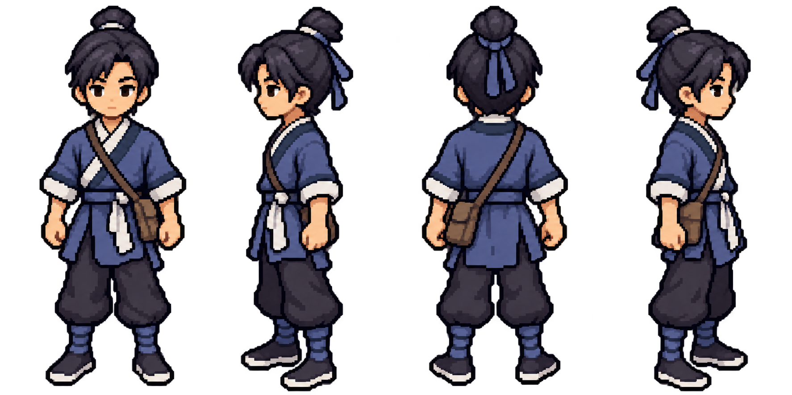

# 主角 imagegen 推进：简化与四向静态参考

日期：2026-10-10。用户反馈：“更接近，进一步推进”。这是对[首张候选](./protagonist_imagegen_candidate_20261010.md)长相和少年气质的方向认可，不代填本轮四向或正式素材验收。

本轮继续使用内置 imagegen，保留同一主角身份，做一次细节收敛、一次四向静态扩展和一次四向眼白修订。没有用代码重新画像素、程序改图或覆盖运行时角色；没有 CLI／外部 API／密钥调用。底层模型版本未另核实。

## 当前候选



从左到右：正面、朝画面左、背面、朝画面右。此图供外观评审，不是动画图集。

主代理与独立 `hero_simple_visual_review` 均实际查看了单张和四向结果：

- 单张 v2 保住发髻、刘海、脸型和少年气质，袖、裤、文袋的碎色有所减少；眼白变化很小，柔光未消除。
- 四向首版朝向明确、全身可见、基线相近，衣色和头身比例基本一致。文袋仍在角色解剖左侧：正面画面右、背面画面左；朝画面左时远侧袋大部分被遮挡，朝画面右时近侧袋可见。不是整人镜像。
- 四向 v2 的正面和朝左侧面眼白明显缩小、眼神更克制，朝右侧面的白块仍比较突出；不声称已完全消除动漫化眼睛。身份、衣色、朝向和文袋侧别保持，但非眼区有生成重渲染差异，不声称像素精确不变。
- 四向的大片光晕明显减弱，但边缘仍有部分透明／细小杂色；原生像素网格、二值透明、有限色板和动画稳定性均未验收。不把目视方向通过当成用户认可或生产通过。

## 原样归档与像素读取

原始生成目录均为 `/Users/witcher/.codex/generated_images/01a08145-47dc-7242-a49b-7d4016caecda/`。下表副本与对应原图 SHA-256 相同；只复制，没有修改位图。

| 阶段／仓库副本 | 原始文件 | SHA-256 |
|---|---|---|
| [单张细节收敛 v2](./protagonist_imagegen_candidate_20261010_v2.png) | `exec-adcfb69e-089d-449b-9cce-6d402863ac4e.png` | `60d8cf52ed78a1480874717d9f5d3b092d0b1a4b5908d8ebf8c8eabb5f73b900` |
| [四向首版](./protagonist_imagegen_turnaround_20261010.png) | `exec-ae7d7a52-960b-4706-9f6f-0e00973bfc74.png` | `ec7221f1b1fb3ee8b1c0c64d5ab29f70888136c6c49a4873b3f239d649adfe9c` |
| [四向眼白收敛 v2](./protagonist_imagegen_turnaround_20261010_v2.png) | `exec-b8b12832-5dc3-473b-8a29-96499a16060f.png` | `3ada25005b38414efb54531491c092ca26de69e233d8579e48c4b0c9c5c3df7c` |

读取原文件 alpha 的结果（不是图像处理）：

| 阶段 | 尺寸／模式 | alpha 范围 | alpha=0 | alpha=1～254 | alpha=255 |
|---|---|---|---:|---:|---:|
| 单张 v2 | 1024×1536 RGBA | 0～254 | 1,121,023 | 451,841 | 0 |
| 四向首版 | 1774×887 RGBA | 0～255 | 866,990 | 705,345 | 1,203 |
| 四向 v2 | 1774×887 RGBA | 0～255 | 883,683 | 687,976 | 1,879 |

## 接入边界与下一道验证

当前真实合同不是可任意改动的参考数字：运行图集 256×384、8列57槽、单帧32×48、锚点(16,44)，`hero_visual.gd`同时硬编码32×48。探索碰撞20×12、战斗格32、逻辑视口640×360和相机zoom=1。图集导出器从既有代码源重建，现有测试还要求与源逐帧相同、二值透明和11色色板。只覆盖PNG会造成源／导出器／测试不一致。

下一步先验证真实显示尺寸，不能拿高清四向图代替32×48的阅读效果；如需要改变角色生产规格，须与用户明确讨论。显示缩放仅用于尺寸对照，不会把生成图缩小另存为生产精灵。外观与真实尺寸确认后，最小动画试验是四向各4帧行走（8FPS）及一组侧向3帧直刺，再验证脸／服装不闪变、脚底稳定与文袋左侧关系，不直接扩满57槽。

当前未导入生成图、未改游戏尺寸／碰撞／地图／动画合同、未宣称生产素材或整套角色完成。

目标续行的后续动作验证见[行走试验与真实失败记录](./protagonist_imagegen_walk_trial_20261010.md)。48×72仅作为推荐档的隔离显示试验，尚未批准正式尺寸；完整行走循环未通过，不把外观方向认可扩大为动画验收。

## 已完成的真实显示尺寸试验

独立工具：[preview_hero_imagegen_size_20261010.gd](../../tools/preview_hero_imagegen_size_20261010.gd)。它只读取四向v2原图，按完整四个纵向分区调用纹理显示，保留透明留白、等比放入三档框，采用最近邻过滤；没有创建裁切／缩小后的角色资源，不重写原图或运行时文件。

两份实际 Godot 渲染证据：[亮底640×360](./hero_imagegen_size_20261010/size_light_640x360.png)、[暗底640×360](./hero_imagegen_size_20261010/size_dark_640x360.png)。它们是独立显示卡，不是探索／战斗实景，也不是 imagegen 新产出的图。

主代理独立重跑：Apple M4 Compatibility 实际捕获25项0失败，headless只读检查15项0失败。检查覆盖输入文件存在／读取、640×360逻辑视口、四个分区边界、按键切背景、截图真实像素及尺寸、亮暗截图不同、原图与现有角色源／PNG／JSON哈希不变；不覆盖美术认可、原生像素网格、动画、地图遮挡或战斗体量。

主代理和独立视觉评审实际查看两张1×截图，当前判断：32×48框内朝向仍能分辨，但脸和衣物压成碎色，难保留用户认可的长相；48×72更容易读清脸向、交领和文袋，是较均衡的试验候选；64×96细节最清楚，但孤立显示不能证明其适合地图和战斗。已向用户询问下一步静态／行走试验的规格，推荐先试48×72；尚未收到选择，没有更改生产规格。

交互预览（1／2切亮暗底，Esc退出）：

```bash
./tools/godot.sh --path . --rendering-method gl_compatibility --resolution 1280x720 --script res://tools/preview_hero_imagegen_size_20261010.gd
```

重复捕获／只读检查：

```bash
./tools/godot.sh --path . --rendering-method gl_compatibility --resolution 1280x720 --script res://tools/preview_hero_imagegen_size_20261010.gd -- --capture
./tools/godot.sh --headless --path . --script res://tools/preview_hero_imagegen_size_20261010.gd -- --verify-only
```

`--headless … -- --capture`会明确退出2且不保存假图。只有真实渲染的capture模式会写上述两张证据截图；所有模式均不改角色原图和生产资源。

## 完整实际提示词与输入

三次均为内置 `image_gen.imagegen`，`transparent_background: true`，每次只传下述一个本项目图像的 `referenced_image_paths`，未传 `num_last_images_to_include`。没有第三方图像输入。

### 1. 单张细节收敛

编辑目标：`docs/art_reference/protagonist_imagegen_candidate_20261010.png`。

```text
Use case: identity-preserve
Asset type: refined pixel-style wuxia RPG protagonist appearance candidate, not an animation atlas.
Input images: Image 1 is the edit target and the approved identity anchor. Preserve this exact young protagonist; do not invent a different hero.
Primary request: Make one restrained simplification pass so this same attractive young man reads more clearly as a compact RPG map character rather than a detailed pixel-painted illustration.
Change only the visual complexity: make the eye whites much smaller and use restrained small dark eyes while preserving his alert calm expression and face shape. Keep skin bright and readable; do not turn the eyes into a continuous black bar or make him baby-faced. Simplify the clothing folds, hair highlight speckles and boot wrapping into a few contiguous, well-designed pixel clusters with two or three discrete tones per main material. Shorten the trailing hair ribbon to a simple tie. Keep the natural shoulders, waist, soft tunic hem and relaxed asymmetrical stance.
Invariants: same recognizable facial identity, black fringe and tied topknot, short neck, youthful body proportions, original front-three-quarter camera and pose, indigo / blue-gray cross-collar cloth tunic, off-white collar and cuffs, waist sash, loose dark trousers, cloth boots, and the single plain document satchel at his anatomical left hip. Keep his humble novice appearance. Do not change costume design, add equipment, enlarge the head, or regress into a rigid rectangular doll.
Style/medium: visible coherent square pixels, stepped hard silhouette, crisp grouped shadows; attractive readable low-resolution sprite appearance. Keep the character as one full-body figure centered with both feet and topknot inside the frame.
Scene/backdrop: actual transparent background. Remove the existing soft blue aura and every glow around the silhouette; no environment, floor, ground shadow, matte or checkerboard drawing.
Avoid: large shiny anime eyes, brown outline, tiny decorative noise, smooth gradients, anti-aliasing, soft halos, realistic fabric texture, blur, weapons, armor, added people, text, logos and watermark.
Output intent: a faithful refined candidate for judging his face, silhouette and simple pixel language. Do not impose an exact 32x48 production grid or add comparison panels.
```

### 2. 四向静态扩展

身份参考：`docs/art_reference/protagonist_imagegen_candidate_20261010_v2.png`。

```text
Use case: identity-preserve
Asset type: four-direction static turnaround reference sheet for an original pixel-style wuxia RPG protagonist, not a production animation atlas.
Input images: Image 1 is the sole identity and costume anchor. Continue this exact young man, not four different people.
Primary request: Show exactly four full-body idle views in one landscape sheet, left to right: directly front-facing toward the viewer, profile facing image-left, back-facing away from the viewer, and profile facing image-right. Make the profiles genuinely side-on and the rear genuinely rear-facing. Each view uses the same scale, head-to-body proportions, standing baseline and restrained slightly elevated RPG map camera.
Preserve: the recognizable youthful face and alert calm expression, black fringe and tied topknot, short natural neck, blue-gray cross-collar cloth tunic, off-white collar and cuffs, waist sash, loose dark trousers and cloth boots. Maintain the reference's attractive simple grouped pixel shading. Do not add more fabric detail or realistic texture.
Critical asymmetry: only one document satchel, always on the character's anatomical LEFT hip, with a strap from the right shoulder. In the front view the bag is on image-right; in the back view it is on image-left. In the profile facing image-left, the bag is on the far hip and should be mostly occluded; in the profile facing image-right it is on the near hip and visible. Do not produce the second side view by simply mirroring the entire character.
Composition: exactly four separate standing figures, equally spaced, heads and both feet fully visible with transparent margins. Relaxed natural idle arms, same outfit and body mass throughout. No labels, frame borders, headings, inset faces, duplicate front-three-quarter views or extra figures.
Scene/backdrop: genuinely transparent background, clean hard pixel silhouette; no glow or blue aura, no floor or shadows, no color matte, no checkerboard drawing.
Avoid: different faces across views, changed clothes or colors, huge shiny eyes, smooth illustration, anti-aliasing, soft halos, added weapons, armor, people, text, logos and watermark.
Output intent: a consistent four-direction appearance reference for visual review before production sprites and animation. Do not impose an exact 32x48 pixel grid.
```

### 3. 四向眼白修订

编辑目标：`docs/art_reference/protagonist_imagegen_turnaround_20261010.png`。

```text
Use case: precise-object-edit
Asset type: eye-only refinement of the existing four-direction pixel-style character reference sheet.
Input images: Image 1 is the exact edit target. Keep this entire four-view sheet unchanged except for the small eye regions in the three faces that are visible.
Primary request: Reduce the bright white sclera areas of every visible eye by roughly half. Use smaller restrained dark eyes with only a tiny off-white highlight or narrow white sliver, not the existing wide white anime-eye rectangles. Keep eyes separate from the eyebrows, and preserve the same calm alert young man's face, eyebrow angles, gaze direction, nose, mouth, cheek shape and warm skin. Do not make him older, angry, vacant or baby-faced.
Invariants: do not change the character identity, heads, hair, short neck, costume, document satchel, four orientations, body proportions, pose, pixel scale, canvas layout or standing baseline. Keep the back view unchanged. Keep the bag on anatomical left: front on image-right, rear on image-left, mostly hidden in the left-facing profile and visible in the right-facing profile.
Style: same crisp grouped pixel language, no smooth painting or added detail.
Background: preserve transparency; no glow, floor, shadow, checkerboard drawing, text, labels or watermark.
Change only the visible eye whites and immediate pixels needed to keep those smaller eyes natural.
```
