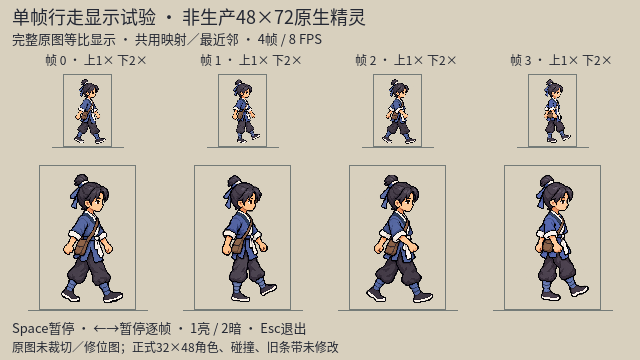
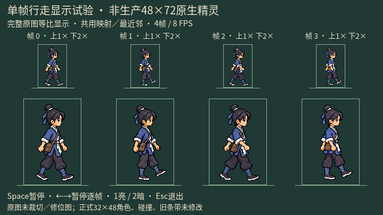

# imagegen 主角朝右行走：手臂修订与清边试验

记录日期：2026-10-11。延续用户“更接近，进一步推进”的外观候选探索；前一阶段见[单帧推进记录](./protagonist_imagegen_walk_single_progress_20261010.md)。

后续同日：[文袋修订候选与实际提示词／检查](./protagonist_imagegen_walk_bagfix_review_20261011.md)。袋形有所改善，但袋外RGB也重新渲染；新增显式`--variant=bagfix`，本页armfix原图、截图与录像保持，不将旧录像冒充新版。

本轮交付是隔离候选和实际录像，**不是已通过的行走动画或生产素材**。人物位图由内置 imagegen 生成／编辑，原样复制；没有手工补像素、Python改图、程序扣图、裁切／缩小写回，也没有替换正常游戏的角色。

## 结论与待决定项

- phase3手臂修订实际改变了几何：可见近肩大袖连续落向前侧袖口，肘接近肩下、手下垂略前，远臂留在后侧；不是只换袖口颜色。脸、头身比例和“远腿支撑／近腿弯抬前传”未见明显漂移，这不等于逐像素不变。
- 独立 `hero_walk_revision_review` 实际看修订原图、旧phase3、phase2参考以及新亮暗接触表。它指出：phase3左髋文袋变得更短圆、偏横，2×可辨，属于非目标改动；1×弱化细节不能证明没有帧间跳变。
- 清边试验失败：头后、脸前、手臂及鞋边仍有宽光晕，部分色阶也重新渲染。因此保留失败记录，但四帧预览采用armfix，不采用edge trial。
- 四帧静态表可用于检查脸／朝向／遮挡；实际录像另交给用户判断连续观感。代理的静态审查、自动索引检查和视频文件存在，都不能代签动态自然度、用户审美认可或正式美术验收。
- 48×72仅为完整高清画布的临时显示框，透明边距保留；不是原生48×72精灵，也不是已统一鞋底锚点。正式32×48／48×72／64×96规格尚待用户选择。
- 在用户判断新外观／动作和正式规格前，不自动扩展完整方向／攻击／受击素材，不迁移图集合同，不绕开“不用程序改人物图”的要求。

## 真实显示证据





[四秒实际播放视频 MP4](./hero_imagegen_walk_20261010/single_frames_armfix_20261011/walk_loop_8fps.mp4)与[Godot原始录像 AVI](./hero_imagegen_walk_20261010/single_frames_armfix_20261011/walk_loop_8fps.avi)。

四原图顺序：pose0 restored → pose1 restored → pose2 consistent → **pose3 armfix** → 循环。每帧完整1024×1536画布共用映射、最近邻显示；没有逐帧调位、修脚底或改变位图。动画8FPS，0.5秒循环；录像容器60FPS不是60张人物动作帧。

[预览脚本](../../tools/preview_hero_imagegen_walk_single_20261010.gd)新增显式 `--variant=armfix`，默认仍显示旧phase3；旧原图及旧10张证据截图未覆盖。Space暂停，←→暂停逐帧，1／2亮暗底，Esc退出。

## 原样归档与透明度

两次调用均为内置 `image_gen.imagegen`，`transparent_background: true`；未使用CLI、外部API密钥或第三方输入图片。具体生成模型版本没有单独核实，不补造。

原始目录：`/Users/witcher/.codex/generated_images/01a08145-47dc-7242-a49b-7d4016caecda/`。两份仓库文件与对应原始生成文件SHA-256一致。

| 候选／状态 | 原始生成文件 | 尺寸与SHA-256 |
|---|---|---|
| [pose3 armfix](./protagonist_imagegen_walk_right_pose3_armfix_20261011.png)，用于隔离预览 | `exec-4baf86c2-74d5-42e8-8d38-77709eab34ce.png` | 1024×1536 RGBA；`1b869f8bd420c25546fb198635510f1e47156efeb8e3adeb76a128008381515c` |
| [pose3 edge trial](./protagonist_imagegen_walk_right_pose3_edge_trial_20261011.png)，清边失败、未采用 | `exec-ada8566c-ccd8-420b-a260-797f6ecb24e8.png` | 1024×1536 RGBA；`28ed9cc70d62fe1e279ef18f0251ca9661b27387977d84e721df3ca611efee1e` |

只读PIL统计；不是修改图像：

| 文件 | alpha范围 | alpha=0 | alpha=1～254 | alpha=255 |
|---|---|---:|---:|---:|
| armfix | 0～254 | 1,168,933 | 403,931 | 0 |
| edge trial | 0～254 | 1,167,522 | 405,342 | 0 |

两图在共同alpha>127的375,568位置中，363,669位置RGB不同。它证明清边调用没有严格保持人物RGB；不能把这个数字解释成同等比例的可感知外观变化。alpha=254接近不透明，统计也不能单凭“没有255”声称人物整体明显透光；失败主要依据可见光晕、重渲染及未兑现硬边二值透明要求。

## 实际完整提示词与输入顺序

以下为调用原文，不是事后摘要。输入均先实际查看；角色原图仅通过内置imagegen编辑。

### 1. phase3 armfix

输入1（编辑目标）：[旧pose3 restored](./protagonist_imagegen_walk_right_pose3_restored_20261010.png)。
输入2（只参考近肩／袖子连接与遮挡，不参考腿、相位或构图）：[pose2 consistent](./protagonist_imagegen_walk_right_pose2_consistent_20261010.png)。

```text
Use case: precise-object-edit
Asset type: targeted arm-only correction of one pixel-style wuxia walk passing-pose candidate.
Input images: Image 1 is the edit target. Image 2 is ONLY a reference for the near-left shoulder/sleeve anatomy and near-over-far arm overlap, NOT a reference for pose, legs, stride, scale or framing.
Primary request: Correct ONLY the two arms in Image 1. Its large clearly visible NEAR LEFT sleeve is currently pointing behind the hip. Move this SAME near sleeve and hand to a relaxed mid-swing just slightly FORWARD of the torso, anatomically continuous with the same visible left shoulder. The near elbow should hang almost below the shoulder; near forearm and hand point down and slightly forward, beside the waist sash/in front of the near bag, much less extended than Image 2. The FAR RIGHT arm hangs slightly behind and is partially occluded by torso and bag. Do not merely swap cuff colors or attach the forward hand to the far shoulder. Both cuffs remain off-white.
Invariants: Preserve Image 1's leg geometry exactly: far/right leg straight down and grounded, near/left leg bent and lifted forward. Preserve face, small eyes, fringe/topknot, short neck, head/body scale and position, collar, torso, sash, near-left brown document bag, all cloth/boot colors, full-body portrait framing and original stepped coarse pixel rendering. Do not change the knees, feet, grounded baseline, pose phase, head size, identity or costume.
Background: keep genuinely transparent, no new halo, shadow, matte, ground, labels, text, watermark or extra figures.
Output: ONE complete right-facing passing pose; only arm pose and anatomical overlap corrected, not a new character or sheet.
```

### 2. edge trial，失败保留

唯一输入（编辑目标）：[本轮pose3 armfix](./protagonist_imagegen_walk_right_pose3_armfix_20261011.png)。

```text
Use case: background-extraction
Asset type: clean transparent-background trial for ONE pixel-style wuxia walk candidate.
Input image: Image 1 is the edit target, not a style inspiration.
Primary request: Remove ONLY the diffuse blue-gray and warm brown halo surrounding the figure, including around hair, hands, bag and boots. Make the entire empty area fully transparent right up to the original stepped silhouette. Keep all existing solid character pixels, their RGB colors, facial features, pixel clusters, body/arm/leg pose, satchel shape and framing unchanged. Do not redraw or simplify the character.
Edge requirement: crisp hard stepped pixel-art edge with no soft feathering or colored matte. Fully opaque figure interior, fully transparent exterior; no glow, shadow, ground, aura or blurred fringe. Preserve the entire topknot, hair ties, both hands and both boots, including their existing dark outlines.
Output: exactly the same ONE complete right-facing passing figure with a clean genuinely transparent background, same portrait canvas and scale. No labels, text, checkerboard drawing, watermark, extra figure or new details.
```

## 工程检查与录像来源

2026-10-11实际结果：默认只读验证36项／armfix只读38项／armfix真实渲染截图87项／armfix四秒引擎播放40项，均0失败。10张新版截图640×360，来自真实Godot Compatibility渲染，不是生成式图片。工程覆盖共用画布映射、4帧时序、键盘暂停／逐帧／亮暗、真实截图和输入／正式资源哈希保护；不覆盖动画自然度或用户批准。

```bash
# 旧默认仍保留
./tools/godot.sh --headless --path . --script res://tools/preview_hero_imagegen_walk_single_20261010.gd -- --verify-only

# 新版只读检查
./tools/godot.sh --headless --path . --script res://tools/preview_hero_imagegen_walk_single_20261010.gd -- --verify-only --variant=armfix

# 新版交互预览
./tools/godot.sh --path . --rendering-method gl_compatibility --resolution 1280x720 --script res://tools/preview_hero_imagegen_walk_single_20261010.gd -- --variant=armfix

# 新版真实渲染截图
./tools/godot.sh --path . --rendering-method gl_compatibility --resolution 1280x720 --script res://tools/preview_hero_imagegen_walk_single_20261010.gd -- --capture --variant=armfix

# 仅四秒引擎播放；此命令不保存视频
./tools/godot.sh --path . --rendering-method gl_compatibility --resolution 1280x720 --script res://tools/preview_hero_imagegen_walk_single_20261010.gd -- --movie-preview --variant=armfix
```

原始AVI实际使用Godot引擎MovieWriter，不是脚本自行导出：

```bash
./tools/godot.sh --path . --rendering-method gl_compatibility --resolution 1280x720 --fixed-fps 60 --write-movie /Users/witcher/Documents/ChatGPT/wuxia_game/docs/art_reference/hero_imagegen_walk_20261010/single_frames_armfix_20261011/walk_loop_8fps.avi --script res://tools/preview_hero_imagegen_walk_single_20261010.gd -- --movie-preview --variant=armfix
```

引擎固定时钟播放4.01666666666666秒、241帧；录制墙钟约3.39秒，不能将固定时钟当作实时性能测试。实际录像640×360、60FPS；输出AVI 6,520,482字节，SHA-256 `a6c433cce5d5bdd81f149b5437056c7dbca7eff66ee28cda7fb90cb77dbc7397`。

为便于播放，用已安装ffmpeg转为无音轨H.264 MP4（`-an`移除AVI音轨），未做缩放、滤镜或源角色位图写回。MP4是有损观看副本，精确像素／透明度以原PNG为准：

```bash
ffmpeg -nostdin -loglevel error -n -i docs/art_reference/hero_imagegen_walk_20261010/single_frames_armfix_20261011/walk_loop_8fps.avi -map 0:v:0 -an -c:v libx264 -crf 18 -preset veryfast -pix_fmt yuv420p -movflags +faststart docs/art_reference/hero_imagegen_walk_20261010/single_frames_armfix_20261011/walk_loop_8fps.mp4
```

ffprobe实际确认MP4：H.264、640×360、60/1 FPS、4.016667秒、241帧；205,992字节，SHA-256 `4a1203f50e48844df0ec146cd57f93fb2e564d4dfd1ee185e01eca944ea4b7a6`。这是实际渲染录像，不是imagegen直接生成的视频。脚本的 `--movie-preview` 本身不写视频；只有额外传引擎 `--write-movie` 才录像。

独立`hero_goal_audit`复核：本记录本地链接、两张原图／副本、正式资源三哈希及录像元数据一致，AVI／MP4完整解码无错误。它没有代签动态自然度或用户验收；本轮连续观感仍等待用户观看判断。

## 正式资源保持

正式运行时仍是32×48、8列图集、锚点(16,44)，探索碰撞20×12。本轮复核如下：

| 正式文件 | SHA-256，和首图记录一致 |
|---|---|
| `assets/source/characters/hero_pixel_source.gd` | `b9a67f25008e390b0fa281fa3566a2e29afb2010a185ac6e0b55001d29136a9b` |
| `assets/runtime/characters/chr_protagonist_atlas.png` | `e13be6ae0ed90c069bcd195d396b3557b13ac8cfbea97fb95c9dd05f632c0358` |
| `assets/runtime/characters/chr_protagonist_atlas.json` | `d600fddcbe1def27e727ef0ebaa41e39535018e0f4ac281a1a73a3dbf55d8146` |

没有正式资源替换、尺寸／锚点合同迁移、完整动作扩展、提交／推送、打包或商店发布。本记录不代填用户试玩意见。
