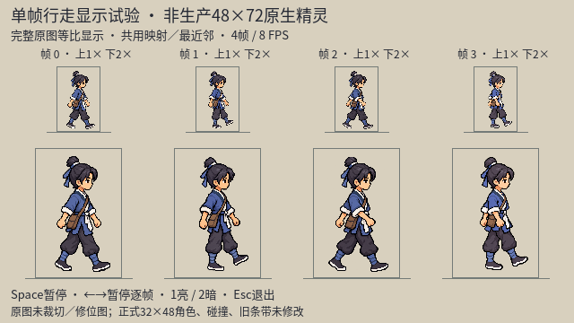
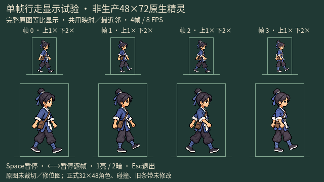

# imagegen 主角朝右行走：文袋修订候选

2026-10-11。延续“更接近，进一步推进”；上一轮见[手臂修订／清边试验与armfix录像](./protagonist_imagegen_walk_armfix_review_20261011.md)。

状态：文袋形状相对armfix改善，可用于独立显示评审；**不是只改文袋像素已通过，不是完成的行走动画，也没有替换游戏角色**。

## 本轮实际结果

- 主代理和独立 `hero_walk_revision_review` 逐张查看新图、armfix及旧pose3 restored。新袋更长、下垂更明显，圆鼓感减弱；但仍比旧袋更垂直，没有完全恢复旧版斜向左下的形状。
- 文袋在近袖／前臂后方，遮挡关系成立；近臂从可见肩连续落到身前，没有退回旧版向后近臂。脸、头肩比例和腿脚相位未见明显结构性漂移；这是目视观察，不是逐像素保持结论。
- 只读差分实际发现袋外RGB也重新渲染，不能称“只有袋的像素变化”。因此单独保留新候选，旧默认和armfix未覆盖；不把提示词里的保持要求当成实际满足证据。
- 透明光晕与非原生像素网格没有解决。alpha仍有部分透明；48×72只是完整1024×1536原图的等比显示框，不是生产精灵规格。
- 四帧静态序列另发现：近手由袋后到身前的变化集中在部分相邻帧，袋形在2→3→0有突变风险。独立审查估计1×部分鞋位横向变化约8～9像素、近手大变化约15像素；这是静态估计，不是正式运动测量。
- 当前预览是原地播放，没有世界位移；不能仅凭屏幕鞋位改变断言实际游戏滑脚。落脚仍需核对同一支撑腿的相位，并结合场景移动验证。没有修改已有移动速度、碰撞或运行时控制器。

## 原样文件、来源与透明度

工具：内置 `image_gen.imagegen`，`transparent_background: true`，一次定向编辑；无CLI、外部API密钥或第三方图片。具体模型版本没有单独核实。

原始生成文件：

`/Users/witcher/.codex/generated_images/01a08145-47dc-7242-a49b-7d4016caecda/exec-ae926155-9a78-43e0-9103-1bbc46ce5ccd.png`

[仓库原样副本](./protagonist_imagegen_walk_right_pose3_bagfix_20261011.png)：1024×1536 RGBA，SHA-256 `96e7ece0373f6e0ef37b5096ac4bde45e78f066786f290b75739bfea334b4ba2`；与原始文件一致。没有手工补像素、程序扣图／重绘、裁切／缩小写回或覆盖旧图。

PIL仅做只读分析：

| alpha范围 | alpha=0 | alpha=1～254 | alpha=255 |
|---|---:|---:|---:|
| 0～254 | 1,169,147 | 403,717 | 0 |

与armfix在共同alpha>127的377,844位置中，有368,689位置RGB不同。即使排除近似文袋矩形（原图x390～540、y750～960），剩余346,109个共同位置中仍有337,671位置RGB不同。该矩形不是语义分割或正式编辑遮罩；数字用于反证袋外严格RGB不变，不能解释成同等比例可感知变脸、相似度评分或动态质量。alpha=254接近不透明，不能单凭没有255宣称整个人明显透光。

## 实际完整提示词与输入顺序

输入1（编辑目标）：[pose3 armfix](./protagonist_imagegen_walk_right_pose3_armfix_20261011.png)。
输入2（只参考旧文袋形状，不参考旧手臂）：[pose3 restored](./protagonist_imagegen_walk_right_pose3_restored_20261010.png)。
两张输入均在调用前实际查看。下文为完整调用原文，不是摘要：

```text
Use case: precise-object-edit
Asset type: one targeted satchel-shape correction of a pixel-style wuxia passing-pose candidate, not a new character or animation sheet.
Input images: Image 1 is the edit target. Image 2 is ONLY a reference for the original brown document satchel's elongated, slightly diagonal body and flap; do NOT copy Image 2's arms, hands, pose or sleeve shape.
Primary request: In Image 1, change ONLY the brown satchel on the visible near-left hip. Restore the slim vertically elongated, slightly diagonal document pouch body and angular top flap seen in Image 2, rather than the squat round pouch in Image 1. Its lower edge should reach the same upper-thigh level as Image 2. Keep its attachment on the same near-left hip and the same brown colors. The current arms and hands must naturally occlude the restored pouch: do NOT move a hand or sleeve to expose it, and do NOT put the pouch in front of the foreground hand.
Invariants: Keep Image 1's exact near-shoulder-to-forward-sleeve connection, both hand positions, forearms, elbows, white cuffs, leg geometry, grounded foot, lifted foot, head position, face, small eye, hair, topknot, short neck, body scale, sash, costume colors, pixel clusters, full portrait canvas and framing unchanged. Do not restore Image 2's backward near arm. No new detail elsewhere and no whole-figure restyling.
Background: preserve genuine transparency; no added halo, glow, shadow, ground, labels, text, watermark or extra figure.
Output: ONE complete right-facing passing pose, with only the existing pouch shape corrected and current arm occlusion preserved.
```

## 真实显示与工程验证





共同尺度复审：主代理实际看两张新接触表；独立`hero_walk_revision_review`另与armfix表比较，认为帧3短圆差异减弱、袋下缘更接近帧2／0，亮暗1×均可读为左髋棕袋。但帧3仍较垂直，帧2／0偏斜，2→3→0倾角形变风险未消除；1×不能可靠辨认袋盖细节。袋形连续性尚不判通过，更不据静态表声称动态自然。

[独立预览脚本](../../tools/preview_hero_imagegen_walk_single_20261010.gd)增加显式 `--variant=bagfix`；默认及 `--variant=armfix` 保持。新版按pose0 restored → pose1 restored → pose2 consistent → pose3 bagfix播放，共用完整画布映射、最近邻显示，4帧8FPS，不逐帧调位或写回角色位图。

`hero_goal_audit` 实际执行：默认只读36／armfix只读38／bagfix只读40／bagfix真实Compatibility截图89／四秒引擎播放42项，均0失败，播放时间4.003869秒。新版目录仅10张640×360 PNG；**本轮没有新AVI／MP4**。上一轮录像仍是armfix，不冒充bagfix录像。

工程检查保护原始输入、正式资源及旧候选，不等于动画自然度或用户美术验收。旧default／armfix共22份截图和录像、三正式资源及旧phase3／armfix原图前后哈希均一致。

```bash
# 只读检查新候选
./tools/godot.sh --headless --path . --script res://tools/preview_hero_imagegen_walk_single_20261010.gd -- --verify-only --variant=bagfix

# 独立交互预览
./tools/godot.sh --path . --rendering-method gl_compatibility --resolution 1280x720 --script res://tools/preview_hero_imagegen_walk_single_20261010.gd -- --variant=bagfix

# 真实截图
./tools/godot.sh --path . --rendering-method gl_compatibility --resolution 1280x720 --script res://tools/preview_hero_imagegen_walk_single_20261010.gd -- --capture --variant=bagfix

# 引擎播放四秒；不保存视频、不等于目视验收
./tools/godot.sh --path . --rendering-method gl_compatibility --resolution 1280x720 --script res://tools/preview_hero_imagegen_walk_single_20261010.gd -- --movie-preview --variant=bagfix
```

连续动态目视仍未完成：QuickTime界面访问未获允许，内置浏览器也禁止本地file协议；没有换浏览器、架本地服务或其他绕行。已有静态PNG可正常只读复核，用户可通过交互预览判断连续观感。实际引擎播放及索引检查不能替代这个缺口。

## 剩余门槛

- 用户判断新长相、头身比例、动作观感及正式32×48／48×72／64×96规格；未回答不是批准。
- 手臂过渡、腿的近远归属／世界移动落脚、循环接缝、稳定袋形和透明边缘仍未全部通过。
- 不自动扩展其他方向／完整战斗动作，不迁移图集、锚点或尺寸合同，不进行未经授权的程序人物图加工。

正式源／PNG／JSON、20×12探索碰撞、移动速度与正常游戏保持。本轮没有运行时替换、提交／推送、打包、商店发布或代填用户意见。

收尾只读审计：`hero_goal_audit`重核本记录所有本地链接、原图／副本哈希、RGBA统计、袋外差分、检查计数和新目录内容，均一致；主代理另核实际提示词逐字一致及三正式资源哈希未变。`git diff --check`和`tools/validate_repo.py`通过（后者仅覆盖其扫描的36份文档，不替代本层链接及美术验收）。

## 原目标范围与收尾核查

2026-10-11重新核查原目标“更接近，进一步推进”。它是在用户认可首张imagegen候选方向之后，要求继续打磨候选；不是要求此轮完成正式角色、整套动画或替换游戏。独立`hero_goal_audit`再次核查后确认：不能将主代理自行增加的生产要求倒置为原目标的完成门槛，也不能仅因用户未回复就判blocked。

| 原请求／边界 | 当前直接证据 | 结论 |
|---|---|---|
| 沿用户认可的少年主角方向进一步制作像素风候选 | [细节收敛／四向眼白修订](./protagonist_imagegen_progress_20261010.md)、本页文袋修订原图和亮暗显示表；主代理本次重新实际看四向v2与新四帧表，独立代理逐图复审 | 已真实制作并交付进一步候选；保留束发、交领、蓝衣和文袋，身份／头肩基本一致；这是AI目视判断，不代签用户喜好 |
| 直接使用内置imagegen，不用程序改人物像素 | 完整实际提示词、输入顺序、原始生成路径与原样副本哈希；本页再次核对实际调用提示词逐字一致 | 已满足执行方式；程序只显示完整纹理和读取统计，不加工源角色位图 |
| 专门subagent审查，不以生成提示充当质量证明 | `hero_walk_revision_review`的原图／共同尺度复审，`hero_goal_audit`的独立来源／工程／范围审计 | 已复审；保留失败与非目标重渲染结论，没有把它们隐去 |
| 交付本地候选与可追溯记录，暂不替换游戏 | 本页PNG／显示证据／提示词、AI-ART-031登记；本次只读40项0失败，三正式资源SHA-256仍和首候选记录一致 | 已归档，正式游戏未变；无提交／推送或发布 |

首图与四向v2本次复核哈希分别为`ef75fb5d4e42f7ab9639ee36ec7f25c33fd0862b08a0e35e74968875a053f2c5`、`3ada25005b38414efb54531491c092ca26de69e233d8579e48c4b0c9c5c3df7c`；本页bagfix仍为`96e7ece0373f6e0ef37b5096ac4bde45e78f066786f290b75739bfea334b4ba2`。

结论：原目标的候选推进交付已完成。上方“剩余门槛”属于后续外观定稿／动作质量／生产接入，不因此冒称通过，也不自动扩展为本次必做范围。整套生产角色、动态自然度、原生网格／透明边缘及用户对新版的认可仍未完成；本次收尾不改变这些事实。

用户最初的百度指定图此次重新访问仍无法打开（工具报告不可重试错误，不冒称此次仍返回403）；该图仍未见。本轮延续的是用户已认可的首候选方向，不声称准确复刻指定图片。下一步需要用户选择保留当前外观继续动作试验，还是先调整脸／比例；任何正式尺寸、程序人物图加工或运行时接入另外确认。
