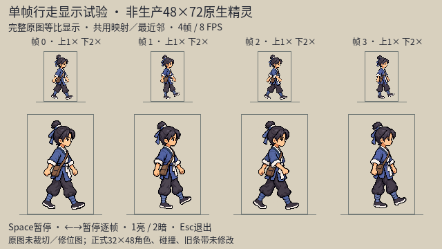
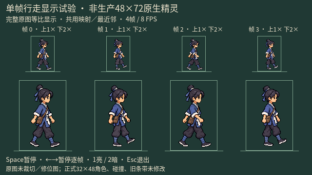

# imagegen 主角行走：单帧路线与真实尺寸复核

生成：2026-10-10；实际渲染复核：2026-10-11。用户目标：“更接近，进一步推进”。

当前状态：已有四张同尺寸原色关键姿态及可运行的独立显示预览；不是已完成／已批准的行走动画，未接入游戏。上一轮条带失败与骨架引导记录见[前一阶段](./protagonist_imagegen_walk_trial_20261010.md)。

后续2026-10-11：[phase3手臂修订、失败清边与实际录像](./protagonist_imagegen_walk_armfix_review_20261011.md)。显式`--variant=armfix`保留旧默认；新增录像通过引擎额外`--write-movie`完成，下文原命令本身仍不保存视频。新版近臂改善、文袋有漂移，不将工程运行成功当作用户新动画验收。

## 本轮结论

- 先用 imagegen 临时区分裤腿，确认phase2后伸近腿／前伸远腿的连续连接，再由imagegen恢复原色；没有手工或程序改人物像素。
- 用phase2人物图优先生成phase0时，近侧大袖仍前摆，动作再次同相；保留失败图，不作为相反接触帧。改为骨架优先、静态四向只提供身份，并临时区分肢体，才得到反相接触姿态。
- phase1的近腿支撑／远腿前传，与phase3的远腿支撑／近腿前传，经原图连续轮廓追踪可区分；恢复色后腿形基本保留。phase3袖口曾把近侧大袖标成远侧色，肩臂遮挡未清楚交换，因此不拿袖口颜色充当手臂归属已通过；恢复白袖口也不等于修复了该问题。
- 原phase2 restored为1145×1374，与后来三帧的头身比例不同；另生成phase2 consistent，与0／1／3共同组成1024×1536四原图预览。旧版保留。
- 主代理与独立 `hero_simple_visual_review` 实际看四原图和亮暗接触表：48×72显示框内1×可读暖色脸、朝向和发髻，头肩基本稳定；接触帧脚底大致齐平，经过帧抬脚清楚。文袋始终同侧，但袋形、袖子／衣领有细小帧间重渲染差异，暗底裤腿对比略弱。
- 动态自然度、循环接缝与phase3手臂仍未完成视觉验收；光晕／部分透明及非原生精灵网格仍未解决。不把四帧播放工程成功当成动画美术通过。

## 四帧显示证据





[独立预览工具](../../tools/preview_hero_imagegen_walk_single_20261010.gd)按0／1／2／3顺序，读取pose0 restored、pose1 restored、pose2 consistent、pose3 restored完整原图，共用映射等比最近邻放入48×72框。不是把角色裁切／缩小保存成生产资源，也没有逐帧修正头／脚、缩放变形或修补位图。交互版另显示1×／3×；接触表上1×、下2×。

按键：Space暂停／播放，←→暂停逐帧，1／2亮暗底，Esc退出。4帧8FPS，0.5秒循环。默认无限交互；`--movie-preview`仅运行4秒并退出，**不保存视频**。

主代理2026-10-11独立重跑：只读36项0失败；真实Apple M4 Compatibility渲染capture85项0失败，输出10张640×360截图（两张接触表、8张逐帧）；4秒实际播放38项0失败，四个索引均被观察。测试覆盖源文件及正式角色／控制器／旧条带哈希不变、共用画布映射、时序、暂停／逐帧／亮暗按键和真实截图；不覆盖人类感知的动画自然度、用户审美认可、原生像素规格或生产素材验收。

```bash
# 交互：原图不改，正式游戏不改
./tools/godot.sh --path . --rendering-method gl_compatibility --resolution 1280x720 --script res://tools/preview_hero_imagegen_walk_single_20261010.gd

# 仅只读工程验证
./tools/godot.sh --headless --path . --script res://tools/preview_hero_imagegen_walk_single_20261010.gd -- --verify-only

# 真实渲染截图
./tools/godot.sh --path . --rendering-method gl_compatibility --resolution 1280x720 --script res://tools/preview_hero_imagegen_walk_single_20261010.gd -- --capture

# 实际8FPS运行4秒；不保存视频、不代替视觉验收
./tools/godot.sh --path . --rendering-method gl_compatibility --resolution 1280x720 --script res://tools/preview_hero_imagegen_walk_single_20261010.gd -- --movie-preview
```

headless capture会明确退出2，不写假截图。预览的灰线是显示框底，不等于人物鞋底锚点；原图中的透明边距保留，不把框底对齐冒称已统一生产锚点。

## 原样归档与透明度

十次调用均为内置 `image_gen.imagegen`，`transparent_background: true`。人物最终位图只经内置生成／编辑，原样复制到项目；无CLI、外部API密钥、Python改图、裁切写回、代码像素补画或旧版覆盖。PIL仅用于读取RGBA统计，不能因透明请求就宣称实际二值透明。

原始目录：`/Users/witcher/.codex/generated_images/01a08145-47dc-7242-a49b-7d4016caecda/`；仓库目录：`docs/art_reference/`。下表名称统一前缀`protagonist_imagegen_walk_right_`、后缀`_20261010.png`。

| 名称／仓库原样副本 | 原始生成文件 | 实际尺寸 | SHA-256 |
|---|---|---|---|
| [pose2_diagnostic](./protagonist_imagegen_walk_right_pose2_diagnostic_20261010.png) | `exec-4df80f32-cc9a-4e22-965e-8174c4adb9b6.png` | 1145×1374 | `5808a61035fd3b54a2242337f368cb1c378e88efa4195e34968ee47d94d9514b` |
| [pose2_restored](./protagonist_imagegen_walk_right_pose2_restored_20261010.png) | `exec-cba1a426-b57d-4b45-8c80-f3f0302dc4da.png` | 1145×1374 | `b293e7bf0f27ccb4050477461c9a10c48d139eb38fcdfa7c63e7cfef14f53372` |
| [pose0_guided](./protagonist_imagegen_walk_right_pose0_guided_20261010.png) | `exec-48c63e68-b0b1-4e9c-9303-a53ed846b0be.png` | 1145×1374 | `27fb7f6347cd4bd1b92b4dc97a48e086318f5b0a1a08c28dbd6215e22ea15114` |
| [pose0_diagnostic](./protagonist_imagegen_walk_right_pose0_diagnostic_20261010.png) | `exec-084a766e-c356-41c5-a627-facd9f9a87fb.png` | 1024×1536 | `04011b2363b7f5eb521dba34be60f82d8dd1a4da42e24e8aa0346912e7db3e20` |
| [pose1_diagnostic](./protagonist_imagegen_walk_right_pose1_diagnostic_20261010.png) | `exec-2a5dd8e2-5577-4283-b653-7384311ad256.png` | 1024×1536 | `c6e4e9abd59391782580f3266acff83515952d60909e4ebc2468eaf324ad7d3b` |
| [pose3_diagnostic](./protagonist_imagegen_walk_right_pose3_diagnostic_20261010.png) | `exec-3eff8401-f1bd-4146-a38e-fb85251c0768.png` | 1024×1536 | `96a735927d673f3af5abc799bee2d7e7fdd0b6a7ac7ed4b4bfd53f806e10b01c` |
| [pose0_restored](./protagonist_imagegen_walk_right_pose0_restored_20261010.png) | `exec-d84be8e3-1caf-41e3-81d0-f29a4f1472b7.png` | 1024×1536 | `48da9de48f6d13c1c58209f75dccc70ee462cc9d81f0429148d901b718e81ad9` |
| [pose1_restored](./protagonist_imagegen_walk_right_pose1_restored_20261010.png) | `exec-f4bc4dcf-5f47-4c75-8a5e-9b6a6d9d2b1d.png` | 1024×1536 | `14a68f8777bc73ba8b82d98666b37cf1e756e66d40119a14df41204a5af91d97` |
| [pose3_restored](./protagonist_imagegen_walk_right_pose3_restored_20261010.png) | `exec-b6675b5f-0a16-48a3-8f18-b5555c49af25.png` | 1024×1536 | `841a056f0739c810f51d66e04f0035ab4aace1cb9c83addb7428f49a6c7baf4c` |
| [pose2_consistent](./protagonist_imagegen_walk_right_pose2_consistent_20261010.png) | `exec-13ded735-bb0e-4a3f-8562-5972fef52aa5.png` | 1024×1536 | `c4860108e629eda5024e3607b1fd3a60f1e208c140ce65feff3ba9962658e357` |

RGBA原文件alpha分析（只读）：

| 名称 | alpha范围 | alpha=0 | alpha=1～254 | alpha=255 |
|---|---|---:|---:|---:|
| pose2_diagnostic | 0～255 | 1,172,667 | 399,173 | 1,390 |
| pose2_restored | 0～255 | 1,172,567 | 399,560 | 1,103 |
| pose0_guided | 0～255 | 1,170,396 | 401,511 | 1,323 |
| pose0_diagnostic | 0～254 | 1,101,593 | 471,271 | 0 |
| pose1_diagnostic | 0～254 | 1,144,112 | 428,752 | 0 |
| pose3_diagnostic | 0～254 | 1,153,405 | 419,459 | 0 |
| pose0_restored | 0～254 | 1,103,012 | 469,852 | 0 |
| pose1_restored | 0～254 | 1,150,865 | 421,999 | 0 |
| pose3_restored | 0～254 | 1,161,243 | 411,621 | 0 |
| pose2_consistent | 0～254 | 1,107,676 | 465,188 | 0 |

## 骨架输入与范围保持

[独立骨架脚本](../../tools/render_hero_walk_pose_guide_20261010.gd)只画线／圆／文字，不输入人物位图，不是角色美术。蓝色近侧／解剖左侧，灰色远侧／右侧。默认旧phase2图原样保留；新增显式`--phase=0/1/3`各输出一张600×600真实渲染图：

| 相位 | 本项目姿态图 | SHA-256 |
|---|---|---|
| 0 近腿前伸 | [phase0](./hero_imagegen_walk_20261010/pose_guide_phase_0_contact.png) | `20c312b9c0db562925327a4613232094e11ba04159f85ccf170321cce39caec5` |
| 1 远腿前传 | [phase1](./hero_imagegen_walk_20261010/pose_guide_phase_1_passing.png) | `f6a5936e5266a30921aa7438304abff245fdc63de7330c7a2eeb095f8363d5e3` |
| 3 近腿前传 | [phase3](./hero_imagegen_walk_20261010/pose_guide_phase_3_passing.png) | `fb48b1adbbf9121bbafa2f3c60f827096e2e0278679278be0532f1b7e49f22ea` |

```bash
./tools/godot.sh --path . --rendering-method gl_compatibility --script res://tools/render_hero_walk_pose_guide_20261010.gd -- --capture --phase=0
# 将0改成1或3；不传phase仍是旧默认图
```

phase1／3支撑脚y526，前传脚y492；近肢最后绘制。姿态图中的颜色只用于近远归属，人物临时彩色诊断另由imagegen生成。没有取第三方像素、下载用户百度参考或冒称看过该403图片。

48×72仍是主代理在尺寸问题尚未得到回复时采用的**隔离显示试验**，不是用户批准的新生产规格。现有32×48角色源、正式PNG／JSON、碰撞、存档、探索／战斗场景未修改；未提交／推送、未导入候选包或商店。

后续仍需：实际连续播放的自然度／接缝与手臂归属复核，边缘／原生精灵生产合同处理，用户选择显示／生产规格及新外观评审。当前只产出朝右四姿态，其他方向与攻击／受击等动作没有因这次试验而完成。

## 十次完整实际提示词

输入都相对`docs/art_reference/`，顺序与实际调用一致；所有调用均传`referenced_image_paths`，未传`num_last_images_to_include`。下面为实际发送原文，不是事后摘要。

### 1. phase2临时双色裤腿

实际输入：`protagonist_imagegen_walk_right_pose2_guided_20261010.png`。

```text
Use case: precise-object-edit
Asset type: temporary limb-color diagnostic for one pixel-style wuxia walking key pose, NOT a new costume or production asset.
Input images: Image 1 is the edit target, the single right-facing hero. Keep its exact body pose, face, hair, torso, arms, bag, framing and pixel style.
Primary request: Change ONLY the color coding of the two trouser legs and their cloth shin wraps to make their continuous ownership unmistakable. The near/anatomical-LEFT leg runs from the near LEFT hip under the visible document bag down BACKWARD toward image-left; color that entire continuous trouser leg and shin wrap saturated teal-blue. The far/anatomical-RIGHT leg runs from the far hip down FORWARD toward image-right; color that entire continuous trouser leg and shin wrap muted brick-red. Each color must be continuously traceable from hip to knee to ankle, with anatomically correct near-leg-over-far-leg occlusion at the crotch. Keep the boots and soles their original colors.
Invariants: This is a color-only diagnostic edit; do NOT change the limb geometry or make the strides wider. Keep the near arm forward, far arm back, all foot positions, head and proportions unchanged. Keep face, eyes, topknot, blue-gray tunic, off-white collar/cuffs/sash, one left-hip brown satchel, and transparent margins unchanged. No new labels, arrows, skeleton lines, extra characters, props, ground or shadow.
Style/background: Match the same coarse pixel clusters and hard stepped silhouette. Preserve genuine transparent background, no glow, matte, watermark or text.
Output: Exactly ONE complete figure in the same right-facing opposite-contact pose; only trouser-leg/wrap colors temporarily differ.
```

### 2. phase2仅恢复衣色

实际输入：`protagonist_imagegen_walk_right_pose2_diagnostic_20261010.png + protagonist_imagegen_walk_right_pose2_guided_20261010.png`。

```text
Use case: precise-object-edit
Asset type: restore costume colors after a one-frame walking-pose diagnostic.
Input images: Image 1 is the edit target with temporary teal and brick-red trouser legs; Image 2 is the original color reference of the SAME pose.
Primary request: Change ONLY the trousers and cloth shin wraps in Image 1 back to their original colors from Image 2: both trouser legs deep charcoal/slate, and both shin wraps muted blue-gray. Preserve enough original near/far shading and occlusion to read the two separate legs. Remove every teal and red diagnostic color.
Invariants: Do NOT change Image 1's pose or limb geometry. The near LEFT leg continues backward to image-left, the far RIGHT leg continues forward to image-right. Near arm forward, far arm back. Preserve exact face identity, eyes, topknot, short neck, head/torso proportions, blue-gray tunic, white trim and sash, left-hip brown document bag, original boots, baseline, full-body framing, pixel-cluster style and transparent margins. Do not redraw new gestures or move limbs.
Backdrop: genuinely transparent, no halo, floor, shadow, labels, text, props, extra figures or watermark.
Output: ONE complete right-facing opposite-contact pose in the original costume palette, not a sprite sheet.
```

### 3. phase0姿态参考优先试验（失败）

实际输入：`protagonist_imagegen_walk_right_pose2_restored_20261010.png + hero_imagegen_walk_20261010/pose_guide_phase_0_contact.png`。

```text
Use case: identity-preserve
Asset type: ONE contact keyframe, phase 0, for an isolated pixel-style wuxia hero walk experiment.
Input images: Image 1 is the ONLY character identity, costume, pixel-style, body scale and framing reference. Image 2 is a POSE-ONLY guide; blue is near/anatomical LEFT and gray is far/anatomical RIGHT. Do not copy the guide's colors, labels, lines or background.
Primary request: Keep exactly the same young right-facing man, but switch to the OPPOSITE contact step from Image 1. Follow Image 2: near/LEFT leg extends FORWARD toward image-right and far/RIGHT leg extends BACK toward image-left; near/LEFT sleeve and hand swing BACK behind the hip, far/RIGHT arm forward. The nearer trouser leg must occlude the far leg correctly, continuous under the near hip and document bag, not simply repaint the same stride.
Preserve: the recognizable face, small eyes, calm expression, topknot, short neck, head size and head position, upright torso, same blue-gray tunic/white trim/sash, charcoal trousers, blue-gray shin wraps, boots, ONE brown document satchel on anatomical LEFT/near hip with right-shoulder strap. Preserve the camera, figure height, portrait framing and pixel clusters of Image 1. Both grounded boots share a common baseline, modest natural stride, no run or high-knee march.
Composition/background: exactly one complete profile character facing right, centered with generous transparent margins, all hair and both feet fully visible. Genuinely transparent, no shadow, glow, matte, checkerboard drawing, labels, text, watermark or other figures. Do not make a contact sheet.
Output intent: a consistent opposite-contact reference keyframe, not an exact native-size production sprite.
```

### 4. phase0骨架优先、临时肢体色

实际输入：`hero_imagegen_walk_20261010/pose_guide_phase_0_contact.png + protagonist_imagegen_turnaround_20261010_v2.png`。

```text
Use case: identity-preserve
Asset type: ONE right-facing pixel-style wuxia walk key pose, contact phase 0.
Input images: Image 1 is the AUTHORITATIVE POSE diagram. Blue limbs are NEAR anatomical LEFT, gray limbs are FAR anatomical RIGHT. Image 2 is ONLY the identity/costume/pixel-style reference; select the rightmost right-facing profile. Image 2's idle posture must NOT override Image 1.
Primary request: Render Image 1's skeleton as the SAME young character from Image 2. Near LEFT arm extends diagonally DOWN-BACKWARD toward image-left, its sleeve and hand behind the visible near-hip bag. Far RIGHT arm extends diagonally DOWN-FORWARD toward image-right, partially occluded by torso. Near LEFT leg extends down-FORWARD toward image-right; far RIGHT leg extends down-BACKWARD toward image-left. Follow the diagram's limb connections and near-over-far overlap, modest stride, two feet grounded on a shared baseline.
Temporary diagnosis: ONLY the near trouser leg and its shin wrap are teal-blue, ONLY the far trouser leg and wrap are brick-red, continuously from the tunic hem to ankle. ONLY the near sleeve's cuff is teal-blue and the far sleeve's cuff brick-red. These four color marks identify the limbs for this diagnostic; the rest of the clothing stays the reference palette. Do not color the entire character like the diagram.
Preserve: youthful face, small eyes, calm expression, black fringe/topknot, short neck, head/body proportions, blue-gray cross-collar tunic, off-white collar and sash, original boots, ONE brown document satchel on anatomical LEFT/near hip with right-shoulder strap. Same coarse grouped square-pixel style and stepped silhouette.
Framing/background: exactly ONE full body right-facing profile, upright head/torso, generous genuine transparent margins, all hair and feet complete. No skeleton lines, circles, labels, ground, shadow, glow, watermark or other figures. Do not reproduce the four-view sheet.
```

### 5. phase1近腿支撑、远腿前传

实际输入：`hero_imagegen_walk_20261010/pose_guide_phase_1_passing.png + protagonist_imagegen_turnaround_20261010_v2.png`。

```text
Use case: identity-preserve
Asset type: ONE passing walk key pose for the same pixel-style wuxia hero.
Input images: Image 1 is the AUTHORITATIVE POSE diagram, blue=near/anatomical LEFT and gray=far/anatomical RIGHT. Image 2 is ONLY the identity, costume and pixel-style reference; use the rightmost right-facing profile, do not inherit its idle pose.
Primary request: Render the exact limb connections and near-over-far overlap of Image 1 as the young man from Image 2. The NEAR LEFT leg supports the body, approximately straight down under the hip with its boot grounded; the FAR RIGHT leg bends gently at the knee and passes forward toward image-right, its boot clearly lifted slightly above the grounded boot. Near arm hangs slightly back, far arm slightly forward; arms close to the torso, not a full wide swing. This is a modest natural walk passing pose, not running, jumping, or kneeling. Head and torso upright.
Temporary diagnosis: Near LEFT trouser leg and shin wrap continuously teal-blue; far RIGHT trouser leg and wrap continuously brick-red. Near sleeve CUFF teal-blue, far sleeve CUFF brick-red; keep the actual sleeves blue-gray. All other costume colors remain original. These temporary colors only identify limb ownership. Do not copy the skeleton lines/circles/labels/background.
Preserve: same youthful face and small eyes, black fringe/topknot, short neck, head/body proportions, blue-gray cross-collar tunic, white collar/sash, original boots, ONE brown left/near-hip document satchel with strap from right shoulder, same coarse square-pixel clusters and stepped edges. No costume redesign beyond the four temporary color marks.
Framing/background: exactly ONE right-facing full-body profile at the same camera angle and character scale as the reference, centered with generous genuinely transparent margins, all hair/feet intact. No ground, floor, shadow, glow, halo, matte, checkerboard drawing, text, labels, watermark or extra figures. Do not make a four-view sheet.
```

### 6. phase3远腿支撑、近腿前传

实际输入：`hero_imagegen_walk_20261010/pose_guide_phase_3_passing.png + protagonist_imagegen_turnaround_20261010_v2.png`。

```text
Use case: identity-preserve
Asset type: ONE passing walk key pose for the same pixel-style wuxia hero.
Input images: Image 1 is the AUTHORITATIVE POSE diagram, blue=near/anatomical LEFT and gray=far/anatomical RIGHT. Image 2 is ONLY the identity, costume and pixel-style reference; use the rightmost right-facing profile, do not inherit its idle pose.
Primary request: Render the exact limb connections and near-over-far overlap of Image 1 as the young man from Image 2. The FAR RIGHT leg supports the body, approximately straight down under the hip with its boot grounded; the NEAR LEFT leg bends gently at the knee and passes forward toward image-right, its boot clearly lifted slightly above the grounded boot. Near arm hangs slightly forward, far arm slightly back; arms close to the torso, not a full wide swing. This is a modest natural walk passing pose, not running, jumping, or kneeling. Head and torso upright.
Temporary diagnosis: Near LEFT trouser leg and shin wrap continuously teal-blue; far RIGHT trouser leg and wrap continuously brick-red. Near sleeve CUFF teal-blue, far sleeve CUFF brick-red; keep the actual sleeves blue-gray. All other costume colors remain original. These temporary colors only identify limb ownership. Do not copy the skeleton lines/circles/labels/background.
Preserve: same youthful face and small eyes, black fringe/topknot, short neck, head/body proportions, blue-gray cross-collar tunic, white collar/sash, original boots, ONE brown left/near-hip document satchel with strap from right shoulder, same coarse square-pixel clusters and stepped edges. No costume redesign beyond the four temporary color marks.
Framing/background: exactly ONE right-facing full-body profile at the same camera angle and character scale as the reference, centered with generous genuinely transparent margins, all hair/feet intact. No ground, floor, shadow, glow, halo, matte, checkerboard drawing, text, labels, watermark or extra figures. Do not make a four-view sheet.
```

### 7. phase0恢复原服色

实际输入：`protagonist_imagegen_walk_right_pose0_diagnostic_20261010.png + protagonist_imagegen_turnaround_20261010_v2.png`。

```text
Use case: precise-object-edit
Asset type: costume-color restoration of a validated walking contact key pose.
Input images: Image 1 is the edit target with temporary blue/red limb markers. Image 2 is ONLY the original costume-color reference, use its rightmost profile. Do not adopt its idle pose.
Primary request: Change ONLY Image 1's diagnostic colors: both trouser legs back to deep charcoal/slate, both shin wraps back to muted blue-gray, both sleeve cuffs back to off-white. Remove every teal/red marker. Keep the two legs readable by original near/far shading and overlap.
Invariants: Keep Image 1's exact pose and connections: near LEFT arm back and leg forward, far RIGHT arm forward and leg back, both grounded boots on the same baseline. Preserve head/face/topknot/short neck, body proportions, camera/framing, tunic, sash, one left/near-hip document bag, boots and coarse square pixel style. No limb movement, head resizing, new costume detail, new figures or props.
Background: preserve genuine transparent background, no halo, matte, shadow, ground, labels, text or watermark.
Output: exactly ONE same complete right-facing contact pose in the original colors.
```

### 8. phase1恢复原服色

实际输入：`protagonist_imagegen_walk_right_pose1_diagnostic_20261010.png + protagonist_imagegen_turnaround_20261010_v2.png`。

```text
Use case: precise-object-edit
Asset type: costume-color restoration of ONE pixel-style walking passing key pose.
Input images: Image 1 is the edit target with temporary colored trouser legs/wraps/cuffs; Image 2 is ONLY the original color reference, use the rightmost profile. Do not adopt its idle posture.
Primary request: Change ONLY the temporary colors in Image 1 to the original costume palette: BOTH trouser legs deep charcoal/slate, BOTH shin wraps muted blue-gray, BOTH sleeve cuffs off-white. Remove all teal and brick-red diagnostic markings.
Invariants: Preserve Image 1's exact leg connections and passing pose: near LEFT leg supports vertically with grounded boot, far RIGHT leg bends and passes forward with boot lifted. Keep all limb positions, same head/face/topknot/short neck, proportions, torso, sleeves, one left/near-hip document bag, boots, camera/framing and coarse pixel style unchanged. Do not switch legs or straighten the lifted leg. The sleeve cuffs must both be the original off-white, not blue or red.
Background/output: ONE complete figure facing right, genuine transparency, no glow, halo, matte, ground, shadow, labels, text, props, extra figures or watermark. Keep all hair/feet and transparent margins intact.
```

### 9. phase3恢复原服色

实际输入：`protagonist_imagegen_walk_right_pose3_diagnostic_20261010.png + protagonist_imagegen_turnaround_20261010_v2.png`。

```text
Use case: precise-object-edit
Asset type: costume-color restoration of ONE pixel-style walking passing key pose.
Input images: Image 1 is the edit target with temporary colored trouser legs/wraps/cuffs; Image 2 is ONLY the original color reference, use the rightmost profile. Do not adopt its idle posture.
Primary request: Change ONLY the temporary colors in Image 1 to the original costume palette: BOTH trouser legs deep charcoal/slate, BOTH shin wraps muted blue-gray, BOTH sleeve cuffs off-white. Remove all teal and brick-red diagnostic markings.
Invariants: Preserve Image 1's exact leg connections and passing pose: far RIGHT leg supports vertically with grounded boot, near LEFT leg bends and passes forward with boot lifted. Keep all limb positions, same head/face/topknot/short neck, proportions, torso, sleeves, one left/near-hip document bag, boots, camera/framing and coarse pixel style unchanged. Do not switch legs or straighten the lifted leg. The sleeve cuffs must both be the original off-white, not blue or red.
Background/output: ONE complete figure facing right, genuine transparency, no glow, halo, matte, ground, shadow, labels, text, props, extra figures or watermark. Keep all hair/feet and transparent margins intact.
```

### 10. phase2骨架优先、统一同组比例

实际输入：`hero_imagegen_walk_20261010/pose_guide_opposite_contact.png + protagonist_imagegen_turnaround_20261010_v2.png + protagonist_imagegen_walk_right_pose0_restored_20261010.png`。

```text
Use case: identity-preserve
Asset type: ONE right-facing opposite-contact keyframe, phase 2, for the same pixel-style wuxia hero.
Input images: Image 1 is the AUTHORITATIVE POSE guide: blue near/LEFT arm forward and near/LEFT leg backward; gray far/RIGHT arm backward and far/RIGHT leg forward. Image 2 is ONLY the character identity/costume/pixel-style anchor, using its rightmost right-facing profile. Image 3 is ONLY a sibling frame for camera, head/body proportion, portrait scale and framing; do NOT copy Image 3's opposite pose.
Primary request: Render the skeleton pose from Image 1 as the SAME young character, at the SAME proportions, camera and scale as Image 3. The near LEFT sleeve/hand extends diagonally down-FORWARD in front of the bag toward image-right; near LEFT trouser leg extends down-BACKWARD to image-left. Far arm back and far leg forward. Keep correctly connected limbs and near-over-far overlap. Both boots grounded on a common baseline, modest natural stride, upright head/torso.
Preserve: recognizable youthful face and small eyes, black fringe/topknot, short neck, blue-gray cross-collar tunic, off-white trim/cuffs/sash, charcoal trousers, muted blue-gray shin wraps, original boots, ONE brown satchel on LEFT/near hip with right-shoulder strap. Same coarse grouped square pixels and stepped edges. Original costume colors ONLY, not diagram colors.
Composition/background: exactly ONE full body character facing image-right, centered portrait canvas with the same head position/size as Image 3, generous real transparent margins, full hair and boots. No diagram lines, labels, text, watermark, extra figures, glow, halo, matte, shadow, ground or checkerboard drawing.
Output intent: a consistent phase-2 keyframe for an isolated four-pose movement preview; not a native production sprite.
```
