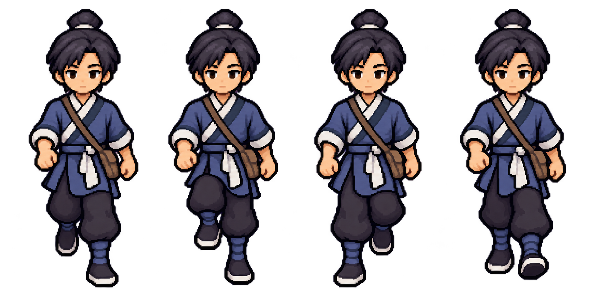
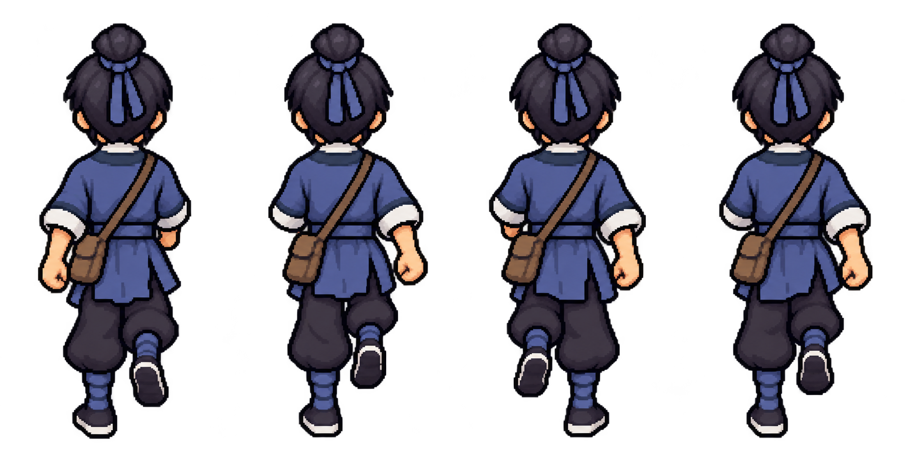

# imagegen 主角纵向行走：正面／背面首轮候选

日期：2026-10-11。本轮只制作朝下／正面与朝上／背面各一张四格行走候选；共两次内置 `image_gen.imagegen` 调用，没有继续迭代。

用户已认可既有主角脸和比例，本轮不重新设计长相。候选沿用四向 v2 身份参考；新规格仍待选择，不接入 runtime、不替换默认 atlas、不打包、不提交。

## 结论

- 两张完整 sheet 均已原样存入项目；原档与项目副本 SHA-256 一致，没有程序裁切、缩小写回、补人物像素或清 alpha。
- 正面四格朝向统一，脸／头身／服装目视延续身份，文袋均在画面右侧。0／2的落脚腿相反，1／3有不同腿形，但第3格整体下缘比0／2高约23个源像素，手臂全循环反摆不够明确，尚不是可验收循环。
- 背面四格朝向统一，无后脑造脸，文袋均在画面左侧；0／2的支撑腿与近侧手不同。但0、1、3均偏左腿支撑、右脚抬起，第1格和第3格没有形成相反经过相位，明确不满足完整四相行走要求。
- 两张都有实际透明 alpha=0，不能说是没有透明通道；但大量 alpha=1～254、所有分格边缘有 alpha=1残留，不是二值透明或全空边距。没有用代码阈值化或“清边”补救。
- 下述判断来自实际看原图与只读像素统计，不是把提示词意图当事实。没有真实连续播放、动画自然度、人类审美或生产素材验收结论。保留两张失败／未通过的首轮候选供主代理独立复审，不在本轮无限试图生成到通过。

## 候选原图





唯一输入：[四向 v2 原图](./protagonist_imagegen_turnaround_20261010_v2.png)。先实际 `view_image` 查看，再调用内置 imagegen。输入 SHA-256：`3ada25005b38414efb54531491c092ca26de69e233d8579e48c4b0c9c5c3df7c`，1774×887 RGBA，调用前后不变。

## 原样归档与调用设置

两次均使用内置工具；`referenced_image_paths` 只有下述同一个输入，`transparent_background: true`，没有 `num_last_images_to_include`，没有 CLI／外部 API／密钥路径。底层生成模型版本没有另行核实，不补造。

输入绝对路径：`/Users/witcher/Documents/ChatGPT/wuxia_game/docs/art_reference/protagonist_imagegen_turnaround_20261010_v2.png`。

原始生成目录：`/Users/witcher/.codex/generated_images/01a12b2d-02c3-7b11-b2b2-6107ce8c028f/`。本轮目标文件此前不存在，因此采用无覆盖字节复制，没有覆盖旧候选或删掉生成原档。

| 方向／项目副本 | 原始生成文件 | 实际尺寸／模式 | 原档与副本 SHA-256 |
|---|---|---|---|
| [down](./protagonist_imagegen_walk_down_sheet_20261011.png) | `exec-d1e05d11-44bb-4bc8-abbb-4bae733abc9b.png` | 1774×887 RGBA | `44bcfc55bda0e80df1d33d907e9888920874487724c60fcdf1bce0c32fbd4188` |
| [up](./protagonist_imagegen_walk_up_sheet_20261011.png) | `exec-1359ec4a-80aa-4bf0-8751-9ef5f1e4c8b2.png` | 1774×887 RGBA | `342a699e4db7f9d9c93678ff1094627a1323d18cd50df2bc0d81b3117d34df0c` |

项目副本完整路径分别为：

- `/Users/witcher/Documents/ChatGPT/wuxia_game/docs/art_reference/protagonist_imagegen_walk_down_sheet_20261011.png`
- `/Users/witcher/Documents/ChatGPT/wuxia_game/docs/art_reference/protagonist_imagegen_walk_up_sheet_20261011.png`

提示中的2048×1024只是偏好，实际工具输出1774×887，不能写成已交付2048×1024。1774不能整除4；只读按 `floor(i*width/4)` 观察的四个区域为 `(0,0,443,887)`、`(443,0,444,887)`、`(887,0,443,887)`、`(1330,0,444,887)`，边界仅用于分析，没有制作切片或新PNG。两种443／444宽不是精确统一原生帧格。

## 透明度与边距：只读统计

使用已配置的 bundled Python/Pillow读取RGBA与alpha；没有调用裁切、缩放、保存、写像素或阈值写回函数。alpha阈值仅在读取数值时用于区分主体与极低透明残留。

| PNG | alpha范围 | alpha=0 | alpha=1～254 | alpha=255 |
|---|---|---:|---:|---:|
| down | 0～255 | 886,827 | 685,772 | 939 |
| up | 0～255 | 913,735 | 658,705 | 1,098 |

半透明计数包含近不透明的254，不能单凭这个数量断言角色整体肉眼透光，也不能因工具请求透明就声称无光晕。alpha=1残留极淡，但不等于完全透明。

下表为每格 `alpha>127` 整体包围盒，坐标相对各格，格式 `[left,top,right,bottom]`，right／bottom为排他边界。它不是人工鞋底锚点，也不等同于最终碰撞基线。

| 相位 | down主体bbox | up主体bbox |
|---|---|---|
| 0 | `[86,27,415,864]` | `[75,46,375,861]` |
| 1 | `[62,27,392,857]` | `[83,46,396,858]` |
| 2 | `[56,27,378,864]` | `[72,46,379,858]` |
| 3 | `[51,27,369,841]` | `[80,46,380,859]` |

主体在四格中均保留正的左右边距，目视鞋尖没有跨格；但 `alpha>0` 包围盒多次触及格边，down第1格还触及画布底边。逐格左右边缘最大alpha均为1，说明是极低透明残留，不能把它描述为不透明脚尖跨格，也不能把“所有空边完全透明”判通过。未裁掉或清理这些像素。

## 实际图像审核

| 检查点 | down／正面 | up／背面 |
|---|---|---|
| 四格、统一朝向、完整头脚 | 四个正面全身，主体未见裁掉头脚 | 四个背面全身，未画后脑脸 |
| 身份、脸／头身比例 | 目视保留既有暖色脸、束发、短颈、交领与蓝衣；不是逐像素不变证明 | 发髻、后脑、蓝色束带、短颈、衣色与既有背面身份延续 |
| 文袋侧别 | 每格都在画面右＝解剖左髋 | 每格都在画面左＝解剖左髋 |
| 0与2相反接触 | 0主要画面右腿落下、2主要画面左腿落下，有明显差别 | 0主要画面左腿支撑、2主要画面右腿支撑，有明显差别 |
| 1与3相反经过 | 有不同腿形，但3的鞋位置／足底高度不对称，不能据此判完整相位通过 | 1与3都主要画面右脚抬起、左腿支撑，不是相反经过相位，失败 |
| 手臂反摆 | 多格画面左手仍显得前伸，0／2反摆关系不足够清楚，不判通过 | 0左手较低清楚、2右手较低清楚；1与3仍同侧，完整反摆未通过 |
| 共用落地线 | alpha>127整体底边864／857／864／841；目视第3格较高。不能把框底当鞋底，失败／待修 | 主体底边861／858／858／859较接近，但不是精确统一鞋底锚点证明 |
| 四相循环 | 未运行连续播放；存在落脚与手臂疑点，未通过 | 相位重复已足以拒绝四相循环，未通过 |
| 完全透明空边／二值alpha | 有真实透明通道，硬边与全空边距未通过 | 有真实透明通道，硬边与全空边距未通过 |

原图局部衣纹／袋盖有生成重渲染差异，因此不宣称只有肢体像素被修改。脸与比例的用户既有认可仍然有效，不因为动画相位失败就重新设计脸，也不替用户批准本轮两张动作图。

## 文袋三维方向约定的独立复核

固定相机看角色正面时，解剖左髋投影在画面右；角色朝画面左转90°，该左髋转到靠相机的一侧，应近侧可见。角色朝画面右时，左髋转到远离相机的一侧，应远侧遮挡。背面则投影在画面左。因此正确约定为：

| 视图 | 解剖左文袋的屏幕／遮挡关系 |
|---|---|
| front／down | 画面右 |
| back／up | 画面左 |
| facing image-left／left | 近侧，可见 |
| facing image-right／right | 远侧，主要隐藏 |

旧四向记录中“left远侧／right近侧”的说法错误，原四向v2的两个侧视文袋与正背关系不自洽。此事实是配件侧别问题，不是否定用户认可的脸和比例。本轮只使用正面／背面设计，两个实际提示的down／up文袋侧别正确，没有沿用错误侧面遮挡约定。

## 完整实际提示词

以下是两次工具调用的原文，输入均为上方唯一四向v2原图；不是事后润色的提示摘要。

### 第1次：朝下／正面

```text
Use case: identity-preserve
Asset type: candidate four-frame DOWN/front-facing walk sprite sheet for an original wuxia RPG; isolated art exploration, not a production-native pixel grid.
Input images: Image 1 is the sole approved identity, face, proportions, costume and pixel-style reference. Use ONLY its leftmost front-facing figure as the character design anchor. Do not redesign the face, enlarge the head, lengthen the neck, add details, or borrow a different character.
Primary request: Create exactly FOUR genuinely different consecutive walking poses of this same boy, all directly FRONT-FACING toward the viewer, ordered left to right as phases 0, 1, 2, 3 of one repeating walk cycle. Maintain his approved warm youthful face, small restrained eyes, fringe and topknot, short neck, body mass, cross-collar blue-gray tunic, off-white cuffs and collar, dark loose trousers, cloth boots and one slim brown document satchel.
Composition/framing: One landscape sheet, preferably 2048x1024, divided conceptually into FOUR equal full-height cells in ONE horizontal row. Each full-body figure is centered inside its own cell, with the same scale, stable head/shoulder position and grounded-shoe baseline. Give every cell generous clear transparent margins above the topknot, below both shoes and on both sides; no toes, swinging hands or satchel may cross a cell boundary. No visible grid, labels, borders, numbers or extra figures.
Motion specification: Anatomical LEFT is image-RIGHT; anatomical RIGHT is image-LEFT in this front view. Phase 0: LEFT/image-RIGHT leg takes the forward grounded contact, RIGHT/image-LEFT leg trails with the shoe clearly higher; RIGHT/image-LEFT arm swings forward and LEFT/image-RIGHT arm swings back. Phase 1: LEFT/image-RIGHT leg is the weight-bearing straight support leg, RIGHT/image-LEFT knee bends and its shoe lifts forward through the passing step; the arms pass through mid-swing, moving toward the reverse of phase 0. Phase 2: RIGHT/image-LEFT leg takes the forward grounded contact, LEFT/image-RIGHT leg trails with the shoe higher; LEFT/image-RIGHT arm now swings forward and RIGHT/image-LEFT arm swings back, visibly the opposite contact from phase 0. Phase 3: RIGHT/image-LEFT leg is the straight weight-bearing support, LEFT/image-RIGHT knee bends and its shoe lifts forward in the opposite passing step from phase 1; arms pass toward phase 0. Keep two anatomically continuous legs and two arms in every frame. The planted shoe uses the same ground baseline; lifted shoes are clearly higher. Phases 0 and 2 must NOT be the same pose, and phases 1 and 3 must NOT be the same pose. Make the sequence 0->1->2->3->0 legible, with alternating support and opposite arm/leg swing, not four idle duplicates or four large sideward lunges.
Critical asymmetry: The ONE document pouch stays attached to the character's anatomical LEFT hip, which is image-RIGHT in every frame. The strap runs from anatomical right shoulder/image-LEFT to that same left-hip pouch. Keep the pouch shape, length, flap, color and attachment stable; let a foreground hand or cuff naturally occlude it, never move it to the other hip and never mirror the whole character.
Style/medium: Preserve the reference's grouped, stepped, coarse pixel-style rendering and original costume colors. No whole-character restyling, smooth illustration, new face, new weapons, second bag or extra costume details.
Background: Genuinely transparent alpha background; empty cells and margins fully transparent. Clean stepped silhouette, no soft glow, halo, ground shadow, floor, colored matte or drawn checkerboard.
Output intent: ONE complete four-frame front-facing walking sheet, with the existing approved identity preserved and only body/limb walking poses changed. No text, watermark or diagrams.
```

### 第2次：朝上／背面

```text
Use case: identity-preserve
Asset type: candidate four-frame UP/back-facing walk sprite sheet for an original wuxia RPG; isolated art exploration, not a production-native pixel grid.
Input images: Image 1 is the sole approved identity, proportions, hair, costume and pixel-style reference. Use ONLY its third figure, the straight back view, as the design anchor. The front and profiles only confirm the same boy's identity. Keep the existing topknot, dark rear hair, short neck, blue hair tie, back tunic and body proportions; never invent a rear face or redesign the character.
Primary request: Create exactly FOUR genuinely different consecutive walking poses of this same boy, all directly BACK-FACING away from the viewer and walking UP the screen, ordered left to right as phases 0, 1, 2, 3 of one repeating walk cycle. Maintain the approved body mass, cross-collar blue-gray tunic, off-white collar and cuffs, dark loose trousers, cloth boots and one slim brown document satchel.
Composition/framing: One landscape sheet, preferably 2048x1024, divided conceptually into FOUR equal full-height cells in ONE horizontal row. Each full-body figure is centered inside its own cell, with the same scale, stable head/shoulder position and grounded-shoe baseline. Give every cell generous clear transparent margins above the topknot, below both shoes and on both sides; no toes, swinging hands or satchel may cross a cell boundary. No visible grid, labels, borders, numbers or extra figures.
Motion specification: Anatomical LEFT is image-LEFT and anatomical RIGHT is image-RIGHT in this rear view. Phase 0: LEFT/image-LEFT leg is the grounded contact/support, RIGHT/image-RIGHT leg trails with its shoe visibly higher; RIGHT/image-RIGHT arm swings forward away from the viewer and is partly hidden by the torso, while LEFT/image-LEFT arm swings backward toward the viewer, with its cuff and hand clearer/lower. Phase 1: LEFT/image-LEFT leg is the straight weight-bearing support, RIGHT/image-RIGHT knee bends and its shoe lifts forward through the passing step; arms move through mid-swing toward the reverse of phase 0. Phase 2: RIGHT/image-RIGHT leg is now the grounded contact/support, LEFT/image-LEFT leg trails with its shoe higher; LEFT/image-LEFT arm swings forward away from the viewer and is partly hidden, while RIGHT/image-RIGHT arm swings backward toward the viewer, with its cuff and hand clearer/lower. Phase 3: RIGHT/image-RIGHT leg is the straight weight-bearing support, LEFT/image-LEFT knee bends and its shoe lifts forward in the opposite passing step from phase 1; arms pass toward phase 0. Keep two anatomically continuous legs and two arms in every frame. The planted shoe uses the same ground baseline; lifted shoes are clearly higher. Phases 0 and 2 must NOT be the same pose, and phases 1 and 3 must NOT be the same pose. Show a readable 0->1->2->3->0 cycle with alternating support and opposite arm/leg swing, not four idle duplicates. Preserve this slightly elevated RPG back-view camera; no profile turn or three-quarter face.
Critical asymmetry: The ONE document pouch stays attached to the character's anatomical LEFT hip, which is image-LEFT in every rear frame. The diagonal strap runs from anatomical RIGHT shoulder/image-RIGHT to that same left-hip pouch. Keep the pouch shape, length, flap, color and attachment stable; let the correct foreground cuff/hand naturally occlude it. Never move it to the other hip, invent a second pouch, mirror the whole character, or use a front-view strap.
Style/medium: Preserve the reference's grouped, stepped, coarse pixel-style rendering and original costume colors. No smooth illustration, new equipment, new weapons or extra costume details.
Background: Genuinely transparent alpha background; empty cells and margins fully transparent. Clean stepped silhouette, no soft glow, halo, ground shadow, floor, colored matte or drawn checkerboard.
Output intent: ONE complete four-frame back-facing walking sheet, with the existing approved identity preserved and only body/limb walking poses changed. No text, watermark or diagrams.
```

## 正式资产保持与边界

本子任务没有改renderer、预览代码、导出工具、来源／AI总登记或正式资产；只新增上方两张候选PNG与本记录。主代理另行独立复审、统一登记。本轮生成前后比对：

| 正式文件 | SHA-256（前后相同） |
|---|---|
| `assets/source/characters/hero_pixel_source.gd` | `b9a67f25008e390b0fa281fa3566a2e29afb2010a185ac6e0b55001d29136a9b` |
| `assets/runtime/characters/chr_protagonist_atlas.png` | `e13be6ae0ed90c069bcd195d396b3557b13ac8cfbea97fb95c9dd05f632c0358` |
| `assets/runtime/characters/chr_protagonist_atlas.json` | `d600fddcbe1def27e727ef0ebaa41e39535018e0f4ac281a1a73a3dbf55d8146` |

不把两张sheet称为完整四向动画；侧向、基础动作、动态目视、规格选择与生产接入不在本子任务的验收结论内。最多两次首轮调用已经用完，停止在可复审候选节点，不再自动迭代、镜像补帧、编程修改人物或切换active manifest。

