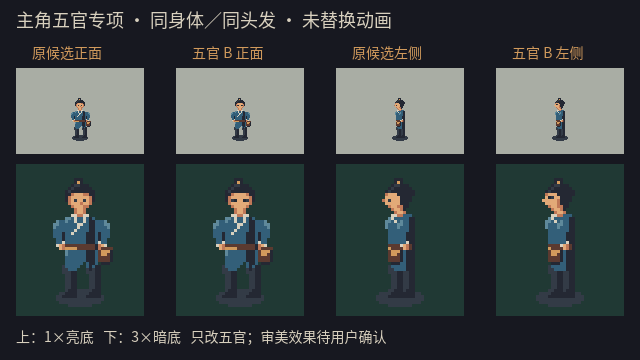
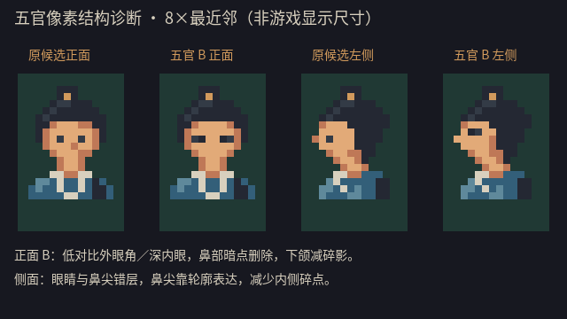

# 主角五官专项修改与评审：2026-10-09

用户反馈：“像素图还是不太符合预期，眼睛五官不好看，建立一个subagent专门修改review。”已建立专门子代理`hero_face_revision`，负责修改可编辑像素源、实际渲染、目视检查；主代理独立查看并提出第二轮修订意见。

后续决定：用户选择A单点眼，不采用B眼角方案；同时要求缩短脖子、取消褐色轮廓、参考《口袋妖怪 金》减少细节。当前继续修改的新版见[短颈／大色块简化候选](./hero_simple_candidate_review_20261009.md)。本页保留两轮实验记录，不再把B作为当前推荐方向。

## 本轮范围

旧静态候选保留为[对比基线](./hero_static_candidate_review_20261009.md)。新源为`assets/source/characters/hero_face_candidate_20261009.gd`，复用旧候选身体，只重绘`Rect2i(10,9,12,6)`内的面部像素。头发、身体、文袋、11色色板、32×48画布和脚底锚点不变；旧动画、运行时PNG／JSON、游戏规则与存档均不替换。

这是原生像素源码修改，由Godot输出PNG；没有调用imagegen，没有对高清候选或第三方图片缩小、采样或描摹。

## 对比图



从左到右：原候选正面、修订正面、原候选左侧、修订左侧。上排1×、下排3×最近邻；显示倍率、背景、身体与落脚点相同。

第二轮保留两种眼形：[A／B的1×、3×对比](./art_reference/hero_face_review_20261009/iteration_a_b_1x_3x.png)、[A／B的8×头部诊断](./art_reference/hero_face_review_20261009/iteration_a_b_8x.png)。A为单点眼，B为深色内眼＋低对比外眼角；本页主要对比与实景使用B，A也保存在源模板和两张原生PNG中，未删除。



8×图仅用于查看像素关系，不是游戏里的角色显示尺寸，不能用放大图的清晰度替代原尺寸效果。

实景前后：[原正面](./art_reference/hero_face_review_20261009/town_before_down.png)／[新正面](./art_reference/hero_face_review_20261009/town_after_down.png)、[原左侧](./art_reference/hero_face_review_20261009/town_before_left.png)／[新左侧](./art_reference/hero_face_review_20261009/town_after_left.png)。在实际`town_street.tscn`内临时展示静态图，冻结移动与动画；不是自然游玩、完整动画或正式地图美术验收。

原生透明文件：[正面](./art_reference/hero_face_review_20261009/down_32x48.png)、[左侧](./art_reference/hero_face_review_20261009/left_32x48.png)。正常`Run.command`／`Character.command`仍显示既有运行时资源，不包含这份未认可候选。

## 评审过程与限制

首轮清理正面鼻部暗点、提高双眼对比，侧面把眼睛与鼻尖错层。子代理和主代理均实际查看：侧脸更易辨认，但正面主要是两点加深，仍偏木讷，改善有限。因此继续比较第二轮眼形，不把首轮的工程检查当作审美通过。

第二轮B把正面眼睛组织为一行的深内眼与较浅外眼角，减少一处下颌暗点；侧面补充同样的低对比眼角。相对旧候选仅改变正面7像素、左侧6像素，这个数量用于核对修改范围，不代表美术质量。主代理实际查看A／B原尺寸、3×、8×和正／侧场景，认为B的视线感比A明确，可作为继续讨论的候选；子代理同时指出B有短横眼／眯眼倾向。两者没有将B判为正式定稿或“已经好看”。

实际肤色面只有约数行、数列像素。本轮以连续肤色、克制眉眼和轮廓表达为重点，不硬塞独立的眉毛、眼白、鼻孔、嘴唇；不宣称可以在这个小脸里表现高清立绘的精细五官。若用户仍认为缺乏人物气质，需要继续讨论头脸造型，而不是以合格尺寸为由结束美术修改。

最终静态外观仍待用户评审；认可后才讨论迁移到四向和动作，不自动重画整套57帧槽。

## 重现

在仓库根目录运行（需要macOS图形渲染器）：

```bash
python3 tools/run_checked.py hero_face_candidate_20261009 ./tools/godot.sh --path . --log-file builds/qa/hero_face_candidate_engine.log --script res://tools/preview_hero_face_candidate.gd
```

输出在`docs/art_reference/hero_face_review_20261009/`；源、工具和文档沿用既有开发目录排除规则，不进入导出包。本轮未重新构建或发布游戏。

## 检查记录

- 子代理实际渲染及主代理独立重跑均为`347 checks, 0 failures`，无ERROR；检查模板、色板、二值透明、脚底、面部区域外逐像素不变、旧深色头发不变、旧源／运行时哈希不变与预览前后故事状态不变。检查大部分是源模板字符检查，不是347项审美验收。
- 主代理另跑既有角色源／导出回归220项和动画管线159项，均通过。只验证既有资源不受影响，没有重跑整个剧情／战斗或验证这份静态脸的新动画。
- 初次受限运行曾出现macOS日志／系统证书访问错误，即使测试正文零失败也未计为通过；随后使用合规授权运行并把日志写入仓库`builds/qa/`，成功重跑。没有修改项目配置以绕过限制。
- 主代理日志：`builds/qa/hero_face_candidate_root_review.log`、`hero_face_runtime_source_guard.log`、`hero_face_runtime_pipeline_guard.log`。子代理日志：`builds/qa/hero_face_candidate_20261009.log`。

| 文件 | SHA-256 |
|---|---|
| 新面部源码 | `51a919605b530c5e4215317db3be9c004793111905d9498f54bf3cfdf9e7a855` |
| B正面 | `204b8c6ba90b6e9f28e567a375054237b6091831575118834883508502dfc6e2` |
| B左侧 | `72799bbb9b8aa2420603fc0a2a28f44d202124927af61d9b36f5ae0ec7583978` |
| 旧静态源（未改） | `285442549f6527eefc37864bf1cac8d6b6e12da138729053446254fa0bd40fe1` |
| 运行时PNG（未改） | `e13be6ae0ed90c069bcd195d396b3557b13ac8cfbea97fb95c9dd05f632c0358` |
| 运行时JSON（未改） | `d600fddcbe1def27e727ef0ebaa41e39535018e0f4ac281a1a73a3dbf55d8146` |
