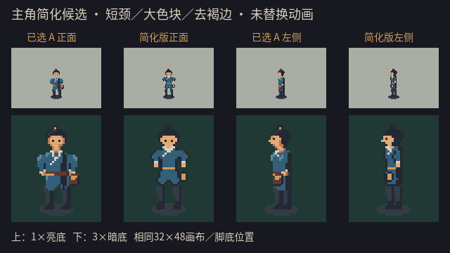
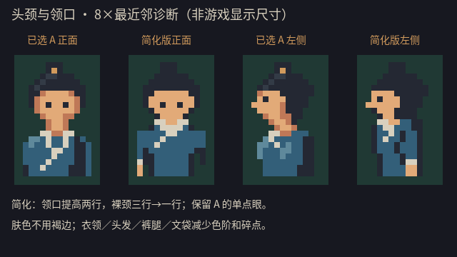

# 主角简化候选：短颈、去褐边、大色块

修订：2026-10-09；主代理独立重跑与归档复核：2026-10-10。用户选择[五官方案A](./hero_face_candidate_review_20261009.md)，并指出脖子太长、轮廓不要褐色、细节过多，希望参考《口袋妖怪 金》的主角像素风，做到简单好看。A的选择只确认单点眼方向，不等于旧身体或新版整套动画获认可。

本轮继续由`hero_face_revision`负责像素源修改与目视review，主代理独立复核并要求收整肩袖、腰部和下摆剪影。根据新的用户意见，修改范围从上轮面部扩至整个静态造型；旧A／B和正常游戏运行时资源仍保留。

另由只读子代理`hero_simple_visual_review`重新查看最终对比、局部和实景，未修改文件。它认为简化和肩腰收整有效，当前没有需要修正后才能展示的问题；文袋在1×中较弱，但不建议靠增加复杂细节补救。

## 参考取舍

主代理实际查看[《金／银》官方原版实机页面](https://www.pokemon.co.jp/ex/VCKG/0818_01/)及其中[主角在城镇的截图](https://www.pokemon.co.jp/ex/VCKG/common/images/img_a_03.jpg)。参考的是原版地图主角，不是《心金／魂银》的重制图或高清人物立绘。

从画面得到的美术判断：少量集中的识别点、紧凑的头肩关系、深色眼点与连续服装色块，比在小人身上逐项展开鼻嘴、衣褶、配件更适合这次需求。这是目视分析，不是官方制作规范；未测量其原始精灵尺寸、色数或头身比。本项目保留束发、交领、文袋和蓝灰衣服，不照搬帽子、服装、人设或精灵。

第三方图片仅在浏览器观看，未下载归档、导入、取色、描摹或用于图像生成。本轮修改可编辑原生像素源码，不调用imagegen。

## 新旧对比



从左到右：A正面、简化正面、A左侧、简化左侧。上排1×亮底，下排3×最近邻暗底，画布／锚点／背景／阴影相同。主要改动：

- 保留A单点眼，删除脸部褐色阴影边，不另加独立鼻口碎点。
- 领口从y16提高到y14，原来的三行裸颈改为一行，并重接头与肩；不是裁画布制造变矮。
- 全身从旧候选的多色阶组织收敛到6种实际使用颜色：深轮廓、裤灰、衣蓝、浅领、肤色和腰带／文袋内芯。棕色／金色不再位于透明外轮廓。
- 头发、衣服、裤靴、文袋去掉碎高光和装饰，保留大色块与少量身份识别点。

简化首轮曾有直筒方盒感，最终版将肩袖上部接成连续蓝面，腰两侧收1像素、下摆略放开；不加回高光或衣褶。[首轮／收整版1×、3×对比](./art_reference/hero_simple_review_20261009/shape_iteration_1x_3x.png)保留了这次取舍，源中的`first`与`final`变体和首轮PNG均可追溯。



8×仅用于核对头颈／像素关系，不是游戏显示尺寸。原生透明图：[正面32×48](./art_reference/hero_simple_review_20261009/down_32x48.png)、[左侧32×48](./art_reference/hero_simple_review_20261009/left_32x48.png)。

实景前后：[A正面](./art_reference/hero_simple_review_20261009/town_before_down.png)／[简化正面](./art_reference/hero_simple_review_20261009/town_after_down.png)、[A左侧](./art_reference/hero_simple_review_20261009/town_before_left.png)／[简化左侧](./art_reference/hero_simple_review_20261009/town_after_left.png)。在实际灰盒场景中临时替换静态视觉，冻结动画和物理，不写存档；不是正式地图美术或新动画验收。

## 可编辑来源与重现

新源：`assets/source/characters/hero_simple_candidate_20261009.gd`。只定义正面／左侧静态姿态，复用项目色板和整数像素stamp函数；旧候选源与输出不覆盖。

```bash
python3 tools/run_checked.py hero_simple_candidate_20261009 ./tools/godot.sh --path . --log-file builds/qa/hero_simple_candidate_engine.log --script res://tools/preview_hero_simple_candidate.gd
```

需要macOS图形渲染器，输出在`docs/art_reference/hero_simple_review_20261009/`。源、工具、文档遵循现有导出排除规则。没有替换正式图集／JSON、重画57帧槽或重建／发布候选包；正常`Run.command`和`Character.command`仍使用旧运行时外观。

## 美术状态

这是一轮按用户反馈完成的静态简化修改。是否足够好看仍需要用户看新图；工程检查不能代替审美判断，参考经典游戏也不等于获得其制作水平。认可新版静态方向后，再讨论迁移到四向和动作。

主代理实际查看最终1×、3×、头颈8×和正／侧实景：认为新版比旧A更干净、头肩连接更紧凑，单点眼更清楚；与简化首轮相比，剪影收整减轻了方盒感。保留发髻、浅色交领、腰侧文袋作为识别点，减少装饰感是有意取舍。

## 工程检查与边界

子代理实际Mac Compatibility渲染与2026-10-10主代理独立重跑均为`1389 checks, 0 failures`，无ERROR。核对真实PNG的裸颈行数3→1、领口y16→y14、实际6色色板、A眼点位置、32×48画布、顶行y4、落脚row43、故事状态和旧A／B／运行时文件不变。大量检查为模板字符检查，不能解读为1389项美术验收。

棕色外轮廓检查扫描肤色阴影`s`、褐色`t`、腰带金色`a`是否与四邻域透明像素相接。正面12→0、左侧11→0；新版完全不使用`s`／`t`，`a`只在腰带与文袋内芯。主代理及只读review也实际查看了脸、手、衣服和配件外轮廓。

日志：`builds/qa/hero_simple_candidate_root_review.log`与`hero_simple_candidate_20261009.log`。仓库文档链接及`git diff --check`另行通过；未以本轮针对性检查声称完整游戏、跨平台或新动画通过。

| 文件 | SHA-256 |
|---|---|
| 最终像素源码 | `af9c5d716aad80247d4aca32b5106d9c34a1f147461099a7e8cf0dae4d57cbce` |
| 预览工具 | `97098c8232076dd0084fb376f9791e471774d97984455c35ad3cfa76d3f310fc` |
| 最终正面 | `bd674fe52bf1e218a393293c478bd2656d02a32003781c443e84a217647e4f15` |
| 最终左侧 | `603ebf3d15f2dc8a2b82add1d06622a7c0a744ce8165b39e5ebabefc190ff88f` |
| 运行时PNG（未改） | `e13be6ae0ed90c069bcd195d396b3557b13ac8cfbea97fb95c9dd05f632c0358` |
| 运行时JSON（未改） | `d600fddcbe1def27e727ef0ebaa41e39535018e0f4ac281a1a73a3dbf55d8146` |
