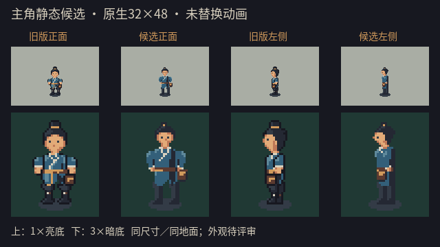

# 主角静态造型候选：2026-10-09

用户反馈：动画演出没有问题，但现有像素图不好看。用户同意先参考成熟像素RPG的造型组织方式，制作正面、侧面静态候选；本轮不追求HD-2D，不扩大角色画布，不重画整套57帧槽，也不把本轮候选视为正式人设认可。

## 当前候选



从左到右：旧版正面、候选正面、旧版左侧、候选左侧。上排1×亮底，下排3×最近邻暗底；四列采用相同画布、锚点、阴影、显示倍率与背景。候选不是高清生成图缩小后得到的精灵，文件本身是真正32×48、二值透明、既有11色范围内的原生像素图。

- 缩小发髻与头部，收拢圆脸轮廓，保留连续暖肤色与有限眉眼像素。
- 衣服减少零碎线条，肩袖向下收拢；交领用斜向浅色组织，不再用贯穿身体的白色竖线。侧面以成片暗部表现衣服厚度，保留腰带与文袋。
- 去掉裤腿上的白色横带，改用连贯灰色面；脚底仍落在row43、脚底锚点仍为(16,44)。

首轮曾出现宽肩方块衬衫的观感，已在同一未交付源中修订为收肩／收袖、斜交领与侧面暗部。当前图展示的是修订后的结果；未把任何一轮自行标为用户认可。

## 场景中的真实尺寸

[旧版正面](./art_reference/hero_static_20261009/town_old_front.png) · [候选正面](./art_reference/hero_static_20261009/town_candidate_down.png) · [候选左侧](./art_reference/hero_static_20261009/town_candidate_left.png)

这些截图由实际`town_street.tscn`、既有场景数据、玩家锚点和镜头渲染。开发预览脚本冻结物理／动画，仅在该进程隐藏旧视觉并挂载候选静态图；没有主菜单／HUD，没有自然游玩或新动画验证。背景仍是灰盒，不冒称正式美术场景。退出工具即结束临时展示，正常游戏与现有候选包继续使用旧运行时图集。

原生透明文件：[正面32×48](./art_reference/hero_static_20261009/down_32x48.png)、[左侧32×48](./art_reference/hero_static_20261009/left_32x48.png)。

## 可编辑来源与重现

源码：`assets/source/characters/hero_static_candidate_20261009.gd`。它只定义正面／左侧静态姿态，复用既有原生源的色板与整数像素stamp辅助函数，不读取、裁切、采样或描摹外部游戏图片。所有源仍由Codex辅助编写，不冒称人工作画。

在仓库根目录运行：

```bash
python3 tools/run_checked.py hero_static_candidate_20261009 ./tools/godot.sh --path . --script res://tools/preview_hero_static_candidate.gd
```

这是需要图形渲染器的一次性开发预览，输出6张PNG到`docs/art_reference/hero_static_20261009/`。不调用运行时图集导出器，不写存档。该工具与像素源都在开发目录，既有导出预设排除`tools/*`、`assets/source/*`和`docs/*`；本轮没有重建或发布游戏包。

本轮参考取舍沿用此前实查的[《八方旅人II》官方介绍](https://store.steampowered.com/app/1971650/OCTOPATH_TRAVELER_II/)与[《Chained Echoes》官方介绍](https://store.steampowered.com/app/1229240/Chained_Echoes/)：仅学习轮廓、服装大色块和识别度。不引入HD-2D、动态光照或其他游戏人设／图像资产。

## 检查与边界

实际Mac Apple M4 Compatibility渲染，`HERO_STATIC_CANDIDATE`零失败；检查源符号、原生尺寸、二值透明、色板、落脚线、与旧图不同、6张输出、预览前后故事状态不变及运行时PNG／JSON哈希不变。984个检查大部分只是逐字符色板检查，**不代表984项美术质量认可**。日志`builds/qa/hero_static_candidate_20261009.log`。

导入检查通过；既有源／导出回归220项及运行时动画管线159项通过，日志`hero_static_runtime_source_guard.log`／`hero_static_runtime_pipeline_guard.log`。本轮没有修改`game/`、`assets/runtime/`、当前57帧源或项目／导出配置，因此未重跑完整剧情／战斗测试，不用这些针对性检查声称完成了全量项目验收。

| 文件 | SHA-256 |
|---|---|
| 候选正面 | `d76d69eb44b463f3433dd81e722a83cb6e8064bde16f83360b1ca690445934ed` |
| 候选左侧 | `fc199369e5998310f236753e8254d41744afeef50f8e4d46673e250aa5638a7b` |
| 运行时PNG（未改） | `e13be6ae0ed90c069bcd195d396b3557b13ac8cfbea97fb95c9dd05f632c0358` |
| 运行时JSON（未改） | `d600fddcbe1def27e727ef0ebaa41e39535018e0f4ac281a1a73a3dbf55d8146` |

主代理已查看对比卡与正／侧场景截图：头部占比收敛、交领和文袋保留、衣裤色块更连贯；仍是低分辨率静态候选，不宣称自然感、武侠气质或“好看”已经获用户认可。用户认可方向后才迁移到四向和各动作；不因动画曾获肯定就假定新造型的全套动画也已通过。

## 本次只需要决定一个问题

这版更简洁、头部更小的造型方向，是否比旧版更接近你想要的主角？若不是，请指出最优先的一处：头脸、身形、服装或配色。不要先扩大画布或增加动作帧；先解决静态造型。
